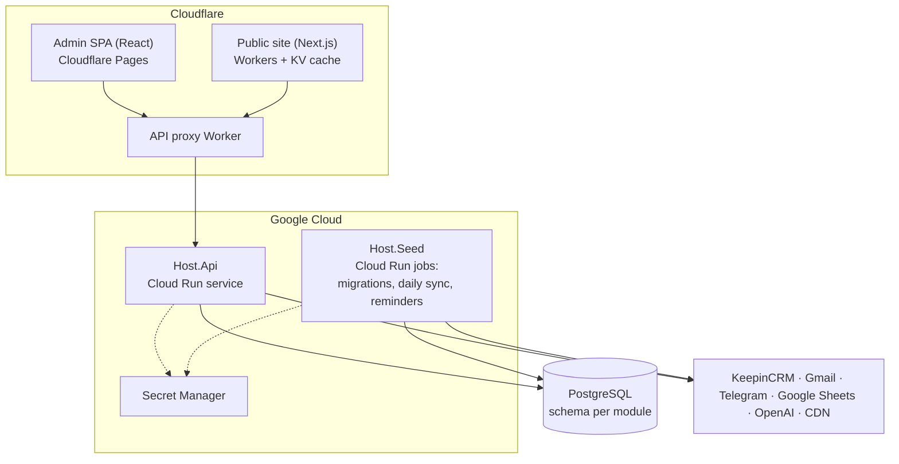

# Brevi ERP — backend

ERP system for **Brevi**, a Ukrainian workwear manufacturer that sews its own garments and also resells personal protective equipment (PPE).
It replaced a large Google Sheets "calculator" (with Apps Script), a separate workshop app and many spreadsheets. Sales, production, purchasing, accounting and the public website content now live in one place.

This repository is the backend: a modular ASP.NET Core API on .NET 10.
The admin panel and the public website live in [brevi-web](https://github.com/Weretik/brevi-web).

> Status: in production and in active development.

## Who uses it

- **Owner / director**: full view, pricing, accounting, reports.
- **Managers**: leads, clients, commercial offers (КП), production orders.
- **Workshop chief**: production orders, stages, work log, fabric stock, payroll.
- **Site visitors** (B2B buyers): the public catalogue and request form use the public part of the API.

## Key features

- **Pricing**: the price of a sewn product is calculated automatically from fabric, accessories and sewing operations, with three price tiers. PPE prices come from versioned supplier price lists (files or supplier cabinets).
- **Commercial offers (КП)**: build an offer from catalogue products and fabric variants, render a branded PDF, and send it from the manager's Gmail.
- **CRM**: clients synced with KeepinCRM, leads, and requests from the website.
- **Production**: orders created from accepted offers, stages and shipments, work log, payroll, fabric norms, Telegram notifications.
- **Warehouse**: fabric stock, issues to production, and shortages.
- **Purchasing and accounting**: supplier invoices (AI-assisted recognition that a person confirms), bank statement import, accounts, transactions, and reports.
- **Website content**: products, pages, articles, SEO fields, and redirects for the public site.
- **Access rights**: built-in and custom roles, with per-page view/create/edit/delete rights.
- **Reminders**: recurring deadline tasks delivered through a Telegram bot.

## Tech stack

| Area | Technology |
| --- | --- |
| Runtime | .NET 10, ASP.NET Core Web API |
| Data | PostgreSQL, Entity Framework Core (one schema per module) |
| Application | Clean Architecture, DDD, CQRS with Mediator (source generator), FluentValidation, Ardalis.Result, Vogen strongly typed IDs |
| Security | ASP.NET Core Identity, cookie session + CSRF, policy-based access rights, rate-limited login |
| Documents | QuestPDF + SkiaSharp (PDF), PdfPig (read PDFs), ExcelDataReader (XLSX import) |
| Integrations | KeepinCRM, Gmail API (OAuth), Telegram Bot API, Google Sheets, OpenAI, FTP-based CDN storage, Google Cloud Storage |
| Hosting | Google Cloud Run (API + jobs), Cloudflare Worker as API proxy, PostgreSQL on managed hosting |
| CI/CD | GitHub Actions, Workload Identity Federation (no stored GCP keys), Artifact Registry, Secret Manager |
| Tests | NUnit: unit, integration (real PostgreSQL), host and architecture tests (~1,800) |

## Architecture



**Modular monolith.** There are 12 business modules: Identity, Reference, Catalog, Crm, Production, Warehouse, Purchasing, Accounting, Content, Media, Reminders and Ai. Each one has four projects (Domain, Application, Infrastructure, Api) and its own PostgreSQL schema.

```text
Host.Api / Host.Seed  (composition root, cross-module adapters)
   ├── Module.Api ──────────→ Module.Application ──→ Module.Domain
   └── Module.Infrastructure ─→ Module.Application + Module.Domain
BuildingBlocks.*  (shared primitives, no business rules)
```

- Modules never reference each other. A module that needs outside data declares a small port in its Application layer. The host implements the port by sending the other module's query. Architecture tests enforce this.
- No foreign keys cross schemas.
- Every use case is a command or query with a validator. It returns a `Result` instead of throwing for business errors.

Design decisions: [architecture decisions (ADR)](docs/sdd/architecture/decisions/README.md). Full architecture docs: [docs/sdd/architecture](docs/sdd/architecture/README.md).

## Run locally

### Requirements

- .NET SDK 10
- PostgreSQL 16+ on your machine (or in Docker)

### 1. Database

```bash
docker run -d --name brevi-db -p 5432:5432 \
  -e POSTGRES_USER=brevi_user -e POSTGRES_PASSWORD=<local-password> -e POSTGRES_DB=brevidb \
  postgres:16
```

### 2. Local configuration

Keep real values out of git. Use User Secrets (Host.Api) or environment variables:

```bash
dotnet user-secrets set "ConnectionStrings:Default" \
  "Host=localhost;Port=5432;Database=brevidb;Username=brevi_user;Password=<local-password>" \
  --project src/Bootstrapper/Host.Api/Host.Api.csproj
dotnet user-secrets set "ADMIN_DEFAULT_PASSWORD" "<first-admin-password>" \
  --project src/Bootstrapper/Host.Api/Host.Api.csproj

# Host.Seed reads environment variables
export ConnectionStrings__Default="Host=localhost;Port=5432;Database=brevidb;Username=brevi_user;Password=<local-password>"
export ADMIN_DEFAULT_PASSWORD="<first-admin-password>"
```

Optional integrations stay off while their settings are empty: Gmail, Telegram, KeepinCRM and OpenAI. CDN storage (`AdmToolsStorage`) is the exception: `Login` and `Password` must have values, even placeholders, or sign-in fails with «AdmToolsStorage options must be configured». Example of the shape (all values are placeholders):

```json
{
  "Identity": { "AdminUser": { "Email": "admin@example.com" } },
  "Crm": { "Gmail": { "ClientId": "<google-oauth-client-id>", "ClientSecret": "<secret>" } },
  "Reminders": { "Telegram": { "BotToken": "<bot-token>", "WebhookSecret": "<secret>" } },
  "AdmToolsStorage": { "Host": "cdn.example.com", "Login": "<login>", "Password": "<password>" },
  "TrustedProxy": { "SharedSecret": "<secret>" }
}
```

The full list is in [configuration and secrets](docs/sdd/operations/configuration/configuration-and-secrets.md).

### 3. Migrations, seed data and first admin

```bash
dotnet run --project src/Bootstrapper/Host.Seed/Host.Seed.csproj
```

This applies the EF Core migrations of every module, adds roles and the first administrator, and fills an empty database with **demo** reference data.

### 4. Start the API

```bash
dotnet run --project src/Bootstrapper/Host.Api/Host.Api.csproj --launch-profile https
```

- API: `https://localhost:7142`, health check: `/health`
- Swagger UI (Development only): `https://localhost:7142/swagger`

Then start the admin from [brevi-web](https://github.com/Weretik/brevi-web) and sign in with the first admin account.

## Tests

```bash
dotnet test tests/UnitTests/UnitTests.csproj
dotnet test tests/ArchitectureTests/ArchitectureTests.csproj
# integration tests need a separate PostgreSQL database
export BREVIERP_CATALOG_TEST_CONNECTION="Host=localhost;Port=5432;Database=postgres;Username=postgres;Password=<local-password>"
dotnet test tests/IntegrationTests/IntegrationTests.csproj
```

CI runs the whole solution against a PostgreSQL service on every pull request.

## Deployment

On merge, GitHub Actions does the following:

1. Builds the API and job images and pushes them to Artifact Registry. It signs in to Google Cloud with Workload Identity Federation, so no JSON key is stored.
2. Runs the seed job (migrations) on Cloud Run Jobs.
3. Deploys the API to Cloud Run.

All secrets come from Secret Manager. A Cloudflare Worker serves `api.brevi.com.ua` and forwards the real client IP together with a shared secret. Scheduled Cloud Run jobs run the daily sync (KeepinCRM, sheets, supplier prices) and the Telegram reminders.

## Repository layout

```text
src/
  Bootstrapper/   Host.Api (HTTP API), Host.Seed (migrations, seed, scheduled jobs)
  BuildingBlocks/ shared abstractions and cross-cutting code
  Modules/        12 business modules × Domain / Application / Infrastructure / Api
  Jobs/           catalogue import and pricing verification jobs
tests/            unit, integration, host and architecture tests
deploy/           Cloudflare API proxy Worker
docs/             architecture, standards, specifications (SDD), contracts, operations
```

## License

[PolyForm Noncommercial 1.0.0](LICENSE.txt). The source is shown for review and learning. Commercial use is not allowed.
