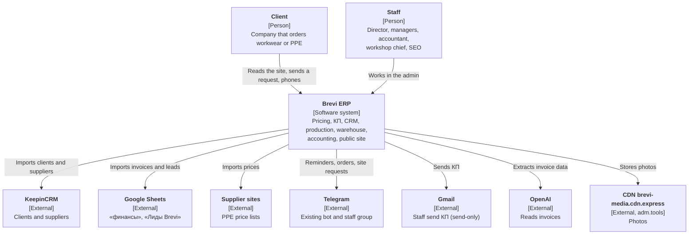
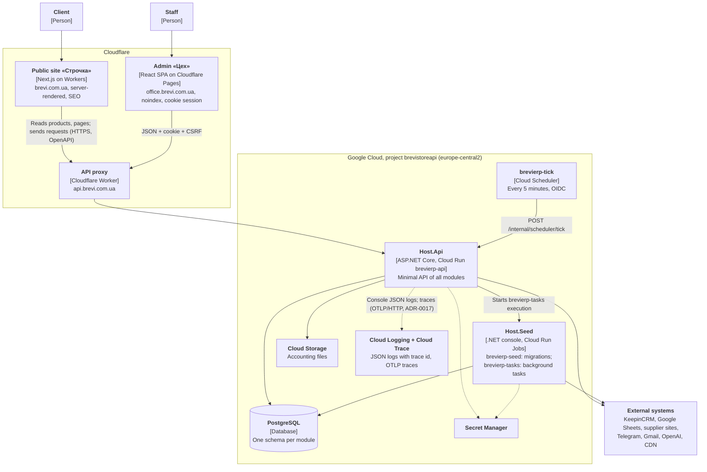
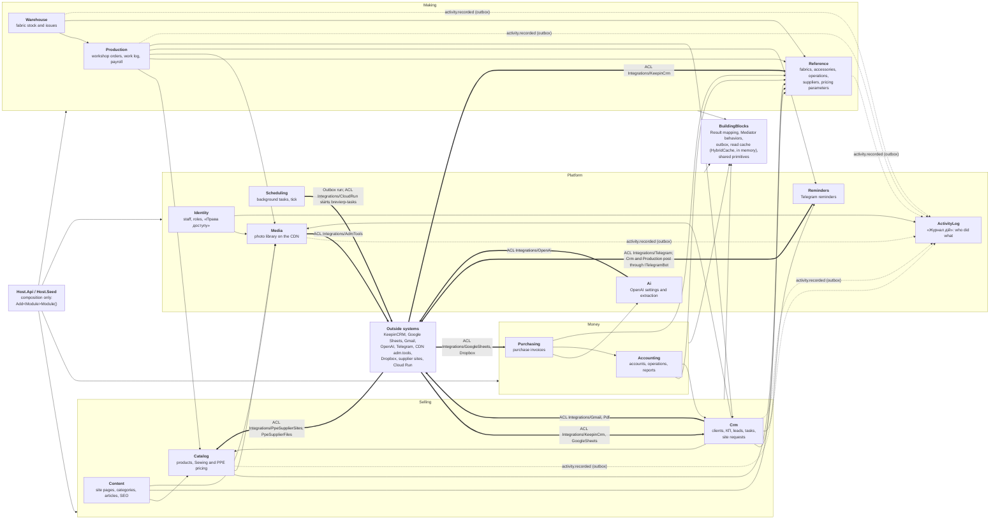
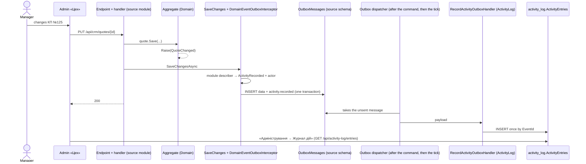

# C4 diagrams

**Checked against code:** 2026-11-16 (`src/`, `.github/workflows/deploy-cloudrun.yml`, `Host.Api/appsettings.json`, project references, brevi-web `apps/`).

Three levels of the [C4 model](https://c4model.com): who uses Brevi and what it talks to (context), which deployable parts it has (containers), and which modules are inside the API (components). The diagrams are Mermaid and render on GitHub. Why each part looks the way it does is in the [ADRs](../decisions/README.md).

Update a diagram in the same change that adds or removes a module, a host, a deployable app, an external system, or a connection between them.

## Level 1: System context

## Level 2: Containers

Deploy: a merge to `master` of `Weretik/BreviERP` starts GitHub Actions, which signs in without a key, runs `brevierp-seed` and then deploys `brevierp-api` ([ADR-0004](../decisions/0004-keyless-cloud-run-delivery.md), [ADR-0018](../decisions/0018-deploy-on-merge-from-main-repository.md)). The old OpenCart site keeps `brevi.com.ua` until the cutover; it is not drawn.

## Level 3: Components of the backend

This diagram is the context map. A thin arrow from A to B means A's Infrastructure references `B.Contracts` (checked from the `.csproj` files on 2026-11-18); Crm, Production and Warehouse also use `Identity.Contracts` for staff names. The arrows form no cycle ([ADR-0019](../decisions/0019-module-graph-without-cycles.md)): when an upstream module needs something of a downstream one, it declares a port in its own `Contracts` and the downstream module implements it, so the arrow still points downstream. Catalog implements Reference's pricing ports and Media's photo usage, Crm implements Media's photo usage, Production implements Crm's `IQuoteOrderLinks`, Warehouse implements Production's `IStockFacts`, and Identity implements ActivityLog's `IActivityActorNames` (the names in «Журнал дій»). No module references another module's Application, Domain or Infrastructure, and there are no foreign keys between schemas ([ADR-0001](../decisions/0001-modular-monolith.md), [ADR-0006](../decisions/0006-module-contracts.md)). The exact references are in the [module map](../overview/modules.md). Thick arrows cross the system edge: an anti-corruption layer in the module's `Infrastructure/Integrations/<System>` translates the outside model, and messages out go through the outbox, sent by the scheduler tick. The architecture test `Modules_do_not_depend_on_each_other_in_a_cycle` fails on any new cycle.

## Dynamic: an action reaches «Журнал дій»

How a staff member's change becomes an entry ([ADR-0016](../decisions/0016-domain-events-to-activity-log.md), [ACT-001](../../specs/activity-log/001-staff-activity-log/README.md)).

