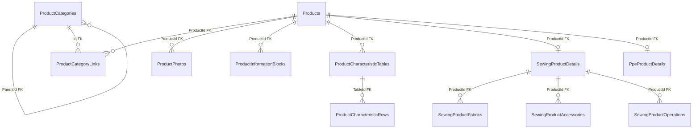

# `catalog` — Catalog Module Data

**Source:** [Catalog snapshot](../../../../src/Modules/Catalog/Catalog.Infrastructure/Catalog.Infrastructure/Migrations/CatalogDbContextModelSnapshot.cs) and [configurations](../../../../src/Modules/Catalog/Catalog.Infrastructure/Catalog.Infrastructure/Congigurations/), reviewed on 2026-10-21. [Back to the database map](README.md). Related features: [products](../../features/catalog/products.md), [categories](../../features/catalog/categories.md), [media](../../features/catalog/media.md).

| Table | PK | Main data and purpose |
| --- | --- | --- |
| `Products` | `Id` | Product: `Name`, `RuName`, `Slug`, `Type`, description, and dates. |
| `ProductCategories` | `Id` | Category: `ParentId` (FK), `Path`, `Level`, names, and `Slug`. |
| `ProductCategoryLinks` | `ProductId`, `Id` | Product-to-category link; `Id` is an FK to the category. |
| `ProductPhotos` | `ProductId`, `Id` | Product photo: `MediaFileId`, order, and visibility flags. |
| `MediaFiles` | `Id` | File metadata: bucket, storage key, URL, type, and size. |
| `ProductInformationBlocks` | `Id` | Product text blocks; `ProductId` (FK). |
| `ProductCharacteristicTables` | `Id` | Product characteristic tables; `ProductId` (FK). |
| `ProductCharacteristicRows` | `Id` | Characteristic rows; `TableId` (FK). |
| `SewingProductDetails` | `ProductId` | Sewing product details; the PK is also an FK to the product. |
| `PpeProductDetails` | `ProductId` | PPE details: `SupplierId`, `BasePrice`; the PK is also an FK to the product. |
| `SewingProductFabrics` | `ProductId`, `FabricId` | Fabrics for a sewing product, primary flag, and order. |
| `SewingProductAccessories` | `ProductId`, `GarmentAccessoryId` | Sewing product accessories and quantities. |
| `SewingProductOperations` | `ProductId`, `GarmentPartOperationId` | Operations for a sewing product. |
| `SewingArticles` | generated long `Id` | Product-owned immutable globally unique sale SKU, activity and order; alternate key `(ProductId, Id)`. |
| `SewingMaterialLines` | generated long `Id` | Shared or Article-specific fabric/accessory/non-inventory cost inputs, quantity/unit and review metadata. Composite Article FK prevents cross-parent links. |
| `SewingOperationLines` | generated long `Id` | Shared operation reference, quantity, optional manual minutes and review metadata. |

Migration `20261024215605_AddSewingComposition` also adds nullable unique `Products.ModelCode` and the `Products.CompositionVersion` concurrency token. These are implemented mappings; PostgreSQL rollout verification remains open. See [Sewing composition](../../features/catalog/sewing-composition.md).

`ProductPhotos.MediaFileId` conceptually references `MediaFiles.Id`, but the FK is absent from the snapshot. `PpeProductDetails.SupplierId`, along with `FabricId`, `GarmentAccessoryId`, and `GarmentPartOperationId` in sewing links, reference [Reference](reference.md) lookup data by ID without cross-module FKs.
