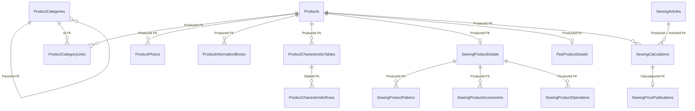

# `catalog` — Catalog Module Data

**Source:** [Catalog snapshot](../../../../src/Modules/Catalog/Catalog.Infrastructure/Catalog.Infrastructure/Migrations/CatalogDbContextModelSnapshot.cs) and [configurations](../../../../src/Modules/Catalog/Catalog.Infrastructure/Catalog.Infrastructure/Congigurations/), reviewed on 2026-10-21. [Back to the database map](README.md). Related features: [products](../../features/catalog/products.md), [categories](../../features/catalog/categories.md), [media](../../features/catalog/media.md).

| Table | PK | Main data and purpose |
| --- | --- | --- |
| `Products` | `Id` | Product: `Name`, `RuName`, `Slug`, `Type`, description, and dates. |
| `ProductCatalogProfiles` | `ProductId` | Product-owned source activity/season/review metadata and nullable PPE supplier offer, unit, sale SKU and links. Separate from legacy pricing percentages. |
| `SewingPricingSettingsVersions` | generated long `Id` | Immutable thirteen-input settings revision, effective instant, formula version, approval and source JSON/SHA-256. Unique revision and source hash. |
| `SewingCalculations` | generated long `Id`; unique UUID `PublicId` / `RequestId` | Immutable full calculation JSON, actor/time and restrictive composite Product/Article ownership. Blocked results retain diagnostic evidence. |
| `SewingPricePublications` | generated long `Id`; unique UUID `PublicId` | Unique calculation FK, actor/time; exact prices come from retained calculation JSON. Append-only history; highest publication ID is current per Article. |
| `ProductCategories` | `Id` | Category: `ParentId` (FK), `Path`, `Level`, names, and `Slug`. |
| `ProductCategoryLinks` | `ProductId`, `Id` | Product-to-category link; `Id` is an FK to the category. |
| `ProductPhotos` | `ProductId`, `Id` | Product photo: `MediaFileId`, order, and visibility flags. |
| `MediaFiles` | `Id` | File metadata: bucket, storage key, URL, type, and size. |
| `ProductInformationBlocks` | `Id` | Product text blocks; `ProductId` (FK). |
| `ProductCharacteristicTables` | `Id` | Product characteristic tables; `ProductId` (FK). |
| `ProductCharacteristicRows` | `Id` | Characteristic rows; `TableId` (FK). |
| `SewingProductDetails` | `ProductId` | Sewing product details; the PK is also an FK to the product. |
| `PpeProductDetails` | `ProductId` | PPE details: `SupplierId`, `BasePrice`; the PK is also an FK to the product. |
| `SewingProductFabrics` | `ProductId`, `FabricId` | Fabrics for a sewing product, primary flag, and order. |
| `SewingProductAccessories` | `ProductId`, `GarmentAccessoryId` | Sewing product accessories and quantities. |
| `SewingProductOperations` | `ProductId`, `GarmentPartOperationId` | Operations for a sewing product. |
| `SewingArticles` | generated long `Id` | Product-owned immutable globally unique sale SKU, activity and order; alternate key `(ProductId, Id)`. |
| `SewingMaterialLines` | generated long `Id` | Shared or Article-specific fabric/accessory/non-inventory cost inputs, quantity/unit and review metadata. Composite Article FK prevents cross-parent links. |
| `SewingOperationLines` | generated long `Id` | Shared operation reference, quantity, optional manual minutes and review metadata. |

Migration `20261024215605_AddSewingComposition` adds nullable unique `Products.ModelCode` and the `Products.CompositionVersion` concurrency token. Migration `20261025093328_AddCatalogImportProfiles` adds profiles, permits metre-based accessories, and replaces the unique operation-reference index with a nonunique index so individual occurrences retain their manual times. Both were applied locally; see [catalogue import](../../features/catalog/catalog-import.md). The job's separate `imports` schema contains batch/source provenance and source-to-target IDs in the same PostgreSQL database.

`ProductPhotos.MediaFileId` conceptually references `MediaFiles.Id`, but the FK is absent from the snapshot. `PpeProductDetails.SupplierId`, along with `FabricId`, `GarmentAccessoryId`, and `GarmentPartOperationId` in sewing links, reference [Reference](reference.md) lookup data by ID without cross-module FKs.

The [publication stage](../../specs/catalog/003-sheet-pricing-parity/publication-implementation.md) adds immutable calculation/publication records through `AddSewingPriceHistory` and `EnforceSewingCalculationArticleOwnership`. History records cannot be orphaned by Product/Article deletion. Published price consumers still await TS-005; adding these tables does not switch legacy Product price projections.

## PPE pricing versions

`PpePricingRuleVersions` stores long internal IDs, unique public/request UUIDs, exact indexed rule code, typed values in jsonb and approval/source metadata. `PpePricingOfferVersions` stores the same lifecycle per Product, with a restrictive Product FK and `(ProductId, Id)` index. Latest-version selection is deterministic; request hashes bind retries to actor and input. Imported drafts have no approval actor/time. The API appends an approved revision instead of overwriting the baseline. Approved versions become effective immediately; source dates remain provenance and never schedule future activation. See [PPE pricing](../../features/catalog/ppe-pricing.md).
