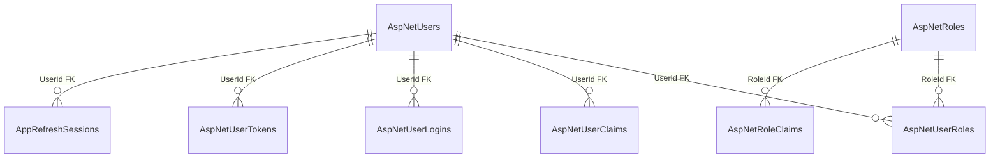

# `identity` — Identity Module Data

**Source:** [Identity snapshot](../../../../src/Modules/Identity/Identity.Infrastructure/Identity.Infrastructure/Migrations/AppIdentityDbContextModelSnapshot.cs), verified 2026-10-21. [Back to database map](README.md) · [session feature](../../features/identity/session.md).

| Table | PK | Purpose |
| --- | --- | --- |
| `AspNetUsers` | `Id` | Users and credentials. |
| `AspNetRoles` | `Id` | Roles and access levels. |
| `AspNetUserRoles` | `UserId`, `RoleId` | Role assignments. |
| `AspNetUserClaims` | `Id` | User claims (`UserId` FK). |
| `AspNetRoleClaims` | `Id` | Role claims (`RoleId` FK). |
| `AspNetUserLogins` | `LoginProvider`, `ProviderKey` | External logins (`UserId` FK). |
| `AspNetUserTokens` | `UserId`, `LoginProvider`, `Name` | User tokens (`UserId` FK). |
| `AppRefreshSessions` | `Id` | Refresh sessions (`UserId` FK). |

