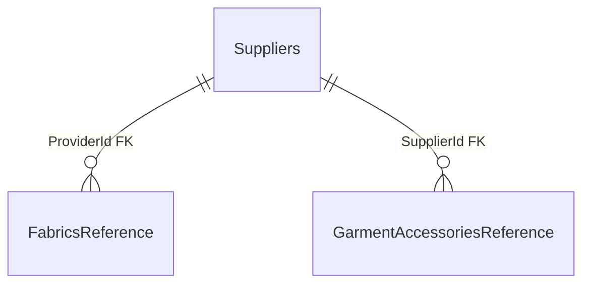

# `reference` — Reference Module Data

**Source:** [Reference snapshot](../../../../src/Modules/Reference/Reference.Infrastructure/Reference.Infrastructure/Migrations/ReferenceDbContextModelSnapshot.cs) and [configurations](../../../../src/Modules/Reference/Reference.Infrastructure/Reference.Infrastructure/Congigurations/), verified 2026-10-21. [Back to database map](README.md).

| Table | PK | Main data and purpose |
| --- | --- | --- |
| `Suppliers` | `Id` | Suppliers and contacts; optional unique `KeepinCrmId`, Brevi-owned `PurchaseCategories`, `IsActive`, `Notes`. |
| `FabricsReference` | `Id` | Fabrics: `Code` (FAB-…, unique when set), `Name`, `NameRu`, `Price`, `PriceUpdatedAt`, `ProviderId` (FK to `Suppliers`), `Composition`, `CompositionRu`, `Density`, `IsActive`, `Comment`, `ProposalDescription`. |
| `GarmentAccessoriesReference` | `Id` | Accessories: `Code` (FUR-…, unique when set), `Name`, `Price`, `PriceUpdatedAt`, `SupplierId` (FK), `Unit` (шт./м/послуга), `IsActive`, `Comment`. |
| `GarmentParts` | `Id` | «Група деталей» of operations: `Name`. |
| `GarmentPartOperations` | `Id` | Operations: `Code` (OP-…, unique when set), `GarmentPartId`, `Element`, `Variant`, `Name` (unique within a group), `Min` numeric(24,8) (0 when `MinutesPerProduct`), `MinutesPerProduct`, `IsActive`, `Notes`; the pricing revision workflow accepts values fitting numeric(20,8). |
| `PricingParameters` | `Id` | «Параметри ціноутворення» from the sheet «Налаштування цін»: unique `Code`, `Group`, `Name`, `Value` (fraction for %, null when `IsCalculated`), `Unit`, `UpdatedOn`, `Comment`, `SortOrder`. Old PPE products may hold its `Id` in `RetailAdditionalReferenceId`/`WholesaleAdditionalReferenceId` (no FK). |
| `PpeMarkupRules` | `Id` | PPE markup rules: unique `Name` (the rule code of PPE offers), `RetailMarkup`, `WholesaleMarkup`, `LargeWholesaleMarkup` (fractions), `PriceNote`, `AppliesTo`, `SortOrder`. |
| `ProductSections` | `Id` | «Типи і розділи»: `Type` (Sewing/Ppe, string), unique `Name`, `IsActive`, `Comment`, `SortOrder`. Products will refer to it by ID. |
| `PricingInputVersions` | generated long `Id` | Immutable effective Fabric/Accessory/Operation input or OtherCost code, decimal value/unit, revision, approval/activity and source provenance. Exactly one reference; same-module FKs retain history. |

`GarmentPartOperations.GarmentPartId` refers conceptually to `GarmentParts`, but the snapshot has no FK. The module's tables are described in [suppliers](../../features/reference/suppliers.md), [fabrics](../../features/reference/fabrics.md), [accessories](../../features/reference/garment-accessories.md), [garment parts](../../features/reference/garment-parts.md), [operations](../../features/reference/garment-part-operations.md), [pricing parameters](../../features/reference/pricing-parameters.md), and [product sections](../../features/reference/product-sections.md).

The [Sewing pricing feature](../../features/catalog/sewing-pricing.md) documents the cross-module cost/norm version contract. Versions are indexed by each owner reference and effective date; source code/revision and source hash/code are unique. Missing standard time is nullable; OtherCost uses an explicit UAH-per-service value. Effective reads normalize instants to UTC and reject ambiguous latest versions rather than selecting one arbitrarily.

The [Reference version feature](../../features/reference/pricing-input-versions.md) documents atomic numeric-edit capture, service-cost revisions and access rules. Migration `PreservePricingOperationPrecision` expands operation minutes from numeric(18,2) to numeric(24,8), preserving the original integer capacity. Its Down can round new fractional values and must not be used as a production recovery action.
