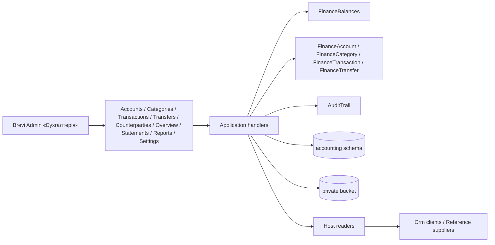

# «Бухгалтерія»

«Бухгалтерія» for the Director: «Рахунки і каси» (bank accounts, cards and cash desks with the opening balance, the confirmed balance on 01.10.2026 and three counted balances), «Категорії» (income and expense, two levels), «Операції» (incomes and expenses), «Перекази» between own accounts, «Огляд», «Контрагенти» (finance counterparties of the module, clients of «Клієнти» and suppliers of «Постачальники» by id, one-off names) and «Потребують перевірки», each for the current books and «Домашня бухгалтерія» before 01.10.2026. Records are cancelled («Анулювати»), never deleted; a used account is only archived and a used category is switched off. An income or expense keeps files (PDF, JPEG, PNG up to 10 MiB, told by their first bytes) in a private Google Cloud Storage bucket, read only through the API. Every change is checked against the version the user opened and written to one change log. «Імпорт архіву Фінансів» moves the finance.json export of the old Calculator (format brevi-finance-v5, gzipped by the browser): a check first, then the move in one transaction, with old ids, sources, states, bank identity (external id, fingerprint, bank id and purpose) and the old change logs; clients and suppliers used in operations are linked to «Клієнти» by KeepinCRM id and to «Постачальники» by KeepinCRM id or a unique name, unknown ones become finance counterparties; a second run adds only what is missing. «Виписки банку» reads a PrivatBank statement (XLSX, XLS or CSV; business account or card) of one account into a preview: lines already in the books (bank id or the old Calculator fingerprint) are exact duplicates, similar ones are probable duplicates excluded at first, an IBAN of another own account makes a transfer, counterparties are recognised by ЄДРПОУ (finance ones, clients, suppliers), IBAN or name and a confirmed one with auto-apply puts its category; the director corrects lines and «Провести виписку» books them in one save, creating unconfirmed counterparties for unknown payees; «Відкотити виписку» cancels what a statement booked (records give up their bank identity), archives the unused counterparties it created and makes it a preview again. «Звіти» builds six reports (summary, expense structure, categories, accounts with transfers, counterparties, operations) for a period with a CSV download for Excel; «Журнал змін» lists the changes of all records; «Резервна копія» downloads every finance record as one JSON file. Money is in kopecks. [SDD](../../specs/accounting/001-finance/README.md), [contract](../../contracts/accounting/finance.openapi.yaml), [tables](../../architecture/data-model/accounting.md).

## Code structure

```text
src/Modules/Accounting/
  Accounting.Domain/Accounting.Domain/
    Ledger/            # LedgerScope (Current/LegacyArchive), LedgerCalendar (cutover 2026-10-01, Kyiv), FinanceText, MoneyMinor
    Accounts/          # FinanceAccount (details, cutover balance, active, version), FinanceAccountDetails, FinanceAccountUsage, type, id
    Categories/        # FinanceCategory (root/child, direction, scope, deactivate, version), CategoryDirection, id
    Movements/         # MovementRules (date/area/account/amount), MovementSource, MovementStatus, LegacyMovement (what a moved record keeps)
    Transactions/      # FinanceTransaction (create, update, void, review, follow/promote counterparty), details, VerificationStatus, id
    Counterparties/    # FinanceCounterparty (create, update, verify, archive, merge), details, CounterpartyKind, CounterpartyLink/State, id
    Transfers/         # FinanceTransfer (create, update, void), details, id
    Attachments/       # FinanceAttachment (file of an operation, soft delete), FinanceAttachmentKind (PDF/JPEG/PNG by first bytes), id
    Statements/        # BankStatement (preview → booked), BankStatementLine (bank data, recognition, director's edit, state), BankLineData, BankLineState, BankDuplicate, ids
    Audit/             # AuditEntry, AuditEntity, AuditAction
    Errors/            # AccountingDomainError
  Accounting.Application/Accounting.Application/
    Abstractions/      # IAccountingDbContext, IAccountingCustomerReader, IAccountingSupplierReader, IAccountingFileStorage, IBankStatementFileReader
    Accounts/          # list with balances, create, update, cutover, archive/restore, delete (409 with history); FinanceAccountChange
    Categories/        # list by scope, create (root/child), update, delete or switch off a used branch; CategoryNames
    Transactions/      # journal with filters (needs review, counterparty) and totals, create, update, void, review, promote one-off; fields, save
    Counterparties/    # tabs with counts, choices, create, update, verify, archive/restore, merge; CounterpartyStates (names of linked ones), FinanceCounterpartyChange
    Transfers/         # journal with filters and totals, create, update, void; fields, save
    Attachments/       # upload (storage first, removed if the row fails), list, content, delete; messages
    Import/            # ImportLegacyFinanceCommand (check or move in parts inside one transaction), LegacyFinanceReader (gzip, 200 MiB limit), LegacyFinanceFile (export rows), LegacyFinancePlan (ids, conflicts, links, totals, balances), LegacyFinanceValues, messages
    Statements/        # upload (hash, parse, recognise), list, details with totals and rollback numbers, edit a line, book, rollback; BankLineRecognition, BankDuplicates, BankParties; messages
      Reading/         # BankHeaders (column names), BankStatementParser (header, rows, own IBAN, errors), BankFingerprint (old Calculator formula)
    Balances/          # FinanceBalances: legacy, current, total, history, earliest date
    Overview/          # GetFinanceOverviewQuery (per currency: counts, top expense roots, review reasons)
    Reports/           # GetFinanceReportQuery (six kinds, totals per currency, operations limit), FinanceReportCsv (Excel-ready CSV)
    Export/            # GetFinanceExportQuery: every stored field of every record as one JSON file
    Journal/           # sort keys, page size, ValidBy
    Lookup/            # FinanceNames: account and category names for rows and snapshots
    History/           # GetFinanceHistoryQuery
    Settings/          # GetAccountingSettingsQuery (cutover date, today in Kyiv)
    Audit/             # AuditTrail (JSON snapshots), GetFinanceAuditQuery («Журнал змін» of all records, titles from snapshots)
    Contracts/         # responses
  Accounting.Infrastructure/Accounting.Infrastructure/
    Statements/        # BankStatementFileReader: XLSX/XLS (ExcelDataReader, 64 MiB unpacked limit) and CSV (encoding and separator detection)
    Files/             # AccountingFilesOptions (Accounting:Files), Google Cloud Storage bucket, local folder, not configured
    Persistence/       # AccountingDbContext (schema accounting), configurations, converters, migrations, design-time factory
    DependencyInjection/
  Accounting.Api/Accounting.Api/
    Access/            # policy access:accounting (Director by default), who made the change
    Results/           # 204 for deletes, 503 while the file storage is off
    Accounts/          # /api/accounting/accounts
    Categories/        # /api/accounting/categories
    Settings/          # /api/accounting/settings
    Transactions/      # /api/accounting/transactions
    Transfers/         # /api/accounting/transfers
    Overview/          # /api/accounting/overview
    Counterparties/    # /api/accounting/counterparties
    Attachments/       # /api/accounting/transactions/{id}/attachments, /api/accounting/attachments/{id}[/content]
    Import/            # POST /api/accounting/legacy-import?dryRun=
    Statements/        # /api/accounting/statements[/{id}[/lines/{lineId}|/book|/rollback]]
    Reports/           # /api/accounting/reports[/csv], /api/accounting/audit, /api/accounting/export
src/Bootstrapper/Host.Api/Accounting/   # AccountingCustomerReader (Crm GetCustomerLookupQuery, GetCustomersByKeepinIdsQuery, GetCustomersByTaxIdsQuery), AccountingSupplierReader (Reference, with KeepinCRM id)
src/Modules/Crm/Crm.Application/Crm.Application/Customers/Lookup/   # client names for modules with their own access rule; clients by KeepinCRM id and by ЄДРПОУ
```

## Structure diagram



## Tests

`tests/UnitTests/Accounting/`: accounts on SQLite in memory (create with cleaning, update and stale version, cutover confirm and reset, archive/restore and list order, delete with log), categories (subcategory rules, unique names per level, rename, delete with children, filter by area), settings (today in Kyiv); operations (`FinanceTransactionTests`: balances per area, area/date/category rules, archived account, update/void/history, journal filters, paging and totals, used account and category rules) and transfers with «Огляд» (`FinanceTransferTests`); counterparties (`FinanceCounterpartyTests`: review until confirmed, clients and suppliers by id, «Перевірити» with «Запамʼятати» and current turnover, one-off to permanent, merge, cleaning and auto category, tabs and choices, default category keeps a category); files (`FinanceAttachmentTests`: stored and listed, type by content and size, voided operation, storage off or down, delete keeps history) with `FakeAccountingFileStorage`; archive move (`LegacyFinanceImportTests`: check without writing, counts and balances, move with ids, sources, links and log, second run adds nothing, gzip, name conflict and broken rule stop the move, wrong file); statements (`BankStatementImportTests`: recognised lines and the old fingerprint, the same file again, booking with transfers and created counterparties, exact and probable duplicates, the director's edit, a card XLSX below title rows and another account's IBAN, refused files, windows-1251 CSV, rollback that cancels and frees the lines for booking again, keeps a confirmed counterparty and counts records changed by hand); reports (`FinanceReportTests`: six kinds count only active income and expense of the period, expense structure, accounts with transfers, operations order and limit, counterparty names, CSV format, «Журнал змін» titles, JSON export with stored fields only); contract. Clients by KeepinCRM id and by ЄДРПОУ on PostgreSQL: `tests/IntegrationTests/Crm/CustomerKeepinLookupTests.cs`, `CustomerTaxIdLookupTests.cs`. Clients and suppliers: `FakeAccountingParties`. Shared data: `FinanceMovementFixture`. Command: `dotnet test tests/UnitTests/UnitTests.csproj --filter "FullyQualifiedName~UnitTests.Accounting"`. Module references and schema: `tests/ArchitectureTests/AccountingDependencyTests.cs`.
