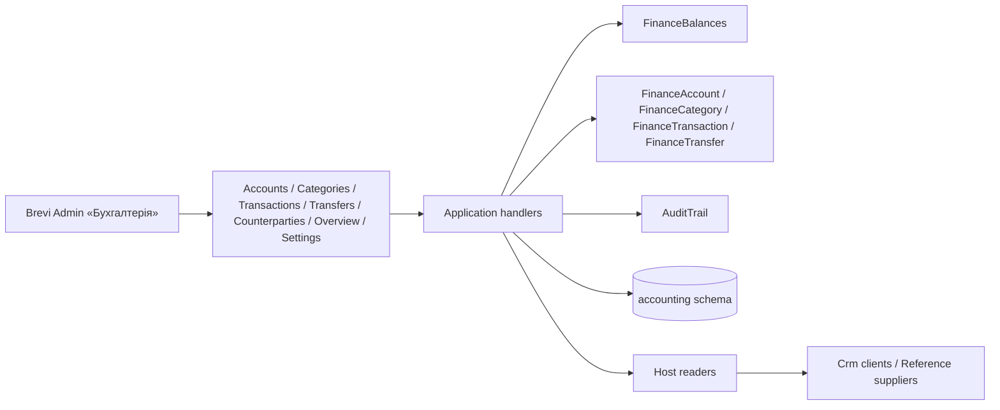

# «Бухгалтерія»

«Бухгалтерія» for the Director: «Рахунки і каси» (bank accounts, cards and cash desks with the opening balance, the confirmed balance on 01.10.2026 and three counted balances), «Категорії» (income and expense, two levels), «Операції» (incomes and expenses), «Перекази» between own accounts, «Огляд», «Контрагенти» (finance counterparties of the module, clients of «Клієнти» and suppliers of «Постачальники» by id, one-off names) and «Потребують перевірки», each for the current books and «Домашня бухгалтерія» before 01.10.2026. Records are cancelled («Анулювати»), never deleted; a used account is only archived and a used category is switched off. Every change is checked against the version the user opened and written to one change log. Money is in kopecks. [SDD](../../specs/accounting/001-finance/README.md), [contract](../../contracts/accounting/finance.openapi.yaml), [tables](../../architecture/data-model/accounting.md).

## Code structure

```text
src/Modules/Accounting/
  Accounting.Domain/Accounting.Domain/
    Ledger/            # LedgerScope (Current/LegacyArchive), LedgerCalendar (cutover 2026-10-01, Kyiv), FinanceText, MoneyMinor
    Accounts/          # FinanceAccount (details, cutover balance, active, version), FinanceAccountDetails, FinanceAccountUsage, type, id
    Categories/        # FinanceCategory (root/child, direction, scope, deactivate, version), CategoryDirection, id
    Movements/         # MovementRules (date/area/account/amount), MovementSource, MovementStatus
    Transactions/      # FinanceTransaction (create, update, void, review, follow/promote counterparty), details, VerificationStatus, id
    Counterparties/    # FinanceCounterparty (create, update, verify, archive, merge), details, CounterpartyKind, CounterpartyLink/State, id
    Transfers/         # FinanceTransfer (create, update, void), details, id
    Audit/             # AuditEntry, AuditEntity, AuditAction
    Errors/            # AccountingDomainError
  Accounting.Application/Accounting.Application/
    Abstractions/      # IAccountingDbContext, IAccountingCustomerReader, IAccountingSupplierReader
    Accounts/          # list with balances, create, update, cutover, archive/restore, delete (409 with history); FinanceAccountChange
    Categories/        # list by scope, create (root/child), update, delete or switch off a used branch; CategoryNames
    Transactions/      # journal with filters (needs review, counterparty) and totals, create, update, void, review, promote one-off; fields, save
    Counterparties/    # tabs with counts, choices, create, update, verify, archive/restore, merge; CounterpartyStates (names of linked ones), FinanceCounterpartyChange
    Transfers/         # journal with filters and totals, create, update, void; fields, save
    Balances/          # FinanceBalances: legacy, current, total, history, earliest date
    Overview/          # GetFinanceOverviewQuery (per currency)
    Journal/           # sort keys, page size, ValidBy
    Lookup/            # FinanceNames: account and category names for rows and snapshots
    History/           # GetFinanceHistoryQuery
    Settings/          # GetAccountingSettingsQuery (cutover date, today in Kyiv)
    Audit/             # AuditTrail (JSON snapshots)
    Contracts/         # responses
  Accounting.Infrastructure/Accounting.Infrastructure/
    Persistence/       # AccountingDbContext (schema accounting), configurations, converters, migrations, design-time factory
    DependencyInjection/
  Accounting.Api/Accounting.Api/
    Access/            # policy CanUseAccounting (Director), who made the change
    Results/           # 204 for deletes
    Accounts/          # /api/accounting/accounts
    Categories/        # /api/accounting/categories
    Settings/          # /api/accounting/settings
    Transactions/      # /api/accounting/transactions
    Transfers/         # /api/accounting/transfers
    Overview/          # /api/accounting/overview
    Counterparties/    # /api/accounting/counterparties
src/Bootstrapper/Host.Api/Accounting/   # AccountingCustomerReader (Crm GetCustomerLookupQuery), AccountingSupplierReader (Reference)
src/Modules/Crm/Crm.Application/Crm.Application/Customers/Lookup/   # client names for modules with their own access rule
```

## Structure diagram



## Tests

`tests/UnitTests/Accounting/`: accounts on SQLite in memory (create with cleaning, update and stale version, cutover confirm and reset, archive/restore and list order, delete with log), categories (subcategory rules, unique names per level, rename, delete with children, filter by area), settings (today in Kyiv); operations (`FinanceTransactionTests`: balances per area, area/date/category rules, archived account, update/void/history, journal filters, paging and totals, used account and category rules) and transfers with «Огляд» (`FinanceTransferTests`); counterparties (`FinanceCounterpartyTests`: review until confirmed, clients and suppliers by id, «Перевірити», one-off to permanent, merge, cleaning and auto category, tabs and choices, default category keeps a category); contract. Clients and suppliers: `FakeAccountingParties`. Shared data: `FinanceMovementFixture`. Command: `dotnet test tests/UnitTests/UnitTests.csproj --filter "FullyQualifiedName~UnitTests.Accounting"`. Module references and schema: `tests/ArchitectureTests/AccountingDependencyTests.cs`.
