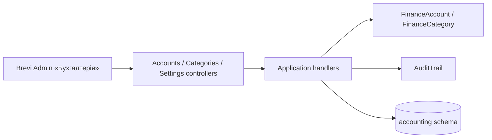

# «Бухгалтерія»: accounts and categories

Stage 1 of «Бухгалтерія» for the Director: «Рахунки і каси» (bank accounts, cards and cash desks with the opening balance and the confirmed balance on 01.10.2026) and «Категорії» (income and expense, two levels, for the current books and «Домашня бухгалтерія» before 01.10.2026). Every change is checked against the version the user opened and written to one change log. Money is in kopecks. [SDD](../../specs/accounting/001-finance/README.md), [contract](../../contracts/accounting/finance.openapi.yaml), [tables](../../architecture/data-model/accounting.md).

## Code structure

```text
src/Modules/Accounting/
  Accounting.Domain/Accounting.Domain/
    Ledger/            # LedgerScope (Current/LegacyArchive), LedgerCalendar (cutover 2026-10-01, Kyiv), FinanceText, MoneyMinor
    Accounts/          # FinanceAccount (details, cutover balance, active, version), FinanceAccountDetails, FinanceAccountType, id
    Categories/        # FinanceCategory (root/child, direction, scope, version), CategoryDirection, id
    Audit/             # AuditEntry, AuditEntity, AuditAction
    Errors/            # AccountingDomainError
  Accounting.Application/Accounting.Application/
    Abstractions/      # IAccountingDbContext
    Accounts/          # list, create, update, cutover, archive/restore, delete; FinanceAccountChange (version + log)
    Categories/        # list by scope, create (root/child), update, delete with children; CategoryNames (unique per level)
    History/           # GetFinanceHistoryQuery
    Settings/          # GetAccountingSettingsQuery (cutover date, today in Kyiv)
    Audit/             # AuditTrail (JSON snapshots)
    Contracts/         # responses
  Accounting.Infrastructure/Accounting.Infrastructure/
    Persistence/       # AccountingDbContext (schema accounting), configurations, converters, migrations, design-time factory
    DependencyInjection/
  Accounting.Api/Accounting.Api/
    Access/            # policy CanUseAccounting (Director), who made the change
    Accounts/          # /api/accounting/accounts
    Categories/        # /api/accounting/categories
    Settings/          # /api/accounting/settings
```

## Structure diagram



## Tests

`tests/UnitTests/Accounting/`: accounts on SQLite in memory (create with cleaning, update and stale version, cutover confirm and reset, archive/restore and list order, delete with log), categories (subcategory rules, unique names per level, rename, delete with children, filter by area), settings (today in Kyiv), contract. Command: `dotnet test tests/UnitTests/UnitTests.csproj --filter "FullyQualifiedName~UnitTests.Accounting"`. Module references and schema: `tests/ArchitectureTests/AccountingDependencyTests.cs`.
