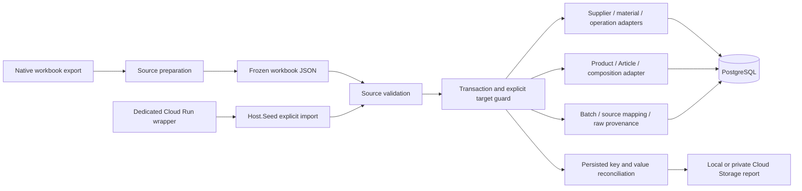

# Catalogue import job

The operational job imports a frozen workbook into the same PostgreSQL database used by Brevi. Local execution is the default; a separate Cloud Run Job supports an explicitly pinned remote host/database/source hash, with private mounted source and persistent reports. It has no runtime Google Sheets connection and is not loaded by Host.Api. See the [import revision](../../specs/catalog/002-sewing-articles-and-composition/catalog-import.md), [field mapping](../../specs/catalog/002-sewing-articles-and-composition/import-field-map.md), and [runbook](../../operations/data/catalog-import.md).

## Code structure

```text
src/Bootstrapper/Host.Seed/
  Program.cs                              # host lifecycle
  Jobs/SeedJobDispatcher.cs                # mutually exclusive command selection
  Jobs/CatalogImportCommandRunner.cs       # thin runner: calls CatalogImport.Execution.CatalogImportCommand
  SeedHostServicesExtensions.cs           # registers import provenance migrator
src/Jobs/CatalogImport/
  Source/{Identity,References}/            # frozen workbook conventions and row parsing
  Planning/{Identity,Validation}/          # source keys and dataset-specific validation
  Execution/                              # CatalogImportCommand (arguments, report, console result), target and source pins, report path, transaction, reconciliation
  Persistence/
    Catalog/{Categories,Products,Composition}/ # category resolution, identity/profile translation and composition writes
    Catalog/CatalogProductWriter.cs        # coordinates identity then composition
    Reference/{Suppliers,Materials,Operations}/ # existing reference adapters; fabric importer copies composition/density
    Reference/ReferenceCatalogWriter.cs    # reference write order
    Provenance/{Records,Configuration,Data,Writing}/ # source audit data and individual EF mappings
  Migrations/                             # imports schema, independent of Catalog schema
deployment/{prepare-catalog-source,import-catalog}.ps1 # source preparation and operator execution
tools/catalog-import/render-catalog-import-job.py    # job configuration rendered by the deploy workflow
src/Modules/Catalog/
  Catalog.Domain/.../Products/ProductCatalogProfile.cs
  Catalog.Infrastructure/.../Persistence/Products/ProductCatalogProfileConfiguration.cs
```

The [job directory guide](../../../../src/Jobs/README.md) and [structure audit](../../specs/catalog/005-import-pricing-structure/audit.md) describe the current ownership. Sewing pricing bootstrap/verification are in a separate job project.

## Structure diagram



An initial import requires an empty Product catalogue; existing Reference rows are preserved and source-matched fields are updated with a change report. The same snapshot is verified and skipped on a rerun. A different snapshot requires a separate reviewed update workflow. Profile data contains source identity, activity/season and nullable PPE supplier offers; it does not synthesize legacy pricing percentages. Composition lines and products carry no review or check marks (CAT-014).

The fabric importer also stores nullable composition/density from the frozen `Тканини` rows. This applies to a new import; an already-applied snapshot remains skipped, so existing imported databases need an explicit source-hash/mapping-checked backfill after the additive Reference migration. The local TS-016 operation is recorded in [evidence](../../specs/crm/001-clients-quotes-custom-sewing/evidence/ts-016-core-2026-10-29.md).

## Tests

- `tests/UnitTests/Jobs/CatalogImport/CatalogImportSourceTests.cs`
- `tests/UnitTests/Jobs/CatalogImport/CatalogImportTargetTests.cs`
- `tests/IntegrationTests/Jobs/CatalogImport/CatalogImportCommandTests.cs`
- `tools/catalog-import/tests/import-catalog.Tests.ps1` (offline gcloud mocks)
- `tools/catalog-import/tests/test_render_catalog_import_job.py` (CI job isolation)
- `tests/IntegrationTests/Jobs/CatalogImport/CatalogImportPersistenceTests.cs`

Focused run: `dotnet test tests/UnitTests/UnitTests.csproj --filter CatalogImport`; `dotnet test tests/IntegrationTests/IntegrationTests.csproj --filter CatalogImport` (slow; needs `BREVIERP_CATALOG_TEST_CONNECTION`).

**Data:** [catalog schema](../../architecture/data-model/catalog.md)

The [cloud runbook](../../operations/data/catalog-import-cloud.md) specifies private source/report storage, Secret Manager, target pins and separate validate/trial/apply executions. Workbook preparation preserves all tab evidence but does not import credentials, derived views or publish source price formulas.
