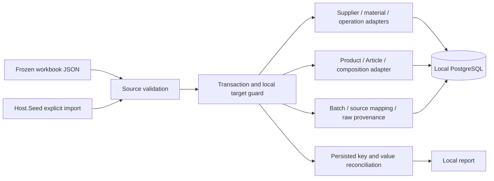

# Local catalogue import job

The operational job imports a frozen workbook into the same PostgreSQL database used by Brevi. It has no runtime Google Sheets connection and is not loaded by Host.Api. See the [import revision](../../specs/catalog/002-sewing-articles-and-composition/catalog-import.md), [field mapping](../../specs/catalog/002-sewing-articles-and-composition/import-field-map.md), and [runbook](../../operations/data/catalog-import.md).

## Code structure

```text
src/Bootstrapper/Host.Seed/
  Program.cs                              # host lifecycle
  Jobs/SeedJobDispatcher.cs                # mutually exclusive command selection
  Jobs/CatalogImport/                      # import arguments, report and console result
  SeedHostServicesExtensions.cs           # registers import provenance migrator
src/Jobs/CatalogImport/
  Source/{Identity,References}/            # frozen workbook conventions and row parsing
  Planning/{Identity,Validation}/          # source keys and dataset-specific validation
  Execution/                              # local-target guard, transaction, reconciliation, report
  Persistence/
    Catalog/{Categories,Products,Composition}/ # category resolution, identity/profile translation and composition writes
    Catalog/CatalogProductWriter.cs        # coordinates identity then composition
    Reference/{Suppliers,Materials,Operations}/ # existing reference adapters
    Reference/ReferenceCatalogWriter.cs    # reference write order
    Provenance/{Records,Configuration,Data,Writing}/ # source audit data and individual EF mappings
  Migrations/                             # imports schema, independent of Catalog schema
src/Modules/Catalog/
  Catalog.Domain/.../Products/Entities/ProductCatalogProfile.cs
  Catalog.Infrastructure/.../Congigurations/ProductCatalogProfileConfiguration.cs
```

The [job directory guide](../../../../src/Jobs/README.md) and [structure audit](../../specs/catalog/005-import-pricing-structure/audit.md) describe the current ownership. Sewing pricing bootstrap/verification are in a separate job project.

## Structure diagram



An initial import requires an empty Product catalogue; existing Reference rows are preserved and source-matched fields are updated with a change report. The same snapshot is verified and skipped on a rerun. A different snapshot requires a separate reviewed update workflow. Profile data contains source identity, activity/season/review and nullable PPE supplier offers; it does not synthesize legacy pricing percentages. Line reviews remain unapproved by Brevi users even when the source row is marked reviewed.

