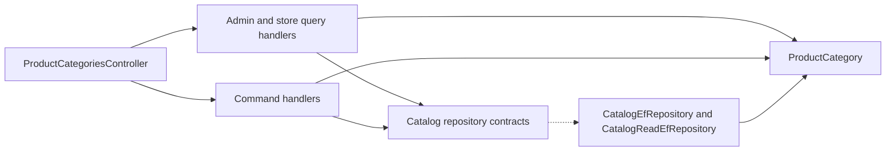

# Product Categories

**Static code review:** 2026-10-16. **Module:** catalog.

Admin CRUD and list for Storefront.

## Structure and relationships

[ProductCategoriesController](../../../../src/Modules/Catalog/Catalog.Api/Catalog.Api/ProductCategory/ProductCategoriesController.cs) routes requests to the [admin query](../../../../src/Modules/Catalog/Catalog.Application/Catalog.Application/Features/ProductCategory/Queries/GetAdminProductCategories/GetAdminProductCategoriesHandler.cs), store query, and command handlers. [ProductCategory](../../../../src/Modules/Catalog/Catalog.Domain/Catalog.Domain/ProductCategories/ProductCategory.cs) is persisted through [CatalogEfRepository](../../../../src/Modules/Catalog/Catalog.Infrastructure/Catalog.Infrastructure/Persistence/CatalogEfRepository.cs). The category belongs to Catalog even though the API route starts with `/api/reference/`.

## Code structure

The following are verified entry points and key feature components; the tree does not list every supporting file.

```text
src/
└── Modules/Catalog/
    ├── Catalog.Api/Catalog.Api/ProductCategory/ProductCategoriesController.cs  # HTTP entry point
    ├── Catalog.Application/Catalog.Application/Features/ProductCategory/
    │   ├── Commands/CreateProductCategory/CreateProductCategoryHandler.cs  # use-case handler
    │   ├── Commands/DeleteProductCategory/DeleteProductCategoryHandler.cs  # use-case handler
    │   ├── Queries/GetAdminProductCategories/GetAdminProductCategoriesHandler.cs  # use-case handler
    │   ├── Queries/GetStoreProductCategories/GetStoreProductCategoriesHandler.cs  # use-case handler
    │   └── Commands/UpdateProductCategory/UpdateProductCategoryHandler.cs  # use-case handler
    ├── Catalog.Domain/Catalog.Domain/ProductCategories/ProductCategory.cs  # domain model
    └── Catalog.Infrastructure/Catalog.Infrastructure/Persistence/CatalogEfRepository.cs  # data access
```

## Structure diagram



## Tests

No automated tests cover this feature yet.

**Data:** [catalog schema](../../architecture/data-model/catalog.md)

## Related sources

[OpenAPI](../../contracts/catalog/product-dependencies.openapi.yaml) · [Admin product list SDD](../../specs/catalog/admin-product-list/README.md).
