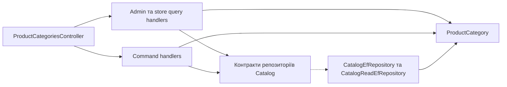

# Категорії товарів

**Статична звірка з кодом:** 2026-10-16. **Модуль:** catalog.

Admin CRUD та список для Storefront.

## Будова й зв'язки

[ProductCategoriesController](../../../../src/Modules/Catalog/Catalog.Api/Catalog.Api/Controllers/ProductCategoriesController.cs) направляє запити до [admin query](../../../../src/Modules/Catalog/Catalog.Application/Catalog.Application/Features/ProductCategory/GetAdminList/GetAdminProductCategoriesQueryHandler.cs), store query та command handlers. [ProductCategory](../../../../src/Modules/Catalog/Catalog.Domain/Catalog.Domain/ProductCategories/Entities/ProductCategory.cs) зберігається через [CatalogEfRepository](../../../../src/Modules/Catalog/Catalog.Infrastructure/Catalog.Infrastructure/Repositories/CatalogEfRepository.cs). Категорія належить Catalog, хоча маршрут API починається з `/api/reference/`.

## Структура в коді

Наведено перевірені точки входу та ключові складові фічі; дерево не перелічує всі допоміжні файли.

```text
src/
└── Modules/Catalog/
    ├── Catalog.Api/Catalog.Api/Controllers/ProductCategoriesController.cs  # HTTP-вхід
    ├── Catalog.Application/Catalog.Application/Features/ProductCategory/
    │   ├── Create/CreateProductCategoryCommandHandler.cs  # обробник сценарію
    │   ├── Delete/DeleteProductCategoryCommandHandler.cs  # обробник сценарію
    │   ├── GetAdminList/GetAdminProductCategoriesQueryHandler.cs  # обробник сценарію
    │   ├── GetStoreList/GetStoreProductCategoriesQueryHandler.cs  # обробник сценарію
    │   └── Update/UpdateProductCategoryCommandHandler.cs  # обробник сценарію
    ├── Catalog.Domain/Catalog.Domain/ProductCategories/Entities/ProductCategory.cs  # доменна модель
    └── Catalog.Infrastructure/Catalog.Infrastructure/Repositories/CatalogEfRepository.cs  # доступ до даних
```

## Схема будови



## Пов'язані джерела

[OpenAPI](../../contracts/catalog/product-dependencies.openapi.yaml) · [SDD списку](../../specs/catalog/admin-product-list/README.md).
