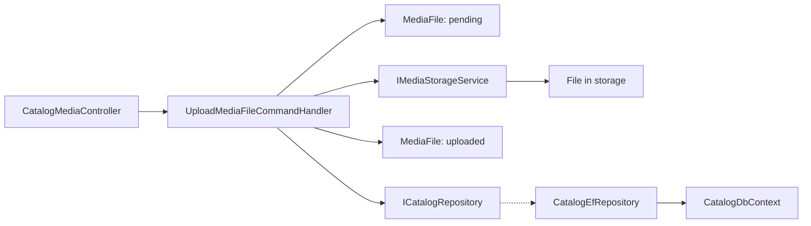

# Catalog Media Files

**Static code review:** 2026-10-16. **Module:** catalog.

Upload, list, and delete files for products.

## Structure and relationships

[CatalogMediaController](../../../../src/Modules/Catalog/Catalog.Api/Catalog.Api/Controllers/CatalogMediaController.cs) calls the [upload handler](../../../../src/Modules/Catalog/Catalog.Application/Catalog.Application/Features/Media/Upload/UploadMediaFileCommandHandler.cs): it creates a pending [MediaFile](../../../../src/Modules/Catalog/Catalog.Domain/Catalog.Domain/Media/Entities/MediaFile.cs), uploads it to storage through an adapter, and marks it as uploaded. [CatalogDbContext](../../../../src/Modules/Catalog/Catalog.Infrastructure/Catalog.Infrastructure/DataBase/CatalogDbContext.cs) stores metadata; the file and database record have separate lifecycles.

## Code structure

The following are verified entry points and key feature components; the tree does not list every supporting file.

```text
src/
└── Modules/Catalog/
    ├── Catalog.Api/Catalog.Api/Controllers/CatalogMediaController.cs  # HTTP entry point
    ├── Catalog.Application/Catalog.Application/Features/Media/
    │   ├── Delete/DeleteMediaFileCommandHandler.cs  # use-case handler
    │   ├── GetList/GetMediaFilesQueryHandler.cs  # use-case handler
    │   └── Upload/UploadMediaFileCommandHandler.cs  # use-case handler
    ├── Catalog.Domain/Catalog.Domain/Media/Entities/MediaFile.cs  # domain model
    └── Catalog.Infrastructure/Catalog.Infrastructure/DataBase/CatalogDbContext.cs  # data context
```

## Structure diagram



## Tests

- `tests/IntegrationTests/GetMediaFilesSpecTests.cs`
- `tests/IntegrationTests/MediaFileByIdSpecTests.cs`
- `tests/IntegrationTests/MediaFilePersistenceConfigurationTests.cs`

Focused run: `dotnet test tests/IntegrationTests/IntegrationTests.csproj --filter MediaFile` (slow; needs `BREVIERP_CATALOG_TEST_CONNECTION`).

**Data:** [catalog schema](../../architecture/data-model/catalog.md)

## Related sources

[OpenAPI](../../contracts/catalog/product-dependencies.openapi.yaml) · [Media files SDD](../../specs/catalog/media-files/README.md).
