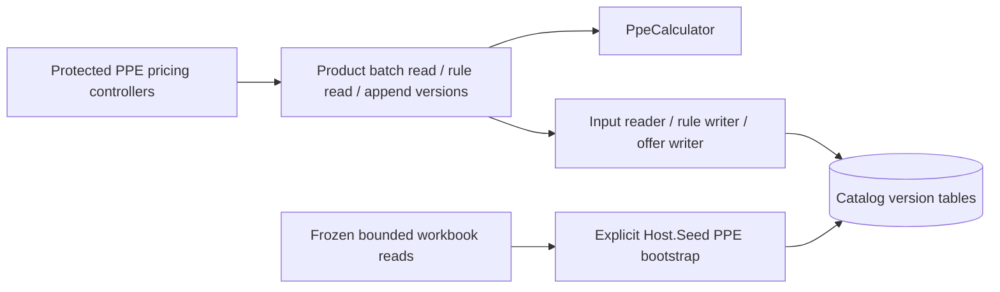

# Catalog: PPE pricing

Versioned three-tier PPE calculation from Brevi-owned rule/offer snapshots. Domain arithmetic reproduces approved workbook precedence and rounding; no live workbook or XML access occurs at runtime. Imported source review remains evidence; only an explicit manager write creates a Brevi-approved version. Missing required data returns blockers and no prices.



```text
Catalog.Domain/Pricing/Ppe/
  Inputs/                  # supplier/external inputs and markup fractions
  Calculation/             # tier precedence, rounding and typed blockers
  Results/                 # independent prices and readiness
Catalog.Application/
  Contracts/Pricing/Ppe/    # read models and persistence ports
  Features/Pricing/Ppe/
    Products/              # bounded Product pricing query
    Evaluation/            # active/enrolled input selection
    Rules/                 # exact rule lookup and approved version creation
    Offers/                # Product offer version creation
    Validation/            # request/precision/provenance checks
Catalog.Infrastructure/Pricing/Ppe/
  Records/                 # private append-only persistence rows
  Configuration/           # identity/UUID/scope indexes, Product FK, jsonb
  Reading/                 # fixed-query batch in one repeatable-read snapshot
  Writing/                 # expected-version, actor-bound replay and transactions
Catalog.Api/
  Controllers/Pricing/Ppe/  # read/manage policies and claim actor
  Contracts/Pricing/Ppe/    # write request boundary
Jobs/CatalogImport/PpePricing/
  Source/                  # bounded frozen source parsing
  Planning/                # source column map, no price formulas
  Bootstrap/               # local-only draft import and replay reconciliation
```

API source: [PPE OpenAPI](../../contracts/catalog/ppe-pricing.openapi.yaml). [Implementation decisions](../../specs/catalog/003-sheet-pricing-parity/ppe-implementation.md) and [evidence](../../specs/catalog/003-sheet-pricing-parity/ppe-evidence.md).

Legacy Product pricing fields are compatibility outputs; new enrolled consumers use this boundary. Legacy endpoint retirement and representative catalogue comparison belong to TS-007. Current calculation is not a quote or publication snapshot.
