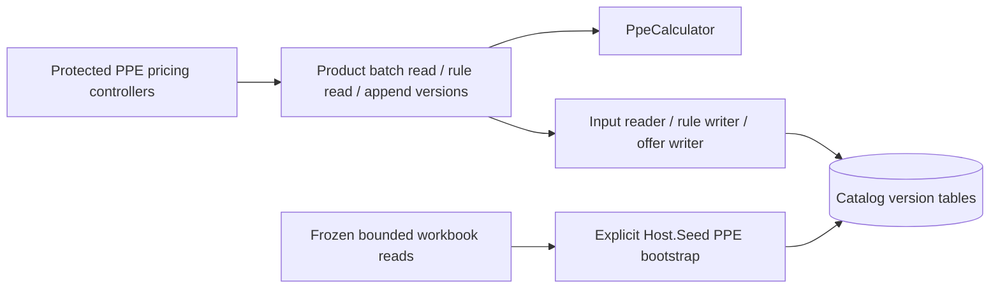

# Catalog: PPE pricing

Versioned three-tier PPE calculation from Brevi-owned rule/offer snapshots. Domain arithmetic reproduces approved workbook precedence and rounding; no live workbook or XML access occurs at runtime. Imported source review remains evidence; only an explicit manager write creates a Brevi-approved version. Missing required data returns blockers and no prices.

The PPE product card ([CAT-008](../../specs/catalog/008-ppe-product-card/README.md)) reads and saves the sheet «ЗІЗ» supplier fields through `GET`/`PUT /api/v1/products/{productId}/ppe-offer` (`Features/Pricing/Ppe/SupplierOffer/`, `PpeSupplierOfferController`). A changed supplier price or rule appends an approved offer version in the same transaction.

The page «Новий ЗІЗ» ([CAT-009](../../specs/catalog/009-product-create-pages/README.md)) shows the three prices before saving through `GET /api/v1/pricing/ppe/rules/preview` (`Features/Pricing/Ppe/Preview/`, `PpePricingRulesController`); nothing is saved.

## Structure diagram



## Code structure

```text
Catalog.Domain/Pricing/Ppe/
  Inputs/                  # supplier/external inputs and markup fractions
  Calculation/             # tier precedence, rounding and typed blockers
  Results/                 # independent prices and readiness
Catalog.Application/
  Abstractions/Pricing/    # rule, offer and Product input ports with their values/version records
  Features/Pricing/
    Queries/GetPpeProductPrices/    # bounded Product pricing query
    Queries/GetPpeRule/, Commands/CreatePpeRuleVersion/  # exact rule lookup and approved version creation
    Commands/CreatePpeOfferVersion/ # Product offer version creation
    Queries/GetPpeSupplierOffer/, Commands/UpdatePpeSupplierOffer/  # PPE card
    Queries/PreviewPpePrices/       # three prices for a supplier price and rule, not saved
    Shared/Ppe/Evaluation/          # active/enrolled input selection
    Shared/Ppe/Validation/          # request/precision/provenance checks
    Shared/Ppe/SupplierOffer/       # card view and reader
Catalog.Infrastructure/Persistence/Pricing/Ppe/
                           # private append-only rows and their configurations (identity/UUID/scope indexes, Product FK, jsonb);
                           # PpePricingInputReader: fixed-query batch in one repeatable-read snapshot;
                           # version writers: expected-version, actor-bound replay and transactions
Catalog.Api/
  Pricing/Ppe/              # controllers (read/manage policies, claim actor) and write requests
Jobs/CatalogImport/PpePricing/
  Source/                  # bounded frozen source parsing
  Planning/                # source column map, no price formulas
  Bootstrap/               # local target, source/plan and transaction orchestration
  Persistence/             # Product identity lookup / replay verification / draft writing
```

## Related sources

API source: [PPE OpenAPI](../../contracts/catalog/ppe-pricing.openapi.yaml). [Implementation decisions](../../specs/catalog/003-sheet-pricing-parity/ppe-implementation.md) and [evidence](../../specs/catalog/003-sheet-pricing-parity/ppe-evidence.md).

Legacy Product pricing fields are compatibility outputs; new enrolled consumers use this boundary. Legacy endpoint retirement and representative catalogue comparison belong to TS-007. Current calculation is not a quote or publication snapshot.

[Scoped PPE structural audit](../../specs/catalog/003-sheet-pricing-parity/structure/ppe/audit.md) documents responsibility splits and keep decisions.

## Current consumer revision

[TS-007 cutover](../../specs/catalog/003-sheet-pricing-parity/cutover/README.md) supersedes earlier legacy Product price fallback descriptions. Current Admin prices use versioned PPE calculations or published Sewing Article prices. Deprecated Product metadata amounts are placeholders, not sale prices.

## Tests

- `tests/UnitTests/Catalog/Pricing/Ppe/PpePricing*Tests.cs`, `tests/UnitTests/Catalog/Pricing/Ppe/PpeSupplierOfferTests.cs`, `tests/UnitTests/Catalog/Products/CatalogProductCreationInputTests.cs` (preview)
- `tests/IntegrationTests/Catalog/Pricing/Ppe/`

Focused run: `dotnet test tests/UnitTests/UnitTests.csproj --filter "FullyQualifiedName~PpePricing|FullyQualifiedName~PpeSupplierOffer"`; `dotnet test tests/IntegrationTests/IntegrationTests.csproj --filter PpePricing` (slow; needs `BREVIERP_CATALOG_TEST_CONNECTION`).

**Data:** [catalog schema](../../architecture/data-model/catalog.md)
