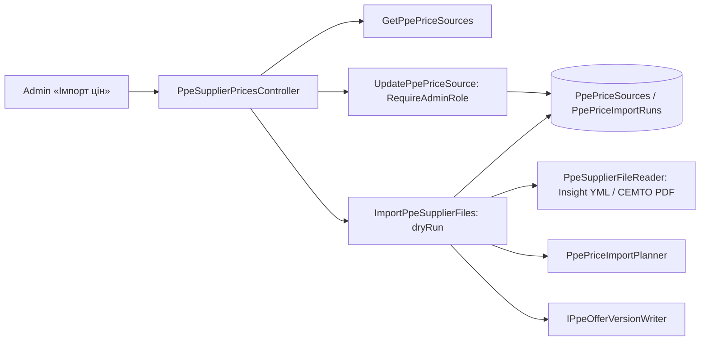

# Catalog: PPE supplier price import («Імпорт цін»)

The tab «Довідники» → «Імпорт цін» lists PPE supplier price sources with their logic, schedule and discount, and updates supplier prices from the suppliers' files: preview first, then apply. Spec: [CAT-017](../../specs/catalog/017-ppe-supplier-price-import/README.md). Stage 1: Insight XML and СЕМТО PDF uploads; scheduled site/cabinet updates come in later stages.

## Flow



## Code structure

```text
Catalog.Application/
  Contracts/Pricing/Ppe/SupplierPrices/   # store port, file reader port, run/problem records
  Features/Pricing/Ppe/SupplierPrices/
    Sources/                              # fixed source list, key normalization
    List/                                 # source rows with counts and last run
    Settings/                             # discount and supplier (admins, director)
    Import/                               # file import command, planner, rows
    Shared/                               # supplier resolution, product specs
Catalog.Infrastructure/Pricing/Ppe/SupplierPrices/
  Records/ Configuration/ Store/          # two catalog tables
  Files/                                  # Insight XmlReader, СЕМТО PdfPig, gzip unpack
Catalog.Api/Controllers/Pricing/Ppe/PpeSupplierPricesController.cs
```

## Tests

`dotnet test tests/UnitTests/UnitTests.csproj --filter PpeSupplierPrice`; integration: `--filter "FullyQualifiedName~PpeSupplierFile|FullyQualifiedName~PpePriceSourceStore|FullyQualifiedName~PpeSupplierPricesApi"`.

## Data

`catalog.PpePriceSources`, `catalog.PpePriceImportRuns` ([data model](../../architecture/data-model/catalog.md#ppe-supplier-price-import)); new prices are approved rows in `PpePricingOfferVersions`.
