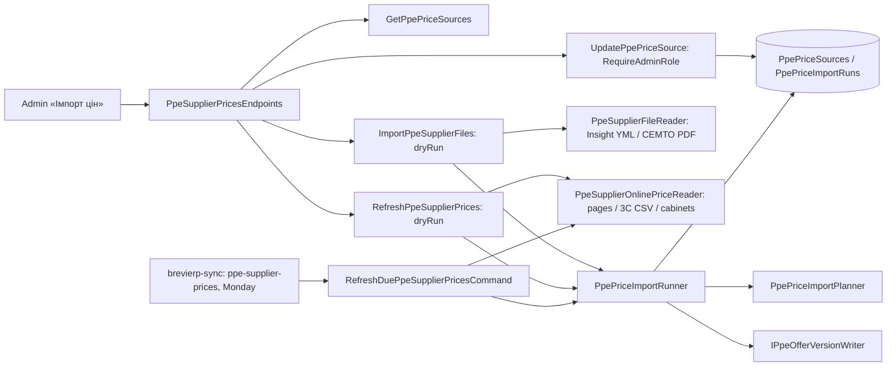

# Catalog: PPE supplier price import («Імпорт цін»)

The tab «Довідники» → «Імпорт цін» lists PPE supplier price sources with their logic, schedule and discount, and updates supplier prices from the suppliers' files: preview first, then apply. Spec: [CAT-017](../../specs/catalog/017-ppe-supplier-price-import/README.md). Stage 1: Insight XML and СЕМТО PDF uploads. Stage 2: АВ-Центр and Перчатка-центр pages and 3C-Маркет's Google lists, every Monday at 09:00 in the `brevierp-sync` job (Mon–Fri 09:00 Kyiv) and on «Оновити зараз». Stage 3: the Трєле dealer cabinet, also every Monday at 09:00 (login from Secret Manager). Insight is updated only from its XML files.

## Flow



## Code structure

```text
Catalog.Application/
  Abstractions/Pricing/                   # store port, file and online reader ports, run/problem records
  Features/Pricing/
    Queries/GetPpePriceSources/           # source rows with counts and last run
    Commands/UpdatePpePriceSource/        # discount and supplier (admins, director)
    Commands/ImportPpeSupplierFiles/      # file import command, planner, rows
    Commands/RefreshPpeSupplierPrices/    # «Оновити зараз» command, Monday schedule
    Shared/Ppe/SupplierPrices/            # Sources/ (fixed list, key normalization), Running/ (plan, save offers, record the run),
                                          # supplier resolution, product specs
Catalog.Infrastructure/
  Persistence/Pricing/PpeSupplierPrices/  # two catalog tables: rows, configurations, PpePriceSourceStore
  Integrations/PpeSupplierFiles/          # Insight XmlReader, СЕМТО PdfPig, gzip unpack
  Integrations/PpeSupplierSites/          # АВ-Центр / Перчатка-центр page patterns, 3C CSV lists, HTTP client
    Cabinets/                             # Трєле sign-in, session pages, dealer price, options
Catalog.Api/Endpoints/Ppe/PpeSupplierPricesEndpoints.cs
Catalog.Application/Features/Pricing/Commands/RefreshDuePpeSupplierPrices/  # due sources of today, one command
Host.Seed/Jobs/Sync/PpeSupplierPricesSyncTask.cs  # brevierp-sync step: sends RefreshDuePpeSupplierPricesCommand, logs outcomes
```

## Tests

`dotnet test tests/UnitTests/UnitTests.csproj --filter PpeSupplierPrice`; integration: `--filter "FullyQualifiedName~PpeSupplierFile|FullyQualifiedName~PpePriceSourceStore|FullyQualifiedName~PpeSupplierPricesApi|FullyQualifiedName~PpeSupplierOnline|FullyQualifiedName~PpeScheduledPriceRefresh"`.

## Data

`catalog.PpePriceSources`, `catalog.PpePriceImportRuns` ([data model](../../architecture/data-model/catalog.md#ppe-supplier-price-import)); new prices are approved rows in `PpePricingOfferVersions`.
