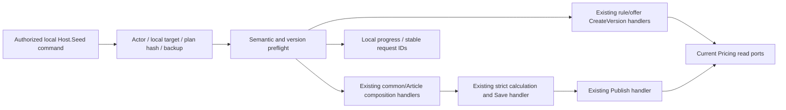

# Catalog: explicit local pricing activation

The operational job turns reviewed inputs into current prices through existing Application handlers. The plan/journal are local files, not a second price database. Actor and backup validation belong to Host.Seed; Catalog keeps Domain rules, concurrency, versioning, saved calculations and publication ownership.

## Structure diagram



## Code structure

```text
Jobs/SewingPricing/Activation/
  Planning/        # immutable plan and scoped input records, current-ports planner
  Guards/          # loopback/exact-database validation
  Confirmation/    # semantic input comparisons and existing composition/PPE commands
  Publication/     # strict version/result checks and Save/Publish handlers
  Reporting/       # progress steps and completion status
  CompositionRoot/ # job-only adapters/service wiring
  PricingActivationJob.cs # preflight then ordered, resumable operations
Jobs/SewingPricing/Reading/JobProductReferenceReader.cs # real Reference validation data
Host.Seed/Jobs/Pricing/Activation/
  ActivationActorReader.cs              # existing manager/admin and lockout validation
  ActivationFileGuard.cs                # immutable plan and backup checks
  PricingActivationCommandRunner.cs     # explicit plan/apply configuration and atomic report
```

## Rules and boundaries

Every production type has one file. No module/API/project/schema dependency is added; runtime modules do not reference jobs. Numeric values/manual operations are unchanged by review confirmation. Original draft/version/publication history remains. Exclusions are an authorized operational scope, not special Domain formulas. [SDD](../../specs/catalog/003-sheet-pricing-parity/activation/execution.md) · [Operations](../../operations/data/pricing-activation.md) · [Evidence](../../specs/catalog/003-sheet-pricing-parity/activation/execution-evidence.md).

## Tests

- `tests/UnitTests/PricingActivationTests.cs`
- `tests/IntegrationTests/Pricing/PricingActivationTests.cs`

Focused run: `dotnet test tests/UnitTests/UnitTests.csproj --filter PricingActivation`; `dotnet test tests/IntegrationTests/IntegrationTests.csproj --filter PricingActivation` (slow; needs `BREVIERP_CATALOG_TEST_CONNECTION`).

**Data:** [catalog schema](../../architecture/data-model/catalog.md)
