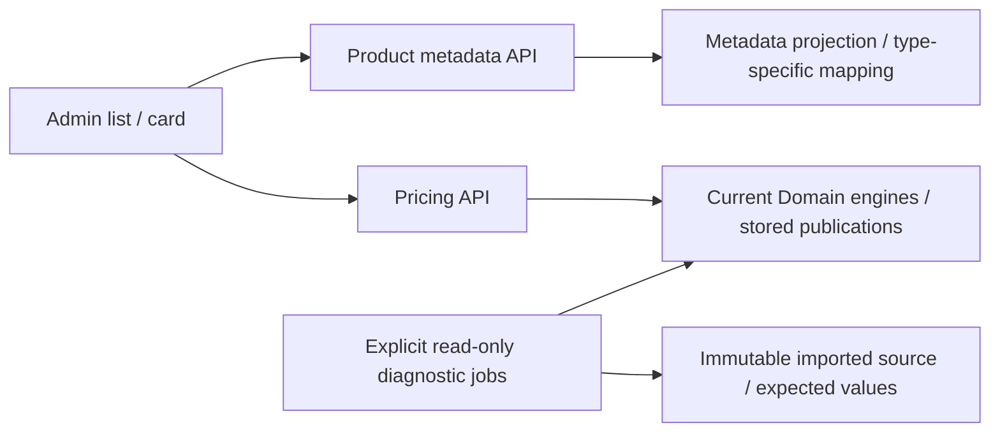

# Catalog: current pricing boundaries after TS-007

Product list/detail/create/replace responses map catalogue metadata, not sale-price formulas. Deprecated sale-price fields remain shape-compatible placeholders. Current prices come from published Sewing Article tiers or versioned PPE input calculation; missing/blocked data is explicit in those contracts. Archived Product inputs remain stored for compatibility/onboarding, not current price ownership.



```text
Catalog.Application/
  Features/Product/GetAdminList/       # metadata/media projection, no price references
  Contracts/Admin/Product/             # aggregate metadata mapper
  Contracts/Admin/Sewing/              # manufacturing metadata, prices=null
  Contracts/Admin/Ppe/                 # supplier/archive metadata, retired price placeholders
  Features/Pricing/                    # sole current pricing scenarios
Catalog.Domain/Pricing/                # current Sewing and PPE arithmetic
Jobs/SewingPricing/Verification/       # per-component source parity and strict blockers
Jobs/CatalogImport/PpePricing/Verification/
  Comparison/                         # expected/actual/delta and missing-source classification
  Diagnostics/                        # provenance/readiness/report types
  Reading/                            # local-only source/identity/input reads, batches <=100
  Evaluation/                         # pure per-row diagnostics, in-memory review override
  PpePricingVerificationJob.cs         # report orchestration only
```

[Specification](../../specs/catalog/003-sheet-pricing-parity/cutover/README.md) · [Reconciliation](../../specs/catalog/003-sheet-pricing-parity/cutover/reconciliation.md) · [Release order](../../operations/data/pricing-cutover.md).
