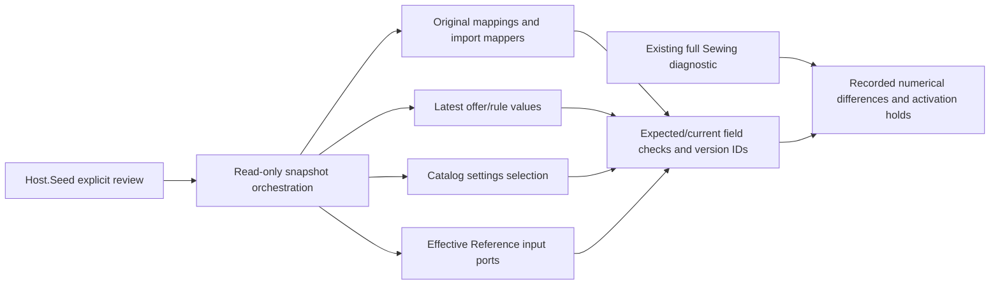

# Catalog: frozen-source input review

The local operational review checks current input data against immutable imported sources before manager confirmation. It compares 124 model compositions, their material/operation lines, current PPE offers/rules and effective Reference/settings values. Source matches, current approvals/reviews and unresolved hold reasons remain separate.

## Structure diagram



## Code structure

```text
Jobs/SewingPricing/Review/
  PricingInputReviewJob.cs              # local guard/source compatibility/read-only snapshot
  Reading/
    Composition/CompositionReviewReader.cs # aggregate/source lookup and line comparison orchestration
    Ppe/PpeInputReviewReader.cs            # latest rule/offer checks and source/active holds
    Reference/
      SettingsInputReviewReader.cs         # Catalog settings selection check
      ReferenceInputReviewReader.cs        # effective Reference cost/norm checks
  Comparison/
    PricingReviewComparison.cs             # field equality and numeric normalization
    Composition/
      MaterialLineReviewComparer.cs        # material scope/quantity/unit/reference field shape
      OperationLineReviewComparer.cs       # operation quantity/manual-time/reference field shape
  Reporting/
    PricingReviewCheck.cs               # field, expected/current value and equality
    PricingReviewSubject.cs             # identity/version/status and distinct holds
    PricingInputReviewReport.cs         # provenance and aggregate counts, no apply authority
Host.Seed/Jobs/Pricing/PricingInputReviewCommandRunner.cs # paths, serialization and exit status
```

## Rules and boundaries

Existing import mappers/current readers remain the owners of conversion/selection. No global formula, external contract, runtime module reference, schema or UI change is introduced. [Specification](../../specs/catalog/003-sheet-pricing-parity/activation/review.md) · [Evidence](../../specs/catalog/003-sheet-pricing-parity/activation/review-evidence.md) · [Operations](../../operations/data/pricing-input-review.md).

## Related sources

[Scoped structural audit](../../specs/catalog/003-sheet-pricing-parity/activation/review-structure-audit.md) · [Structural verification](../../specs/catalog/003-sheet-pricing-parity/activation/review-structure-verification.md).

## Tests

- `tests/UnitTests/PricingInputReviewTests.cs`
- `tests/IntegrationTests/Pricing/PricingInputReviewTests.cs`

Focused run: `dotnet test tests/UnitTests/UnitTests.csproj --filter PricingInputReview`; `dotnet test tests/IntegrationTests/IntegrationTests.csproj --filter PricingInputReview` (slow; needs `BREVIERP_CATALOG_TEST_CONNECTION`).

**Data:** [catalog schema](../../architecture/data-model/catalog.md)
