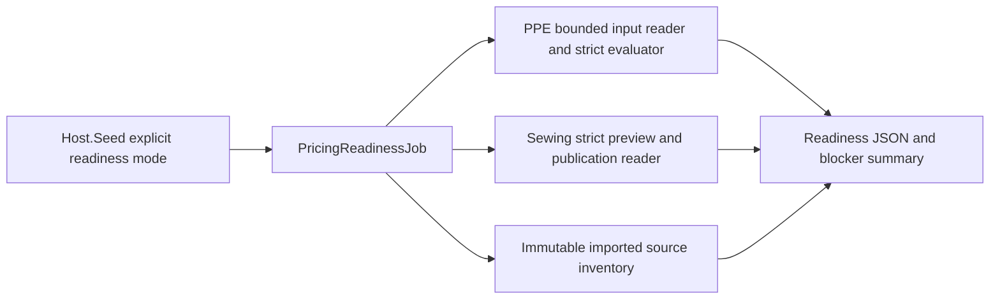

# Catalog: imported pricing readiness

A local operational report inventories every imported source row, evaluates strict current readiness and separates source completeness from existing publication. It calls the current Catalog evaluators/read ports without in-memory approval overrides and has no write capability.



```text
Jobs/SewingPricing/Readiness/
  PricingReadinessJob.cs                 # orchestrates the report
  Reading/
    ImportedPricingReadinessReader.cs   # local guard, immutable source/provenance
    ImportedPricingReadinessData.cs     # internal inventory snapshot
    PpeReadinessReader.cs                # strict current PPE state in <=100-item batches
    SewingReadinessReader.cs             # shared Catalog/Reference snapshot and publication IDs
  Reporting/
    PricingReadinessItem.cs              # one item and advisory next action
    PricingReadinessBlocker.cs           # named strict blocker/input
    PricingReadinessReport.cs            # aggregate counts, no activation authority
    PricingReadinessSourceCheck.cs       # missing/invalid source output cells
Host.Seed/Jobs/Pricing/
  PricingReadinessCommandRunner.cs       # configuration and JSON output only
```

No migration, HTTP API, frontend change or runtime-to-job dependency is introduced. Every production type owns one file; reader/evaluation behavior remains with existing Catalog/Reference owners. [Specification](../../specs/catalog/003-sheet-pricing-parity/activation/README.md) · [Operations](../../operations/data/pricing-readiness.md) · [Evidence](../../specs/catalog/003-sheet-pricing-parity/activation/evidence.md).
