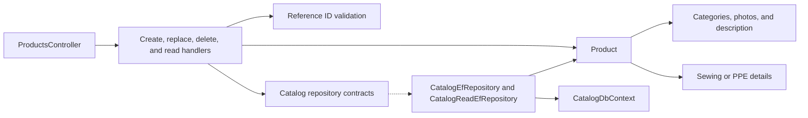

# Catalog Products

**Static code review:** 2026-10-16. **Module:** catalog.

Create, read, full replacement, and deletion of Sewing and PPE products.

The «Товари» page ([CAT-006](../../specs/catalog/006-products-page/README.md)) lists products per type with their working fields kept in the product catalog profile: code (model ID or PPE site article), section from Reference «Типи і розділи», season, active, the director's check and date, the link to the current public site (quotes take photos from it, temporary) and the short description for a quote. Site texts, SEO and photos stay in the database for the planned [Content module](../../specs/content/001-site-content/README.md).

The pages «Новий ЗІЗ» and «Нова модель» ([CAT-009](../../specs/catalog/009-product-create-pages/README.md)) create a product through `POST /api/v1/products/overview`: the server picks the ID (largest + 1), the slug and the next MOD-XXX for an empty sewing code; a PPE product also gets its supplier fields and first offer version (source «Створення ЗІЗ»). `GET /api/v1/products/overview/code-check` checks a code before saving. The legacy `POST /api/v1/products` stays until the Content module and is not used by these pages.

The [Sewing Article/composition extension](sewing-composition.md) adds multiple sale SKUs, shared and Article-specific material inputs, and shared operation norms through separate protected operations. Legacy replacement preserves these children and rejects a second editable norm set once new composition is configured.

## Structure and Relationships

[ProductsController](../../../../src/Modules/Catalog/Catalog.Api/Catalog.Api/Controllers/ProductsController.cs) invokes the [create handler](../../../../src/Modules/Catalog/Catalog.Application/Catalog.Application/Features/Product/Create/CreateProductCommandHandler.cs) and the replace/delete/read handlers. [Product](../../../../src/Modules/Catalog/Catalog.Domain/Catalog.Domain/Products/Entities/Product.cs) owns categories, photos, description, and either [Sewing](../../../../src/Modules/Catalog/Catalog.Domain/Catalog.Domain/Products/Entities/Sewing/SewingProductDetails.cs) or [PPE](../../../../src/Modules/Catalog/Catalog.Domain/Catalog.Domain/Products/Entities/Ppe/PpeProductDetails.cs) details. The handler validates IDs in Reference through the read boundary, and [CatalogDbContext](../../../../src/Modules/Catalog/Catalog.Infrastructure/Catalog.Infrastructure/DataBase/CatalogDbContext.cs) persists the aggregate.

## Code Structure

Verified entry points and key feature components are shown; the tree does not list every supporting file.

```text
src/
└── Modules/Catalog/
    ├── Catalog.Api/Catalog.Api/Controllers/ProductsController.cs  # HTTP entry point
    ├── Catalog.Api/Catalog.Api/Controllers/ProductOverviewController.cs  # «Товари» page API
    ├── Catalog.Application/Catalog.Application/Features/Product/
    │   ├── Create/CreateProductCommandHandler.cs  # use case handler
    │   ├── Delete/DeleteProductCommandHandler.cs  # use case handler
    │   ├── GetAdminDetail/GetAdminProductDetailQueryHandler.cs  # use case handler
    │   ├── GetAdminList/GetAdminProductsQueryHandler.cs  # use case handler
    │   ├── Overview/CodeCheck/GetProductCodeCheckQueryHandler.cs  # free code and next MOD-XXX
    │   ├── Overview/Create/CreateCatalogProductCommandHandler.cs  # «Новий ЗІЗ» / «Нова модель»
    │   ├── Overview/GetList/GetProductOverviewQueryHandler.cs  # «Товари» page list
    │   ├── Overview/Shared/SewingModelCodes.cs  # next MOD-XXX
    │   ├── Overview/Update/UpdateProductOverviewCommandHandler.cs  # «Товари» page fields
    │   └── Update/ReplaceProductCommandHandler.cs  # use case handler
    ├── Catalog.Domain/Catalog.Domain/Products/Entities/
    │   ├── Ppe/PpeProductDetails.cs  # domain model
    │   ├── Product.cs  # domain model
    │   ├── Product.Overview.cs  # code and «Товари» page fields
    │   ├── ProductCatalogProfile.cs  # sheet row fields, section ID
    │   └── Sewing/SewingProductDetails.cs  # domain model
    └── Catalog.Infrastructure/Catalog.Infrastructure/DataBase/CatalogDbContext.cs  # data context
```

## Structure Diagram



## Tests

- `tests/UnitTests/Product*Tests.cs` (incl. `ProductOverviewTests.cs`), `tests/UnitTests/CatalogProductCreation*Tests.cs`, `tests/UnitTests/GetProductListRequestMapperTests.cs`, `tests/UnitTests/UnitTest1.cs` (ProductDomainTests)
- `tests/IntegrationTests/ProductsApiTests.cs`, `tests/IntegrationTests/ProductDeletionTests.cs`, `tests/IntegrationTests/CatalogProductPersistenceTests.cs`, `tests/IntegrationTests/GetAdminProductsSpecTests.cs`

Focused run: `dotnet test tests/UnitTests/UnitTests.csproj --filter Product` (covers `CatalogProductCreation`); `dotnet test tests/IntegrationTests/IntegrationTests.csproj --filter Product` (slow; needs `BREVIERP_CATALOG_TEST_CONNECTION`).

**Data:** [catalog schema](../../architecture/data-model/catalog.md)

## Related Sources

[OpenAPI](../../contracts/catalog/product-catalog.openapi.yaml) · [Overview OpenAPI](../../contracts/catalog/product-overview.openapi.yaml) · [Current SDD](../../specs/catalog/001-product-page/README.md).
