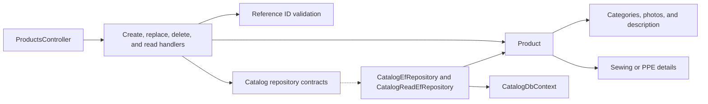

# Catalog Products

**Static code review:** 2026-10-16. **Module:** catalog.

Create, read, full replacement, and deletion of Sewing and PPE products.

The [Sewing Article/composition extension](sewing-composition.md) adds multiple sale SKUs, shared and Article-specific material inputs, and shared operation norms through separate protected operations. Legacy replacement preserves these children and rejects a second editable norm set once new composition is configured.

## Structure and Relationships

[ProductsController](../../../../src/Modules/Catalog/Catalog.Api/Catalog.Api/Controllers/ProductsController.cs) invokes the [create handler](../../../../src/Modules/Catalog/Catalog.Application/Catalog.Application/Features/Product/Create/CreateProductCommandHandler.cs) and the replace/delete/read handlers. [Product](../../../../src/Modules/Catalog/Catalog.Domain/Catalog.Domain/Products/Entities/Product.cs) owns categories, photos, description, and either [Sewing](../../../../src/Modules/Catalog/Catalog.Domain/Catalog.Domain/Products/Entities/Sewing/SewingProductDetails.cs) or [PPE](../../../../src/Modules/Catalog/Catalog.Domain/Catalog.Domain/Products/Entities/Ppe/PpeProductDetails.cs) details. The handler validates IDs in Reference through the read boundary, and [CatalogDbContext](../../../../src/Modules/Catalog/Catalog.Infrastructure/Catalog.Infrastructure/DataBase/CatalogDbContext.cs) persists the aggregate.

## Code Structure

Verified entry points and key feature components are shown; the tree does not list every supporting file.

```text
src/
└── Modules/Catalog/
    ├── Catalog.Api/Catalog.Api/Controllers/ProductsController.cs  # HTTP entry point
    ├── Catalog.Application/Catalog.Application/Features/Product/
    │   ├── Create/CreateProductCommandHandler.cs  # use case handler
    │   ├── Delete/DeleteProductCommandHandler.cs  # use case handler
    │   ├── GetAdminDetail/GetAdminProductDetailQueryHandler.cs  # use case handler
    │   ├── GetAdminList/GetAdminProductsQueryHandler.cs  # use case handler
    │   └── Update/ReplaceProductCommandHandler.cs  # use case handler
    ├── Catalog.Domain/Catalog.Domain/Products/Entities/
    │   ├── Ppe/PpeProductDetails.cs  # domain model
    │   ├── Product.cs  # domain model
    │   └── Sewing/SewingProductDetails.cs  # domain model
    └── Catalog.Infrastructure/Catalog.Infrastructure/DataBase/CatalogDbContext.cs  # data context
```

## Structure Diagram



## Tests

- `tests/UnitTests/Product*Tests.cs`, `tests/UnitTests/GetProductListRequestMapperTests.cs`, `tests/UnitTests/UnitTest1.cs` (ProductDomainTests)
- `tests/IntegrationTests/ProductsApiTests.cs`, `tests/IntegrationTests/ProductDeletionTests.cs`, `tests/IntegrationTests/CatalogProductPersistenceTests.cs`, `tests/IntegrationTests/GetAdminProductsSpecTests.cs`

Focused run: `dotnet test tests/UnitTests/UnitTests.csproj --filter Product`; `dotnet test tests/IntegrationTests/IntegrationTests.csproj --filter Product` (slow; needs `BREVIERP_CATALOG_TEST_CONNECTION`).

**Data:** [catalog schema](../../architecture/data-model/catalog.md)

## Related Sources

[OpenAPI](../../contracts/catalog/product-catalog.openapi.yaml) · [Current SDD](../../specs/catalog/001-product-page/README.md).
