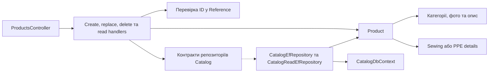

# Товари Catalog

**Статична звірка з кодом:** 2026-10-16. **Модуль:** catalog.

Створення, читання, повна заміна й видалення товарів типів Sewing і PPE.

## Будова й зв'язки

[ProductsController](../../../../src/Modules/Catalog/Catalog.Api/Catalog.Api/Controllers/ProductsController.cs) викликає [create handler](../../../../src/Modules/Catalog/Catalog.Application/Catalog.Application/Features/Product/Create/CreateProductCommandHandler.cs), handlers заміни/видалення і читання. [Product](../../../../src/Modules/Catalog/Catalog.Domain/Catalog.Domain/Products/Entities/Product.cs) володіє категоріями, фото, описом та [Sewing](../../../../src/Modules/Catalog/Catalog.Domain/Catalog.Domain/Products/Entities/Sewing/SewingProductDetails.cs) або [PPE](../../../../src/Modules/Catalog/Catalog.Domain/Catalog.Domain/Products/Entities/Ppe/PpeProductDetails.cs) деталями. Handler перевіряє ID у Reference через межу читання, а [CatalogDbContext](../../../../src/Modules/Catalog/Catalog.Infrastructure/Catalog.Infrastructure/DataBase/CatalogDbContext.cs) зберігає композицію.

## Структура в коді

Наведено перевірені точки входу та ключові складові фічі; дерево не перелічує всі допоміжні файли.

```text
src/
└── Modules/Catalog/
    ├── Catalog.Api/Catalog.Api/Controllers/ProductsController.cs  # HTTP-вхід
    ├── Catalog.Application/Catalog.Application/Features/Product/
    │   ├── Create/CreateProductCommandHandler.cs  # обробник сценарію
    │   ├── Delete/DeleteProductCommandHandler.cs  # обробник сценарію
    │   ├── GetAdminDetail/GetAdminProductDetailQueryHandler.cs  # обробник сценарію
    │   ├── GetAdminList/GetAdminProductsQueryHandler.cs  # обробник сценарію
    │   └── Update/ReplaceProductCommandHandler.cs  # обробник сценарію
    ├── Catalog.Domain/Catalog.Domain/Products/Entities/
    │   ├── Ppe/PpeProductDetails.cs  # доменна модель
    │   ├── Product.cs  # доменна модель
    │   └── Sewing/SewingProductDetails.cs  # доменна модель
    └── Catalog.Infrastructure/Catalog.Infrastructure/DataBase/CatalogDbContext.cs  # контекст даних
```

## Схема будови



## Пов'язані джерела

[OpenAPI](../../contracts/catalog/product-catalog.openapi.yaml) · [Чинна SDD](../../specs/catalog/001-product-page/README.md).
