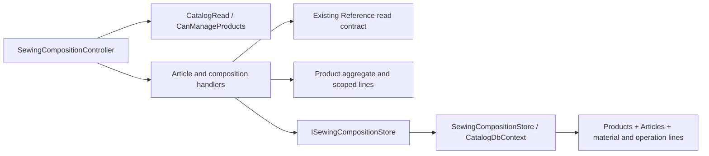

# Sewing Articles and composition

**Implemented code:** 2026-10-25. **Deployment gate:** additive migration has not been verified against PostgreSQL. [SDD and evidence](../../specs/catalog/002-sewing-articles-and-composition/implementation.md).

One Sewing Product owns sale Articles, shared material/operation norms and Article-specific materials. Effective composition combines shared materials with the selected Article's materials. No new price formula is published by these operations.

```text
src/Modules/Catalog/
├── Catalog.Api/Catalog.Api/Controllers/SewingCompositionController.cs  # protected HTTP boundary
├── Catalog.Application/Catalog.Application/Features/Product/Sewing/   # contracts, validation, commands and queries
├── Catalog.Domain/Catalog.Domain/Products/
│   ├── Entities/Product.cs                                          # aggregate and scope rules
│   ├── Entities/Sewing/SewingArticle.cs                              # immutable SKU identity
│   ├── Entities/Sewing/SewingMaterialLine.cs                         # scoped material/review input
│   ├── Entities/Sewing/SewingOperationLine.cs                        # shared operation quantity/manual time
│   └── ValueObjects/                                               # typed child and Reference IDs
└── Catalog.Infrastructure/Catalog.Infrastructure/
    ├── Repositories/SewingCompositionStore.cs                       # projections, tracked writes and conflict mapping
    ├── Congigurations/Sewing*Configuration.cs                       # integrity and typed ID mappings
    └── Migrations/20261024215605_AddSewingComposition.cs              # additive rollout
```



The Product version serializes composition changes across all Articles. Validation occurs before mutation; EF maps stale versions and global uniqueness races to conflicts. Reads use projections and bounded aggregate collections. `CatalogProductUsageReader` includes the new lines so Reference delete guards see their use.

Legacy Product editing preserves these records and rejects changes to legacy norms once the new composition is configured. Existing prices continue to use the previously accepted pricing behavior. OtherCost and unreviewed required inputs produce readiness blockers.

[Canonical API](../../contracts/catalog/sewing-composition.openapi.yaml) · [Product feature](products.md) · [Database map](../../architecture/data-model/catalog.md).
