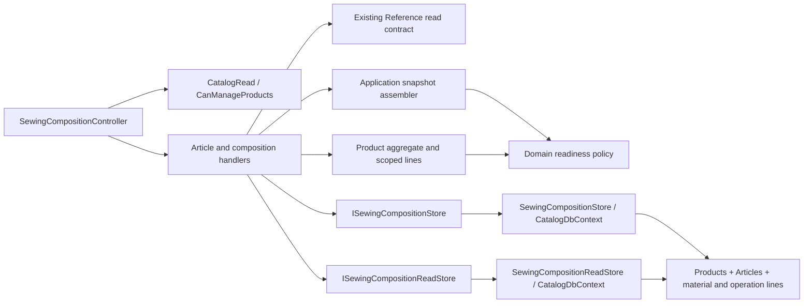

# Sewing Articles and composition

**Implemented code:** 2026-10-25. Local PostgreSQL upgrade, disposable-database import and the [full local catalogue transfer](catalog-import.md) are verified. Shared/production rollout remains separate. [SDD and evidence](../../specs/catalog/002-sewing-articles-and-composition/implementation.md).

One Sewing Product owns sale Articles, shared material/operation norms and Article-specific materials. Effective composition combines shared materials with the selected Article's materials. No new price formula is published by these operations.

```text
src/Modules/Catalog/
├── Catalog.Api/Catalog.Api/Controllers/
│   ├── SewingArticlesController.cs                                # protected Article list/create boundary
│   └── SewingCompositionController.cs                             # protected composition read/replace boundary
├── Catalog.Application/Catalog.Application/
│   ├── Features/Product/Sewing/
│   │   ├── CreateArticle/                                         # create command, request, validator and handler
│   │   ├── ListArticles/                                          # list query, result and handler
│   │   ├── GetComposition/                                        # effective composition query and handler
│   │   ├── ReplaceComposition/                                    # shared norms replacement
│   │   ├── ReplaceArticleComposition/                             # Article material replacement
│   │   └── Shared/{DTOs,Validators,Mapping}/                       # genuinely shared line contracts, validation and assembly
│   └── Contracts/Persistence/Sewing/                              # separate read/write contracts and projection snapshot
├── Catalog.Domain/Catalog.Domain/Products/
│   ├── Entities/Product.cs                                          # aggregate root
│   ├── Entities/Product.SewingIdentity.cs                           # model code and Article identity
│   ├── Entities/Product.SewingComposition.cs                        # aggregate-owned composition writes
│   ├── Entities/Product.SewingReadiness.cs                          # effective materials and readiness delegation
│   ├── Entities/Product.CatalogProfile.cs                           # source profile attachment
│   ├── Entities/Sewing/SewingArticle.cs                              # immutable SKU identity
│   ├── Entities/Sewing/SewingMaterialLine.cs                         # scoped material/review input
│   ├── Entities/Sewing/SewingOperationLine.cs                        # shared operation quantity/manual time
│   ├── Readiness/                                                 # one policy and separate typed material/operation facts
│   └── ValueObjects/                                               # typed child and Reference IDs
└── Catalog.Infrastructure/Catalog.Infrastructure/
    ├── Repositories/SewingCompositionStore.cs                       # tracked writes and conflict mapping
    ├── Repositories/SewingCompositionReadStore.cs                   # no-tracking read projections
    ├── Congigurations/Sewing*Configuration.cs                       # integrity and typed ID mappings
    └── Migrations/20261024215605_AddSewingComposition.cs              # additive rollout
```



The Product version serializes composition changes across all Articles. Validation occurs before mutation; EF maps stale versions and global uniqueness races to conflicts. Reads use projections and bounded aggregate collections. `CatalogProductUsageReader` includes the new lines so Reference delete guards see their use.

Legacy Product editing preserves these records and rejects changes to legacy norms once the new composition is configured. Existing price consumers continue to use the previously accepted behavior until cutover. The composition-only view remains conservative for OtherCost; the new [versioned Article pricing calculation](sewing-pricing.md) validates its Reference-owned cost. Unreviewed required inputs remain blockers in both paths.

[Canonical API](../../contracts/catalog/sewing-composition.openapi.yaml) · [Product feature](products.md) · [Database map](../../architecture/data-model/catalog.md).

[Responsibility audit](../../specs/catalog/002-sewing-articles-and-composition/code-audit/audit.md) · [Structural remediation](../../specs/catalog/004-sewing-composition-structure/README.md). Readiness is assembled from the same projection snapshot as its version and lines, without a second tracked Product load. Both replacement responses use the same Domain policy as GET, so required-review blockers remain visible after a successful save.
