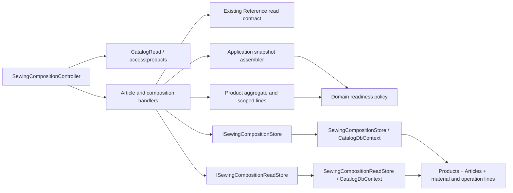

# Sewing Articles and composition

**Implemented code:** 2026-10-25. Local PostgreSQL upgrade, disposable-database import and the [full local catalogue transfer](catalog-import.md) are verified. Shared/production rollout remains separate. [SDD and evidence](../../specs/catalog/002-sewing-articles-and-composition/implementation.md).

One Sewing Product owns its fabric variants (Articles) and shared material/operation norms. Each variant is a sale SKU with its one fabric and metres per product ([CAT-015](../../specs/catalog/015-fabric-variants/README.md)); everything else is shared by the model. Every line keeps an optional comment ([CAT-007](../../specs/catalog/007-sewing-product-card/README.md)). Effective composition combines the shared materials with the variant's fabric.

## Code structure

```text
src/Modules/Catalog/
├── Catalog.Api/Catalog.Api/Controllers/
│   ├── SewingArticlesController.cs                                # protected variant list/create/update/delete boundary
│   └── SewingCompositionController.cs                             # protected composition read/replace boundary
├── Catalog.Application/Catalog.Application/
│   ├── Features/Product/Sewing/
│   │   ├── CreateArticle/                                         # variant with its fabric in one transaction
│   │   ├── UpdateArticle/                                         # variant SKU, activity and fabric
│   │   ├── DeleteArticle/                                         # variant without price history
│   │   ├── ListArticles/                                          # list query, result and handler
│   │   ├── GetComposition/                                        # effective composition query and handler
│   │   ├── ReplaceComposition/                                    # shared norms replacement
│   │   └── Shared/{DTOs,Validators,Mapping}/                       # genuinely shared line contracts, validation and assembly
│   └── Contracts/Persistence/Sewing/                              # separate read/write contracts and projection snapshot
├── Catalog.Domain/Catalog.Domain/Products/
│   ├── Entities/Product.cs                                          # aggregate root
│   ├── Entities/Product.SewingIdentity.cs                           # model code and Article identity
│   ├── Entities/Product.SewingComposition.cs                        # aggregate-owned composition writes
│   ├── Entities/Product.SewingReadiness.cs                          # effective materials and readiness delegation
│   ├── Entities/Product.CatalogProfile.cs                           # source profile attachment
│   ├── Entities/Sewing/SewingArticle.cs                              # fabric variant: sale SKU, activity, order
│   ├── Entities/Sewing/SewingMaterialLine.cs                         # shared material or the variant's fabric
│   ├── Entities/Sewing/SewingOperationLine.cs                        # shared operation quantity/manual time
│   ├── Readiness/                                                 # one policy and separate typed material/operation facts
│   └── ValueObjects/                                               # typed child and Reference IDs
└── Catalog.Infrastructure/Catalog.Infrastructure/
    ├── Repositories/SewingCompositionStore.cs                       # tracked writes and conflict mapping
    ├── Repositories/SewingCompositionReadStore.cs                   # no-tracking read projections
    ├── Congigurations/Sewing*Configuration.cs                       # integrity and typed ID mappings
    └── Migrations/20261024215605_AddSewingComposition.cs              # additive rollout
```

## Structure diagram



## Rules and boundaries

The Product version serializes composition changes across all Articles. Validation occurs before mutation; EF maps stale versions and global uniqueness races to conflicts. Reads use projections and bounded aggregate collections. `CatalogProductUsageReader` includes the new lines so Reference delete guards see their use.

Legacy Product editing preserves these records and rejects changes to legacy norms once the new composition is configured. Existing price consumers continue to use the previously accepted behavior until cutover. The composition-only view remains conservative for OtherCost; the new [versioned Article pricing calculation](sewing-pricing.md) validates its Reference-owned cost. A variant has only its one fabric line; other materials are shared.

## Related sources

[Canonical API](../../contracts/catalog/sewing-composition.openapi.yaml) · [Product feature](products.md) · [Database map](../../architecture/data-model/catalog.md).

[Responsibility audit](../../specs/catalog/002-sewing-articles-and-composition/code-audit/audit.md) · [Structural remediation](../../specs/catalog/004-sewing-composition-structure/README.md). Readiness is assembled from the same projection snapshot as its version and lines, without a second tracked Product load. The replacement response uses the same Domain policy as GET.

## Tests

- `tests/UnitTests/SewingArticleTests.cs`, `tests/UnitTests/SewingComposition*Tests.cs`
- `tests/IntegrationTests/SewingComposition*Tests.cs`, `tests/IntegrationTests/SewingVariantPersistenceTests.cs`

Focused run: `dotnet test tests/UnitTests/UnitTests.csproj --filter SewingComposition`; `dotnet test tests/IntegrationTests/IntegrationTests.csproj --filter SewingComposition` (slow; needs `BREVIERP_CATALOG_TEST_CONNECTION`).

**Data:** [catalog schema](../../architecture/data-model/catalog.md)
