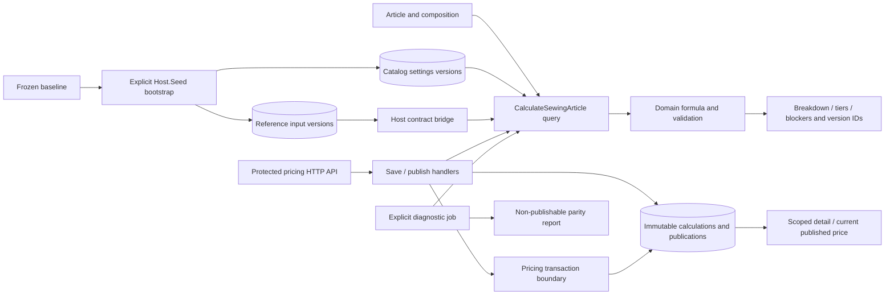

# Sewing Article pricing, saved calculations and publication

Implemented sewing engine and backend publication stages of [Pricing SDD 003](../../specs/catalog/003-sheet-pricing-parity/README.md). See the [initial engine design](../../specs/catalog/003-sheet-pricing-parity/sewing-implementation.md), [publication design](../../specs/catalog/003-sheet-pricing-parity/publication-implementation.md), [API contract](../../contracts/catalog/sewing-pricing.openapi.yaml) and [publication evidence](../../specs/catalog/003-sheet-pricing-parity/publication-evidence.md). The React Admin TS-005 consumer is implemented and verified; it reads published prices through the bounded Product projection while legacy Product response fields remain compatible.

## Current behavior

The pure engine computes applicable material/OtherCost amounts, weighted operation minutes, salary, multiplicative cutting/master/manager/bonus, overhead and three rounded prices for 1–9, 10–40 and 41+. It returns named blockers instead of a zero price. Standard time may be absent when an explicit positive manual time exists.

Catalog settings and Reference costs/norms are immutable effective versions. Calculation identifies settings and Reference version IDs plus Product composition version and is strict about activity, approval, units and composition review. Protected HTTP operations save full immutable snapshots, read them, publish current successful calculations and read the latest published tiers. Blocked and stale calculations cannot publish. Repeated requests retain their original calculation/publication; republishing an old result does not replace the current publication.

Complete settings revisions and OtherCost revisions use expected-current-version IDs and request UUIDs. Numeric edits to previously versioned fabrics, accessories and operation norms append approved input revisions atomically. Existing Reference reads remain anonymous; those writes require CanManageProducts. See [Reference version ownership](../reference/pricing-input-versions.md).

## Code structure

```text
src/Modules/Catalog/
  Catalog.Domain/Catalog.Domain/Pricing/Sewing/
    Calculation/                                  # pure formula and input validation
    Inputs/                                       # material/operation calculation facts
    Results/                                      # breakdown, tiers and named blockers
    Settings/                                     # parameter value, version/ID and settings validation
  Catalog.Application/Catalog.Application/
    Contracts/Pricing/{SewingComposition,SewingSettings,ReferenceInputs,SewingCalculation}/
    Contracts/Pricing/History/{Calculations,Publications,Transactions}/ # focused storage/transaction boundaries
    Features/Pricing/Sewing/
      Evaluation/                                 # shared evaluator and input resolution
      Preview/                                    # internal calculation query and handler
      Calculations/{Save,Get}/                     # immutable saved-calculation scenarios
      Publications/{Publish,GetCurrent}/           # publication / current published-price scenarios
      Publications/GetProducts/                   # bounded Product-page published-price projection
      Settings/{CreateVersion,GetCurrent}/         # complete settings revision / current read
  Catalog.Infrastructure/Catalog.Infrastructure/Pricing/
    SewingSettings/{Configuration,Reading,Writing}/ # settings versions and expected-version writes
    SewingComposition/Reading/                     # calculation input projection
    History/Calculations/                          # calculation storage and snapshot serialization; Records/Configuration
    History/Publications/                          # publication storage; Records/Configuration
    History/Publications/Reading/                  # two-query Product projection; JSON tier extraction only
    History/Transactions/                          # advisory/Product locks and commit; shared scoped DbContext
  Catalog.Api/Catalog.Api/
    Controllers/Pricing/Sewing/                     # Article pricing and settings HTTP controllers
    Contracts/Pricing/Sewing/{Calculations,Settings}/ # complete settings and calculation request UUID
src/Modules/Reference/
  Reference.Domain/Reference.Domain/Pricing/InputVersions/ # immutable typed versions and units
  Reference.Application/Reference.Application/Contracts/Pricing/{InputVersions,Usage}/
  Reference.Infrastructure/Reference.Infrastructure/Pricing/
    InputVersions/{Configuration,Reading,Changes}/  # effective reads; tracked changes and atomic revision append
    OtherCosts/Writing/                            # explicit service-cost revision adapter
    Usage/                                        # retained-history use checks
src/Bootstrapper/Host.Api/DependencyInjection/ServiceRegistration/
  CatalogPricingReferenceReader.cs                 # Reference reads enlist in Catalog pricing transaction
src/Jobs/SewingPricing/
  Bootstrap/{Source,Inputs,Reconciliation}/         # source mapping, input baseline and immutable-version comparison
  Reading/                                        # seed-job cross-module bridge
  Verification/{Diagnostics,Comparison}/            # per-Article data and pure parity comparison; coordinator owns transaction
```

The [job navigation guide](../../../../src/Jobs/SewingPricing/README.md), [publication structure audit](../../specs/catalog/003-sheet-pricing-parity/structure/audit.md) and [verification](../../specs/catalog/003-sheet-pricing-parity/structure/verification.md) record the current boundaries. CLR namespaces of persisted Domain and Infrastructure record types remain unchanged. Calculations, publications and transaction adapters share one scoped CatalogDbContext; their separation does not split the atomic write boundary.

## Relationships



Reference input versions use restrictive same-module FKs so history cannot become orphaned. The host's existing usage bridge includes pricing history, preserving a controlled conflict for attempted Reference deletion.

The existing composition-only readiness view remains conservative for OtherCost and directs callers to the versioned Article pricing check. Imported composition review is never automatically granted. All sanctioned pricing writes share a transaction advisory lock; save/publish also lock the Product row. Reference reads use the same transaction, so publication cannot observe partly committed input changes. React Admin consumes the published-price projection. PPE pricing and future Storefront API adoption remain separate stages.


## Current consumer revision

[TS-007 cutover](../../specs/catalog/003-sheet-pricing-parity/cutover/README.md) supersedes earlier legacy Product price fallback descriptions. Current Admin prices use versioned PPE calculations or published Sewing Article prices. Deprecated Product metadata amounts are placeholders, not sale prices.

## Tests

- `tests/UnitTests/SewingArticlePricingTests.cs`, `tests/UnitTests/SewingPricingContractTests.cs`, `tests/UnitTests/PublishedSewingProductsQueryTests.cs`
- `tests/IntegrationTests/Pricing/Sewing/`, `tests/IntegrationTests/SewingArticlePricingPersistenceTests.cs`

Focused run: `dotnet test tests/UnitTests/UnitTests.csproj --filter SewingPricing`; `dotnet test tests/IntegrationTests/IntegrationTests.csproj --filter SewingPricing` (slow; needs `BREVIERP_CATALOG_TEST_CONNECTION`).

**Data:** [catalog schema](../../architecture/data-model/catalog.md)
