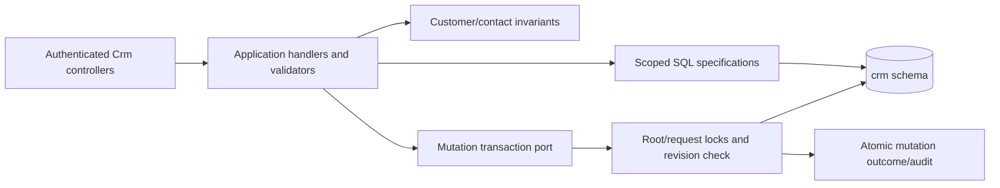

# CRM clients and contacts

**Implemented slice:** customer/contact foundation, 2026-10-26. Quote/custom/document functionality remains planned in [CRM-001](../../specs/crm/001-clients-quotes-custom-sewing/README.md). This card does not claim CRM history import or production rollout.

Authenticated Admin/Manager can create, read, search/page, revise and deactivate customers and contacts. Admin-only merge retains victim roots/audit while moving contacts/external identities to the survivor. Exact external identities are unique; similar names/shared emails never auto-merge. Manager reads/writes owned clients; quote-derived sharing will be added with quote ownership (there are no quotes yet). Every mutation has requestId replay and a root revision; successful intent/result audit is stored in the same transaction. No destructive customer/contact delete API.

## Code structure

```text
src/Modules/Crm/
  Crm.Domain/Crm.Domain/Customers/
    Customer.cs                       root invariants/revision/merge
    Identifiers/                      typed long keys and int actor reference
    Contacts/                         contact and channel validation
    ExternalIdentities/               exact source identity
  Crm.Application/Crm.Application/Customers/
    Models/                           individual DTO/intent/actor types
    Persistence/                      transaction session and read ports
    GetCustomer/Specifications/       scoped SQL detail projection
    GetCustomers/Specifications/      SQL page/count/search projections
    CreateCustomer/                   command, handler, validator
    ReviseCustomer/                   command, handler, validator
    SaveCustomerContact/              create/revise contact use case
    MergeCustomers/                   Admin merge orchestration
  Crm.Infrastructure/Crm.Infrastructure/
    Persistence/                      EF context, config per entity, migration,
                                      row locks, idempotency and audit transaction
    DependencyInjection/              existing host/seed registration
  Crm.Api/Crm.Api/Customers/
    CustomersController.cs            client reads/writes/merge
    CustomerContactsController.cs     contact writes
    CrmActorClaims.cs                 authenticated numeric actor
    Requests/                         one request type per file
```



[Actual API contract](../../contracts/crm/clients-quotes.openapi.yaml), [database ownership](../../architecture/data-model/crm.md), [local migration job](../../operations/data/crm-clients.md). Host.Api registers the Crm Mediator assembly and infrastructure; Host.Seed registers Crm migration in normal deployment flow and an explicit CRM-only local mode. Existing Catalog/Reference/Identity remain separate owners.
