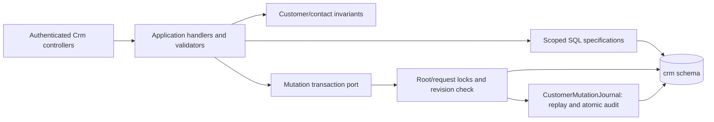
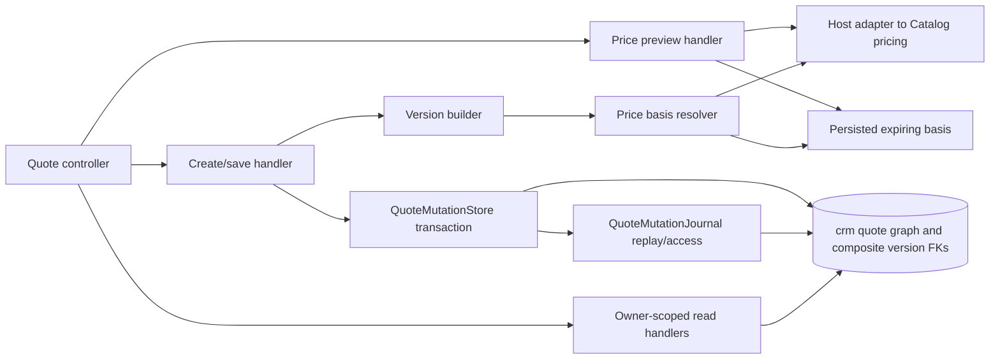
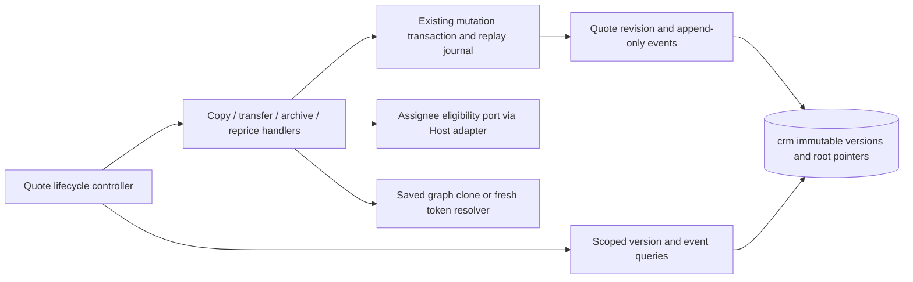
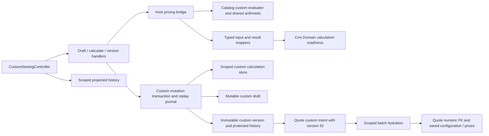

# CRM clients, contacts and draft quotes

**Implemented local slices:** clients, P2/P3 quotes, TS-006 private custom drafts/calculations/versions/quote hydration, EN-003 private-byte/render adapter proof and TS-008 configuration templates/model suggestions. Automatically verified 2026-10-28. File lifecycle, custom frontend, document issuance and import remain separate planned work; no production rollout is claimed.

Authenticated Admin/Manager can create, read, search/page, revise and deactivate customers and contacts. Admin-only merge retains victim roots/audit while moving contacts/external identities to the survivor. Exact external identities are unique; similar names/shared emails never auto-merge. Manager reads/writes owned clients; draft quotes are owner-scoped. Every mutation has requestId replay and a root revision; successful intent/result audit is stored in the same transaction. No destructive customer/contact delete API.

## Code structure

```text
src/Modules/Crm/
  Crm.Domain/Crm.Domain/Customers/
    Customer.cs                       root invariants/revision/merge
    Identifiers/                      typed long keys and int actor reference
    Contacts/                         contact and channel validation
    ExternalIdentities/               exact source identity
  Crm.Application/Crm.Application/Customers/
    Access/                           authenticated actor reference
    Contracts/Inputs/                 shared customer/source intent types
    Contracts/Responses/              pure detail/contact/source response records
    Mapping/                          domain-to-detail mapping
    GetCustomers/DTOs/                page summary projection
    SaveCustomerContact/Inputs/       contact/channel intent types
    Persistence/                      transaction session and read ports
    GetCustomer/Specifications/       scoped SQL detail projection
    GetCustomers/Specifications/      SQL page/count/search projections
    CreateCustomer/                   command, handler, validator
    ReviseCustomer/                   command, handler, validator
    SaveCustomerContact/              create/revise contact use case
    MergeCustomers/                   Admin merge orchestration
  Crm.Infrastructure/Crm.Infrastructure/
    Persistence/                      EF context, entity configurations/migrations
    Persistence/Customers/Reading/     scoped read repository
    Persistence/Customers/Writing/     transaction coordinator and root locks
    Persistence/Customers/Idempotency/ payload encoding, replay/access and journal
    DependencyInjection/              existing host/seed registration
  Crm.Api/Crm.Api/Customers/
    CustomersController.cs            client reads/writes/merge
    CustomerContactsController.cs     contact writes
    Requests/                         one request type per file
  Crm.Api/Crm.Api/Access/
    CrmActorClaims.cs                 actor binding shared by CRM controllers
```



[Actual API contract](../../contracts/crm/clients-quotes.openapi.yaml), [database ownership](../../architecture/data-model/crm.md), [local migration job](../../operations/data/crm-clients.md). Host.Api registers the Crm Mediator assembly and infrastructure; Host.Seed registers Crm migration in normal deployment flow and an explicit CRM-only local mode. Existing Catalog/Reference/Identity remain separate owners.

[Structural audit and verification](../../specs/crm/001-clients-quotes-custom-sewing/code-audit/audit.md). The transaction coordinator retains commit/rollback ownership; the journal uses the same context and transaction. Customer aggregate invariants remain together; mapped entity/context namespaces and the HTTP/JSON contract are unchanged.

## Draft quote structure

```text
Crm.Domain/Crm.Domain/Quotes/
  Quote.cs, Versions/, Items/, Variants/, Pricing/, Identifiers/
Crm.Application/Crm.Application/Quotes/
  CreateQuote/, SaveQuoteVersion/, GetQuote/, GetQuotes/
  PreviewQuotePrices/Specifications/  preview-specific access query
  Pricing/QuotePriceBasisResolver.cs  token, input, expiry and source checks
  Mapping/QuoteVersionBuilder.cs      ordered graph construction
  Contracts/Inputs/, Contracts/Responses/, Persistence/
Crm.Infrastructure/Crm.Infrastructure/Persistence/
  Quotes/Reading/, Writing/, Pricing/
  Quotes/Idempotency/                 hash, replay/access and atomic journal
  Configurations/Quotes/             seven quote-specific EF mappings
Crm.Api/Crm.Api/Quotes/               HTTP binding and separate request records
Host.Api/Crm/QuoteCatalogPriceReader.cs
tests/IntegrationTests/Crm/Quotes/    API, adapter, persistence, access, integrity
```



Drafts preserve saved monetary snapshots across reads and text edits. Fresh pricing tokens are actor/quote/input-bound; source drift conflicts. See the [quote contract](../../contracts/crm/quote-drafts.openapi.yaml), [P2 audit](../../specs/crm/001-clients-quotes-custom-sewing/code-audit/p2-implementation-audit-2026-10-26.md) and [verification evidence](../../specs/crm/001-clients-quotes-custom-sewing/evidence/p2-quote-backend-2026-10-26.md).

## P3 lifecycle implementation

```text
Crm.Domain/Crm.Domain/Quotes/
  Quote.cs, Events/QuoteLifecycleEvent.cs    revision, ownership/archive, issued pointer and audit
Crm.Application/Crm.Application/Quotes/
  GetQuoteVersions/, GetQuoteVersion/, GetQuoteEvents/    scoped paged typed history
  RepriceQuote/                              confirmation of all current preview tokens
  RepriceQuote/Mapping/QuoteRepriceSnapshot.cs saved graph conversion, separate from orchestration
  GetQuoteVersions/Specifications/, GetQuoteEvents/Specifications/ scenario-owned access checks
  CopyQuote/, TransferQuote/, ArchiveQuote/   independent command/handler per action
  Mapping/QuoteSnapshotCloner.cs              deep copy of saved graph without pricing
  Ownership/IQuoteAssigneeReader.cs           eligibility port
Crm.Infrastructure/Crm.Infrastructure/Persistence/
  Quotes/Reading/QuoteReadRepository.History.cs          SQL history projections
  Configurations/Quotes/QuoteLifecycleEventConfiguration.cs
  Migrations/*AddQuoteLifecycle*, *PreserveIssuedQuoteVersion*
Crm.Api/Crm.Api/Quotes/QuoteLifecycleController.cs
Crm.Api/Crm.Api/Quotes/QuoteAssigneesController.cs separate eligible-user lookup HTTP boundary
Host.Api/Crm/QuoteAssigneeReader.cs            Identity eligibility adapter
```



Reprice confirms an unchanged current graph using all fresh scoped variant tokens. Copy selects any authorized saved version, records its provenance and preserves prices without a Catalog call. Transfer atomically changes current access; former Managers cannot read history or replay prior mutations after losing scope. Archive/restore preserve business state and versions. Ready/sent edits create a draft and retain the issued-version pointer; actual ready/send operations and human numbering remain later phases. [TS-005 evidence](../../specs/crm/001-clients-quotes-custom-sewing/evidence/ts-005-2026-10-28.md). Frontend lifecycle integration is pending.

## Private custom sewing

Existing Admin/Manager authentication protects every custom operation. Structured draft input stores name/type/season, public/private text, approved application sale intent and component selections/norms. Explicit server calculation records approved source versions and a scoped expiring basis token; confirmation freezes a new immutable version. Quote selection uses the saved version ID and never posted costs. History/copy/text edits preserve the old configuration and prices. [Protocol](../../specs/crm/001-clients-quotes-custom-sewing/design/custom-sewing-protocol.md).

```text
Crm.Domain/Crm.Domain/CustomSewing/
  Composition/, Drafts/, Versions/, Identifiers/, Pricing/  bounded configuration and immutable source basis
Crm.Application/Crm.Application/CustomSewing/
  CreateDraft/, SaveDraft/, Calculate/, SaveVersion/        independent commands, handlers, validators
  GetDraft/, GetVersion/, GetVersions/                     scenario-local SQL projections and paging
  ResolveQuoteVersions/Specifications/                    quote-selected private version scope
  Mapping/CustomDetailProjection.cs                       pure shared response projection
  Access/, Contracts/, Persistence/, Pricing/              policies, views and ports
Crm.Infrastructure/Crm.Infrastructure/Persistence/
  CustomSewing/{Reading,Writing,Pricing,Idempotency}/        SQL, locking, basis storage and replay journal
  Configurations/CustomSewing/                             typed JSONB converters and constraints
  Migrations/*AddCustomSewingVersions*, *EnforceCustomSewingHistory*
Crm.Api/Crm.Api/CustomSewing/                               strict request binding and scoped controller
Host.Api/Crm/CustomSewing/
  Pricing/CustomSewingPricing.cs                           Catalog evaluator coordinator
  Mapping/{CustomPricingInputMapper,CustomPriceBasisMapper}.cs  typed input/result translation
Crm.Domain/Crm.Domain/CustomSewing/Pricing/CustomCalculationReadiness.cs  eligibility and tier bounds
Crm.Infrastructure/Crm.Infrastructure/Persistence/CustomSewing/Pricing/CustomCalculationStore.cs  scoped token persistence
Crm.Application/Crm.Application/Quotes/                    custom preview and server-side snapshot hydration
```



Additional focused tests: `tests/UnitTests/Crm/CustomSewing/CustomSewingDraftTests.cs`, `CustomSewingContractTests.cs`, `tests/UnitTests/Crm/Quotes/QuoteTierProjectionTests.cs`; `tests/IntegrationTests/Crm/CustomSewing/{CustomSewingPersistenceTests,CustomSewingApiTests,CustomSewingPricingBridgeTests}.cs`. Run `dotnet test tests/IntegrationTests/IntegrationTests.csproj --filter FullyQualifiedName~CustomSewing` with the isolated local CRM test connection. Existing quote draft/lifecycle/access/migration regressions are also covered. [Dated verification](../../specs/crm/001-clients-quotes-custom-sewing/evidence/ts-006-2026-10-28.md).

[TS-006 functional audit and decomposition](../../specs/crm/001-clients-quotes-custom-sewing/evidence/ts-006-audit-refactor-2026-10-28.md): confirmation rechecks expiry after source validation, Host mapping/orchestration is split, eligibility belongs to Domain and calculation-token persistence has its own store. Current audit verification: 36 unit, 17 integration/API and 2 architecture tests passed.

## Configuration templates, suggestions and private adapter readiness

TS-008 implements scoped versioned customConfiguration templates with introduction/selections/norms, archive/restore and exact request replay. Apply creates a new private draft with retained TemplateOrigin and no implicit pricing. Source-style suggestions use approved unique models, six exact garment groups, sample coverage and varying norms; four bounded Catalog SQL reads plus one reference resolution avoid per-article queries. No supplier costs or private notes enter the reusable/public projection. [Contract](../../contracts/crm/custom-templates.openapi.yaml), [evidence](../../specs/crm/001-clients-quotes-custom-sewing/evidence/ts-008-2026-10-28.md).

Code structure: Domain CustomSewing/Templates and Drafts/CustomTemplateOrigin; Application CustomSewing/{CreateTemplate,ReviseTemplate,ArchiveTemplate,GetTemplate,GetTemplates,ApplyTemplate,GetSuggestions}, with suggestion DTOs in GetSuggestions/Contracts; Infrastructure Persistence/Templates/{Reading,Writing,Idempotency} and Configurations/Templates; API Templates/{controllers,Requests}; Catalog Contracts/Suggestions and Infrastructure/Suggestions; Host.Api/Crm/CustomSewing/Suggestions with pure translation in Mapping/SewingSuggestionInputMapper.cs. Shared DI wires these capabilities. AddCustomSewingTemplates adds three tables and nullable draft origin; immutable template history rejects updates/deletes.

EN-003 separates Application Abstractions/{Files,Documents} and Files/{Access,Validation} from Infrastructure Files/Storage and Documents/Rendering. Real private bytes, allowlist/limits/hash/ACL and a six-page Ukrainian PDF are proven; registration is opt-in until dependent workflows supply authoritative access and issuance. [Configuration/runtime/retention design](../../specs/crm/001-clients-quotes-custom-sewing/design/private-adapters.md). Existing public Catalog storage is unchanged.

Focused tests: CustomTemplateRulesTests, SewingSuggestionRulesTests, PrivateFilePolicyTests; CustomTemplatePersistenceTests, CustomTemplateApiTests, TemplateQueryTranslationTests, SewingSuggestionBridgeTests, SewingSuggestionBatchBoundaryTests, PrivateFileStoreTests and ChromiumDocumentRendererTests. [Latest wave evidence](../../specs/crm/001-clients-quotes-custom-sewing/evidence/p4-wave1-2026-10-28.md): 58 unit, 40 integration/API/adapter and 2 architecture checks passed, with explicit runtime/database configuration. Remaining P4 implementation: TS-007, FE-006, FE-007.

[Follow-up functional/structure audit](../../specs/crm/001-clients-quotes-custom-sewing/evidence/p4-wave1-audit-refactor-2026-10-28.md): 40 focused checks passed after mapping/journal separation and DTO grouping. Renderer admission now also bounds font/HTML preparation; cancelled queued calls do not prepare content. No schema/API change.
