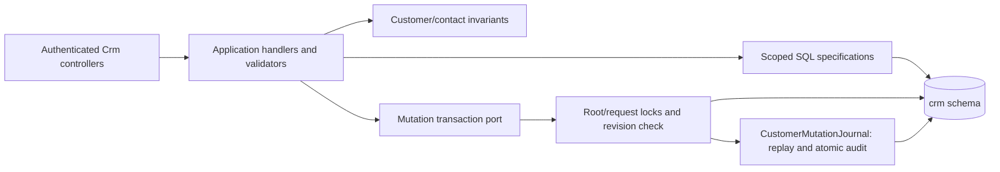

# «Менеджер сервісу»: clients and КП

**Implemented:** customer/contact master with clients from KeepinCRM, and КП (commercial proposals) stages 1–6: create, edit «Товари та ціни», reprice, give to a manager, «Налаштування КП», the PDF, sending from each staff member's own Gmail, «КП для знайомства» with «Готові шаблони», «Виріб з нуля», «Змінити склад», history, copy, delete (Director) and the transfer of old Calculator КП; «Архів» was removed on 2026-11-08. The earlier Codex quote, custom sewing, PDF, email and archive work was removed on 2026-11-04.

Authenticated Admin/Manager can create, read, search/page, revise and deactivate customers and contacts. Admin-only merge retains victim roots/audit while moving contacts/external identities to the survivor. Exact external identities are unique; similar names/shared emails never auto-merge. Manager reads/writes owned clients. Every mutation has requestId replay and a root revision; successful intent/result audit is stored in the same transaction. No destructive customer/contact delete API. Clients come from KeepinCRM: the daily `keepin-clients` step and `POST /api/crm/customers/keepin-sync` refresh them by KeepinCRM ID; the one-time transfer deletes unlinked Brevi clients unless a КП uses them ([CRM-002](../../specs/crm/002-keepincrm-clients/README.md), [runbook](../../operations/jobs/sync-job.md#keepin-clients)).

## Code structure

```text
src/Modules/Crm/
  Crm.Domain/Crm.Domain/Customers/
    Customer.cs                       root invariants/revision/merge
    Identifiers/                      typed long keys and int actor reference
    Contacts/                         contact and channel validation
    ExternalIdentities/               exact source identity
  Crm.Application/Crm.Application/Abstractions/Customers/  transaction session, mutation store and read ports; CrmActor and detail records they use;
                                    KeepinCRM client source and sync store
  Crm.Application/Crm.Application/Features/Customers/
    Queries/GetCustomer/              scoped SQL detail projection
    Queries/GetCustomers/             page summary, SQL page/count/search projections
    Queries/GetCustomerLookup/, GetCustomersByKeepinIds/, GetCustomersByTaxIds/   reads for other features and modules
    Commands/CreateCustomer/          command, handler, validator
    Commands/ReviseCustomer/          command, handler, validator
    Commands/SaveCustomerContact/     create/revise contact use case with contact/channel inputs
    Commands/MergeCustomers/          Admin merge orchestration
    Commands/SyncKeepinCrmClients/    KeepinCRM → Brevi client sync
    Shared/                           customer/source inputs, responses, Mapping/ (domain to detail)
  Crm.Infrastructure/Crm.Infrastructure/
    Persistence/                      EF context, entity configurations/migrations
    Persistence/Customers/            read repository, write session and root locks, mutation journal (idempotency), KeepinCRM sync store
    Integrations/KeepinCrm/           KeepinCRM clients HTTP source, parser, options
    DependencyInjection/              existing host/seed registration; CrmKeepinCrmExtensions
  Crm.Api/Crm.Api/Endpoints/Customers/
    CustomersEndpoints.cs             group /api/crm/customers: client reads/writes/merge, one *Endpoint.cs per use case
    CustomerContactsEndpoints.cs      group /api/crm/customers/{customerId}/contacts: contact writes
  Crm.Api/Crm.Api/Customers/
    *Request.cs                       one request type per file
  Crm.Api/Crm.Api/Access/
    CrmActorClaims.cs                 actor binding shared by CRM endpoints
```



[Actual API contract](../../contracts/crm/clients-quotes.openapi.yaml), [database ownership](../../architecture/data-model/crm.md), [local migration job](../../operations/data/crm-clients.md). Host.Api registers the Crm Mediator assembly and infrastructure; Host.Seed runs the Crm migrations in the normal deployment flow. Existing Catalog/Reference/Identity remain separate owners.

The transaction coordinator retains commit/rollback ownership; the journal uses the same context and transaction.

## КП (commercial proposals)

[QTE-001](../../specs/crm/003-quotes/README.md), [API contract](../../contracts/crm/quotes.openapi.yaml), tables `Quotes`, `QuoteItems`, `QuoteItemOptions`, `QuoteItemOptionFabrics`, `QuoteSettings`, `StaffMailboxes`, `QuoteSendings`, `QuoteIntroTemplates`, `QuoteEvents` in [schema crm](../../architecture/data-model/crm.md).

- «КП за місяць» of «Робочий стіл» ([DESK-001](../../specs/identity/003-role-desks/README.md)): `GET /api/crm/quotes/period` counts КП created and sent in a Kyiv period, in total and per responsible person (code `Quotes/Period/`, test `QuotePeriodTests`).
- Any Manager creates a КП and becomes responsible; a Manager sees and changes only own КП. Admin (the Director also holds Admin) sees all and gives a КП to any active manager (`PUT /api/crm/quotes/{id}/responsible`).
- Number «n-month-year» (`37-9-2026`), counted per Kyiv month; a parallel create retries with the next number.
- Items: sewing model with fabric variants, catalog PPE, one-off PPE. Each row has three prices (до 9 / 10–40 / від 41 шт.) with a «show» flag; at least one shown price must be above zero.
- A new Catalog row takes texts and published prices from the Catalog; a saved row keeps them, so a save never reprices. Sewing prices are never typed by hand. A PPE price that differs from the Catalog needs a reason and records who and when. One-off PPE prices are manual.
- «Перерахувати за актуальними цінами» (`POST …/reprice`) first lists changes, then applies them; manual prices stay; rows the Catalog cannot price are listed and keep their prices.
- `Version` is checked on every write; a stale save gets 409 «КП змінили в іншому вікні».
- «Налаштування КП» (`GET`/`PUT /api/crm/quote-settings`, Admin role): requisites and logo, each staff member's КП contact, letter template, PDF texts (7 opening texts by the КП composition and the small PDF labels, R-35), introduction catalogue texts with five «Переваги», letter variants. Before the first save the old Calculator values are returned with version 0.
- «Сформувати КП» (`GET /api/crm/quotes/{id}/pdf`): PDF of the saved КП, drawn on request by QuestPDF with embedded Noto Sans; only shown items and prices (as tiles in whole hryvnias rounded up, hidden quantities leave no gap; a position is never split between pages), the opening text that fits the composition, client comment, the responsible manager's contact (saved one, else the account's) and requisites; every fixed text comes from the settings (R-35). Code: `Crm.Infrastructure/Integrations/Pdf/`.
- Gmail (R-15): `POST /api/crm/mailboxes/{userId}/connect` gives the Google consent address (send permission only), the anonymous `google-callback` stores the address and the encrypted refresh token in `crm.StaffMailboxes`; `GET /api/crm/quotes/{id}/send-draft` gives the letters with marks filled, `POST /api/crm/quotes/{id}/send` sends the PDF from the sender's own Gmail, logs `crm.QuoteSendings` and marks the КП Sent. Setup: [Gmail for КП](../../operations/configuration/crm-gmail.md).
- Manager fabric line (R-31): `GET /api/crm/quote-lookups/fabrics?ids=` gives composition, density, price per metre and supplier (id, name) of Reference fabrics for the line under each КП fabric; not in the PDF. Code: `Quotes/FabricFacts/`, adapter `Crm.Infrastructure/Adapters/Reference/QuoteFabricFactsReader.cs`; test `QuoteFabricFactsTests`.
- «КП для знайомства» (R-16–R-18): `POST`/`PUT /api/crm/quote-introductions` save a КП of kind Introduction with a layout (summer and winter pages, or one) of 4 models each: the main model of the season first (codes in «Налаштування КП», defaults MOD-166 «Імпульс» and MOD-169 «Прайм»), then 3 models of that season, one fabric each. The server turns them into ordinary sewing items with only the від 41 шт. price shown, so saved prices stay. `GET /api/crm/quote-lookups/introduction` gives the main models and letter names, `searchCrmQuoteCatalog` takes `season`, `GET /api/crm/quote-lookups/products?ids=` reloads chosen models. The PDF of an introduction (`QuoteIntroPdfDocument`) follows the client's sample: one page per season with the banner and main model, «Переваги», three model cards, the prices note, next step and contacts; built-in banners and Roboto are embedded resources. The setup gives each letter's subject and text; a subject or text changed in the editor is kept on the КП (`letterSubject`, `letterBody`) and the send draft puts the chosen letter first with it and fills «Кому».
- «Готові шаблони» (R-19): `GET`/`POST /api/crm/quote-intro-templates`, `DELETE …/{id}`; shared by all staff, unique name, no prices; the author, Director or Admin delete.
- «Виріб з нуля» (R-20): an item of kind CustomSewing has no Catalog product: the manager names it and picks accessories and operations (shared) and one or more variants, each a sum of fabrics with metres (R-26). `POST /api/crm/quote-lookups/custom-sewing-price` prices each variant through the Catalog query `CalculateSewingCompositionQuery` (the same formula, settings and reference versions as a Catalog article; nothing saved) and returns line names, minutes, labour and the three prices or the problems. Saving prices it the same way; while its composition and fabrics stay, a save keeps the prices, and «Перерахувати» prices it again from the saved composition. Lines are in `crm.QuoteItemLines`, variant fabrics in `crm.QuoteItemOptionFabrics`.
- Model in another fabric (R-27): a Sewing row with `articleId` null and one Reference fabric is priced the same way from the model's shared lines (`IQuoteModelCompositionReader`) in `QuoteItemsBuilder`; «Перерахувати» repeats it.
- «Змінити склад» (R-21): `GET /api/crm/quote-lookups/catalog/{productId}/composition` returns a sewing model's Catalog composition (variant fabrics with metres, shared accessories, extra fabrics, services and operations) through `IQuoteModelCompositionReader`. The changed item is a CustomSewing that keeps the model's `ProductId`, code, link and season; services are lines of kind `Service` with the other-cost code, extra fabrics lines of kind `Fabric`.
- «Історія змін» (R-22): `GET /api/crm/quotes/{id}/history` lists `crm.QuoteEvents` newest first: created or copied, saved, sent, repriced, given to a manager (and archived or restored before R-23 removed the archive), with who and when. Handlers add the line in the same save as the change.
- «Архів» removed (R-23): КП archived before are not listed; the Director sees their count (`GET /api/crm/quotes/legacy-archive`) and deletes them (`DELETE …/legacy-archive`); a КП kept by a production order returns to the list. Code: `Quotes/LegacyArchive/`.
- «Видалити КП» (R-33): Director only, any status; a КП with a production order is 409. Code: `Quotes/DeleteQuote/`, `Quotes/ProductionLinks/`, host `Crm/QuoteProductionOrders.cs`.
- Own item photo (R-34): `POST /api/crm/quote-lookups/photos` stores the photo in the media folder «Фото КП» and returns its address. Code: `Quotes/Photos/`, adapter `Crm.Infrastructure/Adapters/Media/QuotePhotoStorage.cs`; test `QuoteLifecycleTests`.
- Client card tab «КП»: `getCrmQuotes?customerId=` lists that client's КП within the actor's access (a Manager sees only own).
- «Копіювати» (R-24): `POST /api/crm/quotes/{id}/copy` makes a new draft with the next number and the same items and saved prices (`Quote.CopyAs`); the actor becomes author and responsible.
- Transfer of old Calculator КП (R-25): `POST /api/crm/quote-import` (Admin) with `dryRun`; keeps numbers, people, dates, status, saved prices and history, links items to the Catalog by code, skips КП transferred before. Runbook: [old КП transfer](../../operations/data/migrations-and-seeding.md#old-кп-transfer).

```text
src/Modules/Crm/
  Crm.Domain/Crm.Domain/Quotes/          Quote (with QuoteIntroduction, copy, the old archive mark), QuoteEvent (history), QuoteItem, QuoteItemOption, QuotePrice, QuoteNumber, limits
    Introductions/                       QuoteIntroTemplate («Готовий шаблон») and its limits
    Settings/                            QuoteSettings (one row), its sections, defaults from the Calculator
    Sending/                             StaffMailbox (connected Gmail), QuoteSending (sent letter), limits
  Crm.Application/Crm.Application/Abstractions/Quotes/  ports implemented by Crm.Infrastructure: IQuoteStore (CrmDbContext), IQuoteCatalogReader,
                                       IQuoteStaffReader, IQuoteSewingCalculator, IQuoteModelCompositionReader, IQuoteProductionOrders,
                                       IQuotePdfRenderer, IGmailClient, IMailboxProtector, IQuoteImportLookup, IQuotePhotoStorage, IQuoteFabricFactsReader
  Crm.Application/Crm.Application/Features/Quotes/
    Commands/                          CreateQuote SaveQuote DeleteQuote CopyQuote SetQuoteResponsible RepriceQuote UploadQuotePhoto
                                       ImportQuotes (transfer of Calculator КП: validator, handler, mapper, report) PurgeLegacyArchivedQuotes
                                       CreateQuoteIntroduction SaveQuoteIntroduction CreateQuoteIntroTemplate DeleteQuoteIntroTemplate
                                       SaveQuoteSettings StartMailboxConnect CompleteMailboxConnect DisconnectMailbox SendQuote AddEmbroideryToQuote
    Queries/                           GetQuote GetQuotes GetQuoteHistory GetLegacyArchivedQuotes GetQuotePeriod GetQuoteStaff
                                       SearchQuoteCatalog GetQuoteCatalogProducts GetQuoteModelComposition CalculateQuoteCustomSewing («Виріб з нуля»)
                                       GetQuoteFabricFacts GetQuoteIntroductionSetup GetQuoteIntroTemplates GetQuoteSettings GetQuotePdf GetQuoteSendDraft
    Shared/Access/                     QuoteActor (own vs all), messages, actor name lookup
    Shared/Validation/                 FluentValidation of the editor content
    Shared/Building/                   QuoteItemsBuilder (Catalog prices, manual price audit), QuoteNumbering, Kyiv clock
    Shared/Introductions/              Validation/, Building/ (pages → items, page rules), Templates/
    Shared/Settings/                   DTOs, mapper, Reading/
    Shared/Pdf/                        QuotePdfModel (client view) and builder, Composing/ (shared PDF build), Introduction/ (catalogue client view)
    Shared/Sending/                    Gmail options, recipients, marks
    Shared/                            inputs, responses, Mapping/, custom sewing item builder
  Crm.Infrastructure/Crm.Infrastructure/
    Persistence/Quotes/                  EF mappings of КП, settings, mailboxes and sendings
    Persistence/Quotes/                  unique-number, settings and mailbox race detection
    Integrations/Pdf/                    QuestPDF documents (КП, introduction catalogue), shared parts, renderer, photo loader, fonts
    Integrations/Gmail/                  GmailClient (OAuth + upload send), MIME letter, Data Protection token store, options
  Crm.Api/Crm.Api/Endpoints/Quotes/      groups Quotes, QuoteIntroductions, QuoteIntroTemplates, QuoteLookups, QuoteSettings,
                                         Mailboxes, QuoteImport; one *Endpoint.cs per use case
  Crm.Api/Crm.Api/Quotes/                request types
src/Modules/Crm/Crm.Contracts/Crm.Contracts/{Customers,Quotes,Embroidery}/  ICustomerDirectory, IQuoteReader, IEmbroideryCalculationReader for other modules
src/Modules/Crm/Crm.Infrastructure/Crm.Infrastructure/Contracts/          their implementations (Mediator queries)
src/Modules/Crm/Crm.Infrastructure/Crm.Infrastructure/Adapters/Catalog/
  QuoteCatalogReader.cs                  Catalog.Contracts ICatalogProductReader + Reference.Contracts fabrics
  QuoteSewingCalculator.cs               «Виріб з нуля» through Catalog.Contracts ISewingPriceCalculator, names from Reference.Contracts
  QuoteModelCompositionReader.cs         model composition for «Змінити склад» through Catalog.Contracts ISewingModelReader
  QuoteImportLookup.cs                   Catalog products and Reference rows by code for the old КП transfer
src/Modules/Crm/Crm.Infrastructure/Crm.Infrastructure/Adapters/Production/QuoteProductionOrders.cs  orders linked to КП (Production.Contracts IQuoteOrderLinks)
src/Modules/Crm/Crm.Infrastructure/Crm.Infrastructure/Adapters/Identity/QuoteStaffReader.cs  active Manager/Admin users (Identity.Contracts)
```

## Tests

- КП rules, builder, settings validation, sending (recipients, MIME letter, consent address, ID token), PDF (client view, render smoke; `BREVI_QUOTE_PDF_OUT=<file>` saves the sample) and introductions (page rules, catalogue view; `BREVI_QUOTE_INTRO_PDF_OUT=<file>`), «Виріб з нуля» (`QuoteCustomSewingTests`; old КП transfer `QuoteImportTests`; Catalog formula in `SewingCompositionPricingTests`): `dotnet test tests/UnitTests/UnitTests.csproj --filter FullyQualifiedName~UnitTests.Crm.Quotes`.
- КП on PostgreSQL (numbers, own vs all, stale version, reprice, responsible, delete (Director, production order), history, old archive purge, copy; settings save and PDF source; Gmail connect, send, failure and send draft with fakes; introductions and templates; «Виріб з нуля» save and reprice; old КП transfer dry run, run, rerun and taken numbers): `dotnet test tests/IntegrationTests/IntegrationTests.csproj --filter FullyQualifiedName~IntegrationTests.Crm.Quote` with `BREVIERP_CRM_TEST_CONNECTION` pointing at a local PostgreSQL.
- KeepinCRM clients: `tests/UnitTests/Crm/Customers/KeepinCrmClientSyncTests.cs` (`--filter FullyQualifiedName~KeepinCrmClientSync`); customers on PostgreSQL: `--filter FullyQualifiedName~CustomerPersistenceTests`.
