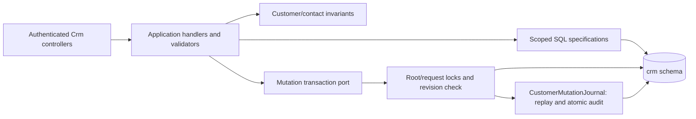

# «Менеджер сервісу»: clients and КП

**Implemented:** customer/contact master with clients from KeepinCRM, and КП (commercial proposals) stage 1: create, edit «Товари та ціни», reprice, give to a manager. The earlier Codex quote, custom sewing, PDF, email and archive work was removed on 2026-11-04.

Authenticated Admin/Manager can create, read, search/page, revise and deactivate customers and contacts. Admin-only merge retains victim roots/audit while moving contacts/external identities to the survivor. Exact external identities are unique; similar names/shared emails never auto-merge. Manager reads/writes owned clients. Every mutation has requestId replay and a root revision; successful intent/result audit is stored in the same transaction. No destructive customer/contact delete API. Clients come from KeepinCRM: the daily `keepin-clients` step and `POST /api/crm/customers/keepin-sync` refresh them by KeepinCRM ID; the one-time transfer deletes unlinked Brevi clients unless a КП uses them ([CRM-002](../../specs/crm/002-keepincrm-clients/README.md), [runbook](../../operations/jobs/sync-job.md#keepin-clients)).

## Code structure

```text
src/Modules/Crm/
  Crm.Domain/Crm.Domain/Customers/
    Customer.cs                       root invariants/revision/merge
    Identifiers/                      typed long keys and int actor reference
    Contacts/                         contact and channel validation
    ExternalIdentities/               exact source identity
  Crm.Application/Crm.Application/Customers/
    Access/                           authenticated actor reference
    Contracts/Inputs/                 shared customer/source intent types
    Contracts/Responses/              pure detail/contact/source response records
    Mapping/                          domain-to-detail mapping
    GetCustomers/DTOs/                page summary projection
    SaveCustomerContact/Inputs/       contact/channel intent types
    Persistence/                      transaction session and read ports
    GetCustomer/Specifications/       scoped SQL detail projection
    GetCustomers/Specifications/      SQL page/count/search projections
    CreateCustomer/                   command, handler, validator
    ReviseCustomer/                   command, handler, validator
    SaveCustomerContact/              create/revise contact use case
    MergeCustomers/                   Admin merge orchestration
    KeepinCrmSync/                    KeepinCRM → Brevi client sync, ports and command
  Crm.Infrastructure/Crm.Infrastructure/
    Persistence/                      EF context, entity configurations/migrations
    Persistence/Customers/Reading/     scoped read repository
    Persistence/Customers/Writing/     transaction coordinator and root locks
    Persistence/Customers/Idempotency/ payload encoding, replay/access and journal
    KeepinCrm/                        KeepinCRM clients HTTP source, parser, options
    Persistence/Customers/KeepinCrmSync/ bulk load/delete/save for the sync
    DependencyInjection/              existing host/seed registration; CrmKeepinCrmExtensions
  Crm.Api/Crm.Api/Customers/
    CustomersController.cs            client reads/writes/merge
    CustomerContactsController.cs     contact writes
    Requests/                         one request type per file
  Crm.Api/Crm.Api/Access/
    CrmActorClaims.cs                 actor binding shared by CRM controllers
```



[Actual API contract](../../contracts/crm/clients-quotes.openapi.yaml), [database ownership](../../architecture/data-model/crm.md), [local migration job](../../operations/data/crm-clients.md). Host.Api registers the Crm Mediator assembly and infrastructure; Host.Seed runs the Crm migrations in the normal deployment flow. Existing Catalog/Reference/Identity remain separate owners.

The transaction coordinator retains commit/rollback ownership; the journal uses the same context and transaction.

## КП (commercial proposals)

[QTE-001](../../specs/crm/003-quotes/README.md), [API contract](../../contracts/crm/quotes.openapi.yaml), tables `Quotes`, `QuoteItems`, `QuoteItemOptions` in [schema crm](../../architecture/data-model/crm.md).

- Any Manager creates a КП and becomes responsible; a Manager sees and changes only own КП. Admin (the Director also holds Admin) sees all and gives a КП to any active manager (`PUT /api/crm/quotes/{id}/responsible`).
- Number «n-month-year» (`37-9-2026`), counted per Kyiv month; a parallel create retries with the next number.
- Items: sewing model with fabric variants, catalog PPE, one-off PPE. Each row has three prices (до 9 / 10–40 / від 41 шт.) with a «show» flag; at least one shown price must be above zero.
- A new Catalog row takes texts and published prices from the Catalog; a saved row keeps them, so a save never reprices. Sewing prices are never typed by hand. A PPE price that differs from the Catalog needs a reason and records who and when. One-off PPE prices are manual.
- «Перерахувати за актуальними цінами» (`POST …/reprice`) first lists changes, then applies them; manual prices stay; rows the Catalog cannot price are listed and keep their prices.
- `Version` is checked on every write; a stale save gets 409 «КП змінили в іншому вікні».
- Later stages (not built): «Налаштування КП» and PDF, sending from each manager's own Gmail, «КП для знайомства», composition editing and archive.

```text
src/Modules/Crm/
  Crm.Domain/Crm.Domain/Quotes/          Quote, QuoteItem, QuoteItemOption, QuotePrice, QuoteNumber, limits
  Crm.Application/Crm.Application/Quotes/
    Access/                              QuoteActor (own vs all), messages, actor name lookup
    Contracts/                           inputs and responses
    Validation/                          FluentValidation of the editor content
    Building/                            QuoteItemsBuilder (Catalog prices, manual price audit), Kyiv clock
    Catalog/, Staff/                     ports implemented in Host.Api
    Persistence/                         IQuoteStore (CrmDbContext) and load query
    Mapping/                             responses
    CreateQuote/, SaveQuote/, DeleteQuote/, GetQuote/, GetQuotes/,
    SetResponsible/, RepriceQuote/,
    SearchCatalog/, GetStaff/            one use case per folder: command/query, validator, handler
  Crm.Infrastructure/Crm.Infrastructure/
    Persistence/Configurations/Quotes/   three EF mappings
    Persistence/Quotes/                  unique-number detection
  Crm.Api/Crm.Api/Quotes/                QuotesController, QuoteLookupsController, Requests/
src/Bootstrapper/Host.Api/Crm/
  QuoteCatalogReader.cs                  Catalog overview, admin detail photo and Reference fabrics through Mediator
  QuoteStaffReader.cs                    active Manager/Admin users from Identity
```

## Tests

- КП rules and builder: `dotnet test tests/UnitTests/UnitTests.csproj --filter FullyQualifiedName~UnitTests.Crm.Quotes`.
- КП on PostgreSQL (numbers, own vs all, stale version, reprice, responsible, delete): `dotnet test tests/IntegrationTests/IntegrationTests.csproj --filter FullyQualifiedName~QuotePersistenceTests` with `BREVIERP_CRM_TEST_CONNECTION` pointing at a local PostgreSQL.
- KeepinCRM clients: `tests/UnitTests/Crm/Customers/KeepinCrmClientSyncTests.cs` (`--filter FullyQualifiedName~KeepinCrmClientSync`); customers on PostgreSQL: `--filter FullyQualifiedName~CustomerPersistenceTests`.
