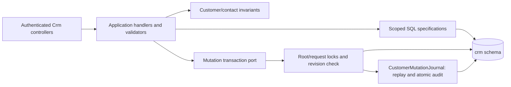

# «Менеджер сервісу»: clients and КП

**Implemented:** customer/contact master with clients from KeepinCRM, and КП (commercial proposals) stages 1–6: create, edit «Товари та ціни», reprice, give to a manager, «Налаштування КП», the PDF, sending from each staff member's own Gmail, «КП для знайомства» with «Готові шаблони», «Виріб з нуля», «Змінити склад», history, archive, copy and the transfer of old Calculator КП. The earlier Codex quote, custom sewing, PDF, email and archive work was removed on 2026-11-04.

Authenticated Admin/Manager can create, read, search/page, revise and deactivate customers and contacts. Admin-only merge retains victim roots/audit while moving contacts/external identities to the survivor. Exact external identities are unique; similar names/shared emails never auto-merge. Manager reads/writes owned clients. Every mutation has requestId replay and a root revision; successful intent/result audit is stored in the same transaction. No destructive customer/contact delete API. Clients come from KeepinCRM: the daily `keepin-clients` step and `POST /api/crm/customers/keepin-sync` refresh them by KeepinCRM ID; the one-time transfer deletes unlinked Brevi clients unless a КП uses them ([CRM-002](../../specs/crm/002-keepincrm-clients/README.md), [runbook](../../operations/jobs/sync-job.md#keepin-clients)).

## Code structure

```text
src/Modules/Crm/
  Crm.Domain/Crm.Domain/Customers/
    Customer.cs                       root invariants/revision/merge
    Identifiers/                      typed long keys and int actor reference
    Contacts/                         contact and channel validation
    ExternalIdentities/               exact source identity
  Crm.Application/Crm.Application/Customers/
    Access/                           authenticated actor reference
    Contracts/Inputs/                 shared customer/source intent types
    Contracts/Responses/              pure detail/contact/source response records
    Mapping/                          domain-to-detail mapping
    GetCustomers/DTOs/                page summary projection
    SaveCustomerContact/Inputs/       contact/channel intent types
    Persistence/                      transaction session and read ports
    GetCustomer/Specifications/       scoped SQL detail projection
    GetCustomers/Specifications/      SQL page/count/search projections
    CreateCustomer/                   command, handler, validator
    ReviseCustomer/                   command, handler, validator
    SaveCustomerContact/              create/revise contact use case
    MergeCustomers/                   Admin merge orchestration
    KeepinCrmSync/                    KeepinCRM → Brevi client sync, ports and command
  Crm.Infrastructure/Crm.Infrastructure/
    Persistence/                      EF context, entity configurations/migrations
    Persistence/Customers/Reading/     scoped read repository
    Persistence/Customers/Writing/     transaction coordinator and root locks
    Persistence/Customers/Idempotency/ payload encoding, replay/access and journal
    KeepinCrm/                        KeepinCRM clients HTTP source, parser, options
    Persistence/Customers/KeepinCrmSync/ bulk load/delete/save for the sync
    DependencyInjection/              existing host/seed registration; CrmKeepinCrmExtensions
  Crm.Api/Crm.Api/Customers/
    CustomersController.cs            client reads/writes/merge
    CustomerContactsController.cs     contact writes
    Requests/                         one request type per file
  Crm.Api/Crm.Api/Access/
    CrmActorClaims.cs                 actor binding shared by CRM controllers
```



[Actual API contract](../../contracts/crm/clients-quotes.openapi.yaml), [database ownership](../../architecture/data-model/crm.md), [local migration job](../../operations/data/crm-clients.md). Host.Api registers the Crm Mediator assembly and infrastructure; Host.Seed runs the Crm migrations in the normal deployment flow. Existing Catalog/Reference/Identity remain separate owners.

The transaction coordinator retains commit/rollback ownership; the journal uses the same context and transaction.

## КП (commercial proposals)

[QTE-001](../../specs/crm/003-quotes/README.md), [API contract](../../contracts/crm/quotes.openapi.yaml), tables `Quotes`, `QuoteItems`, `QuoteItemOptions`, `QuoteItemOptionFabrics`, `QuoteSettings`, `StaffMailboxes`, `QuoteSendings`, `QuoteIntroTemplates`, `QuoteEvents` in [schema crm](../../architecture/data-model/crm.md).

- Any Manager creates a КП and becomes responsible; a Manager sees and changes only own КП. Admin (the Director also holds Admin) sees all and gives a КП to any active manager (`PUT /api/crm/quotes/{id}/responsible`).
- Number «n-month-year» (`37-9-2026`), counted per Kyiv month; a parallel create retries with the next number.
- Items: sewing model with fabric variants, catalog PPE, one-off PPE. Each row has three prices (до 9 / 10–40 / від 41 шт.) with a «show» flag; at least one shown price must be above zero.
- A new Catalog row takes texts and published prices from the Catalog; a saved row keeps them, so a save never reprices. Sewing prices are never typed by hand. A PPE price that differs from the Catalog needs a reason and records who and when. One-off PPE prices are manual.
- «Перерахувати за актуальними цінами» (`POST …/reprice`) first lists changes, then applies them; manual prices stay; rows the Catalog cannot price are listed and keep their prices.
- `Version` is checked on every write; a stale save gets 409 «КП змінили в іншому вікні».
- «Налаштування КП» (`GET`/`PUT /api/crm/quote-settings`, Admin role): requisites and logo, each staff member's КП contact, letter template, PDF texts, introduction catalogue texts with five «Переваги», letter variants. Before the first save the old Calculator values are returned with version 0.
- «Сформувати КП» (`GET /api/crm/quotes/{id}/pdf`): PDF of the saved КП, drawn on request by QuestPDF with embedded Noto Sans; only shown items and prices, client comment, the responsible manager's contact (saved one, else the account's) and requisites.
- Gmail (R-15): `POST /api/crm/mailboxes/{userId}/connect` gives the Google consent address (send permission only), the anonymous `google-callback` stores the address and the encrypted refresh token in `crm.StaffMailboxes`; `GET /api/crm/quotes/{id}/send-draft` gives the letters with marks filled, `POST /api/crm/quotes/{id}/send` sends the PDF from the sender's own Gmail, logs `crm.QuoteSendings` and marks the КП Sent. Setup: [Gmail for КП](../../operations/configuration/crm-gmail.md).
- «КП для знайомства» (R-16–R-18): `POST`/`PUT /api/crm/quote-introductions` save a КП of kind Introduction with a layout (summer and winter pages, or one) of 4 models each: the main model of the season first (codes in «Налаштування КП», defaults MOD-166 «Імпульс» and MOD-169 «Прайм»), then 3 models of that season, one fabric each. The server turns them into ordinary sewing items with only the від 41 шт. price shown, so saved prices stay. `GET /api/crm/quote-lookups/introduction` gives the main models and letter names, `searchCrmQuoteCatalog` takes `season`, `GET /api/crm/quote-lookups/products?ids=` reloads chosen models. The PDF of an introduction is a catalogue (season pages with model cards, «Переваги», next step and contact); its send draft puts the chosen letter first and fills «Кому».
- «Готові шаблони» (R-19): `GET`/`POST /api/crm/quote-intro-templates`, `DELETE …/{id}`; shared by all staff, unique name, no prices; the author, Director or Admin delete.
- «Виріб з нуля» (R-20): an item of kind CustomSewing has no Catalog product: the manager names it and picks accessories and operations (shared) and one or more variants, each a sum of fabrics with metres (R-26). `POST /api/crm/quote-lookups/custom-sewing-price` prices each variant through the Catalog query `CalculateSewingCompositionQuery` (the same formula, settings and reference versions as a Catalog article; nothing saved) and returns line names, minutes, labour and the three prices or the problems. Saving prices it the same way; while its composition and fabrics stay, a save keeps the prices, and «Перерахувати» prices it again from the saved composition. Lines are in `crm.QuoteItemLines`, variant fabrics in `crm.QuoteItemOptionFabrics`.
- Model in another fabric (R-27): a Sewing row with `articleId` null and one Reference fabric is priced the same way from the model's shared lines (`IQuoteModelCompositionReader`) in `QuoteItemsBuilder`; «Перерахувати» repeats it.
- «Змінити склад» (R-21): `GET /api/crm/quote-lookups/catalog/{productId}/composition` returns a sewing model's Catalog composition (variant fabrics with metres, shared accessories, extra fabrics, services and operations) through `IQuoteModelCompositionReader`. The changed item is a CustomSewing that keeps the model's `ProductId`, code, link and season; services are lines of kind `Service` with the other-cost code, extra fabrics lines of kind `Fabric`.
- «Історія змін» (R-22): `GET /api/crm/quotes/{id}/history` lists `crm.QuoteEvents` newest first: created or copied, saved, sent, repriced, given to a manager, archived, restored, with who and when. Handlers add the line in the same save as the change.
- «Архів» (R-23): `POST /api/crm/quotes/{id}/archive` and `…/restore` with `version`; `getCrmQuotes?archived=true` lists the archive. An archived КП is read-only (409) until restored.
- Client card tab «КП»: `getCrmQuotes?customerId=` lists that client's КП, in work and archived together, within the actor's access (a Manager sees only own).
- «Копіювати» (R-24): `POST /api/crm/quotes/{id}/copy` makes a new draft with the next number and the same items and saved prices (`Quote.CopyAs`); the actor becomes author and responsible.
- Transfer of old Calculator КП (R-25): `POST /api/crm/quote-import` (Admin) with `dryRun`; keeps numbers, people, dates, status, saved prices and history, links items to the Catalog by code, skips КП transferred before. Runbook: [old КП transfer](../../operations/data/migrations-and-seeding.md#old-кп-transfer).

```text
src/Modules/Crm/
  Crm.Domain/Crm.Domain/Quotes/          Quote (with QuoteIntroduction, archive, copy), QuoteEvent (history), QuoteItem, QuoteItemOption, QuotePrice, QuoteNumber, limits
    Introductions/                       QuoteIntroTemplate («Готовий шаблон») and its limits
    Settings/                            QuoteSettings (one row), its sections, defaults from the Calculator
    Sending/                             StaffMailbox (connected Gmail), QuoteSending (sent letter), limits
  Crm.Application/Crm.Application/Quotes/
    Access/                              QuoteActor (own vs all), messages, actor name lookup
    Contracts/                           inputs and responses
    Validation/                          FluentValidation of the editor content
    Building/                            QuoteItemsBuilder (Catalog prices, manual price audit), QuoteNumbering, Kyiv clock
    Catalog/, Staff/                     ports implemented in Host.Api
    CustomSewing/                        «Виріб з нуля» and changed models: IQuoteSewingCalculator and IQuoteModelCompositionReader ports, item builder, price preview and model composition queries
    Persistence/                         IQuoteStore (CrmDbContext) and load query
    Mapping/                             responses
    CreateQuote/, SaveQuote/, DeleteQuote/, GetQuote/, GetQuotes/,
    SetResponsible/, RepriceQuote/, History/, Archive/, CopyQuote/,
    Import/                              transfer of Calculator КП: command, validator, handler, mapper, IQuoteImportLookup port, report
    SearchCatalog/, GetCatalogProducts/,
    GetStaff/                            one use case per folder: command/query, validator, handler
    Introductions/                       Contracts/, Validation/, Building/ (pages → items, page rules), Setup/,
                                         CreateIntroduction/, SaveIntroduction/, Templates/ (Create/Delete/GetTemplates)
    Settings/                            Contracts/ (DTOs, mapper), Reading/, GetSettings/, SaveSettings/
    Pdf/                                 QuotePdfModel (client view) and builder, IQuotePdfRenderer, Composing/ (shared PDF build), GetPdf/,
                                         Introduction/ (catalogue client view and builder)
    Sending/                             Gmail/ (ports, options), Connect/, Disconnect/, Draft/, Send/, recipients, marks
  Crm.Infrastructure/Crm.Infrastructure/
    Persistence/Configurations/Quotes/   EF mappings of КП, settings, mailboxes and sendings
    Persistence/Quotes/                  unique-number, settings and mailbox race detection
    Quotes/Pdf/                          QuestPDF documents (КП, introduction catalogue), shared parts, renderer, photo loader, fonts
    Quotes/Sending/                      GmailClient (OAuth + upload send), MIME letter, Data Protection token store, options
  Crm.Api/Crm.Api/Quotes/                QuotesController, QuoteIntroductionsController, QuoteIntroTemplatesController,
                                         QuoteLookupsController, QuoteSettingsController, MailboxesController, QuoteImportController, Requests/
src/Bootstrapper/Host.Api/Crm/
  QuoteCatalogReader.cs                  Catalog overview, admin detail photo and Reference fabrics through Mediator
  QuoteStaffReader.cs                    active Manager/Admin users from Identity
  QuoteSewingCalculator.cs               «Виріб з нуля» through the Catalog composition query, names from Reference
  QuoteModelCompositionReader.cs         model composition for «Змінити склад» through the Catalog sewing card query
  QuoteImportLookup.cs                   Catalog products and Reference rows by code for the old КП transfer
```

## Tests

- КП rules, builder, settings validation, sending (recipients, MIME letter, consent address, ID token), PDF (client view, render smoke; `BREVI_QUOTE_PDF_OUT=<file>` saves the sample) and introductions (page rules, catalogue view; `BREVI_QUOTE_INTRO_PDF_OUT=<file>`), «Виріб з нуля» (`QuoteCustomSewingTests`; old КП transfer `QuoteImportTests`; Catalog formula in `SewingCompositionPricingTests`): `dotnet test tests/UnitTests/UnitTests.csproj --filter FullyQualifiedName~UnitTests.Crm.Quotes`.
- КП on PostgreSQL (numbers, own vs all, stale version, reprice, responsible, delete, history, archive, copy; settings save and PDF source; Gmail connect, send, failure and send draft with fakes; introductions and templates; «Виріб з нуля» save and reprice; old КП transfer dry run, run, rerun and taken numbers): `dotnet test tests/IntegrationTests/IntegrationTests.csproj --filter FullyQualifiedName~IntegrationTests.Crm.Quote` with `BREVIERP_CRM_TEST_CONNECTION` pointing at a local PostgreSQL.
- KeepinCRM clients: `tests/UnitTests/Crm/Customers/KeepinCrmClientSyncTests.cs` (`--filter FullyQualifiedName~KeepinCrmClientSync`); customers on PostgreSQL: `--filter FullyQualifiedName~CustomerPersistenceTests`.
