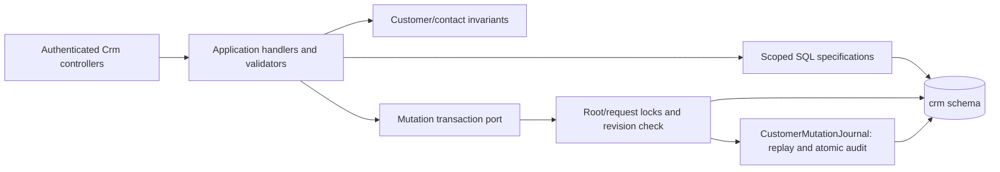
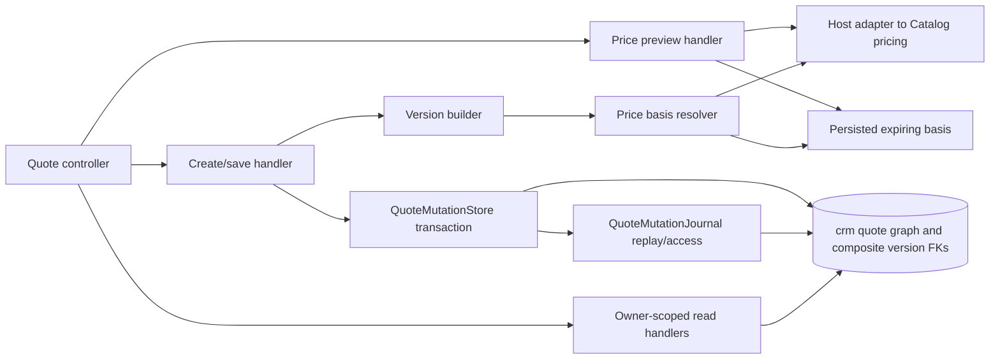
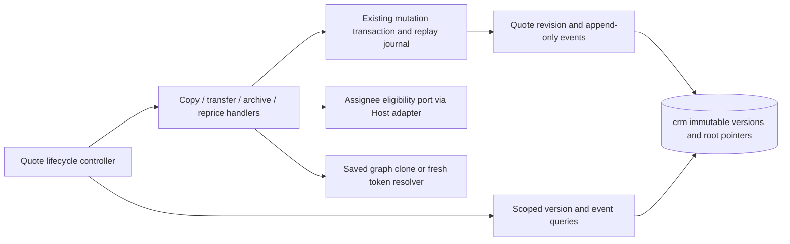

# CRM clients, contacts and draft quotes

**Implemented local slices:** customer/contact foundation and P2 draft quotes. Backend was verified 2026-10-26; the matching Admin frontend was implemented and automatically checked 2026-10-27 against pinned backend `1c1f51dc7837f3d5e3a0da7326cb17b48d23e4d9`. See [handoff evidence](../../specs/crm/001-clients-quotes-custom-sewing/evidence/p2-handoff-2026-10-27.md). P3 backend lifecycle is implemented locally (2026-10-28); FE-005 handoff and manual acceptance remain pending. Custom/document/import phases remain planned. This card does not claim production rollout.

Authenticated Admin/Manager can create, read, search/page, revise and deactivate customers and contacts. Admin-only merge retains victim roots/audit while moving contacts/external identities to the survivor. Exact external identities are unique; similar names/shared emails never auto-merge. Manager reads/writes owned clients; draft quotes are owner-scoped. Every mutation has requestId replay and a root revision; successful intent/result audit is stored in the same transaction. No destructive customer/contact delete API.

## Code structure

```text
src/Modules/Crm/
  Crm.Domain/Crm.Domain/Customers/
    Customer.cs                       root invariants/revision/merge
    Identifiers/                      typed long keys and int actor reference
    Contacts/                         contact and channel validation
    ExternalIdentities/               exact source identity
  Crm.Application/Crm.Application/Customers/
    Access/                           authenticated actor reference
    Contracts/Inputs/                 shared customer/source intent types
    Contracts/Responses/              pure detail/contact/source response records
    Mapping/                          domain-to-detail mapping
    GetCustomers/DTOs/                page summary projection
    SaveCustomerContact/Inputs/       contact/channel intent types
    Persistence/                      transaction session and read ports
    GetCustomer/Specifications/       scoped SQL detail projection
    GetCustomers/Specifications/      SQL page/count/search projections
    CreateCustomer/                   command, handler, validator
    ReviseCustomer/                   command, handler, validator
    SaveCustomerContact/              create/revise contact use case
    MergeCustomers/                   Admin merge orchestration
  Crm.Infrastructure/Crm.Infrastructure/
    Persistence/                      EF context, entity configurations/migrations
    Persistence/Customers/Reading/     scoped read repository
    Persistence/Customers/Writing/     transaction coordinator and root locks
    Persistence/Customers/Idempotency/ payload encoding, replay/access and journal
    DependencyInjection/              existing host/seed registration
  Crm.Api/Crm.Api/Customers/
    CustomersController.cs            client reads/writes/merge
    CustomerContactsController.cs     contact writes
    Requests/                         one request type per file
  Crm.Api/Crm.Api/Access/
    CrmActorClaims.cs                 actor binding shared by CRM controllers
```



[Actual API contract](../../contracts/crm/clients-quotes.openapi.yaml), [database ownership](../../architecture/data-model/crm.md), [local migration job](../../operations/data/crm-clients.md). Host.Api registers the Crm Mediator assembly and infrastructure; Host.Seed registers Crm migration in normal deployment flow and an explicit CRM-only local mode. Existing Catalog/Reference/Identity remain separate owners.

[Structural audit and verification](../../specs/crm/001-clients-quotes-custom-sewing/code-audit/audit.md). The transaction coordinator retains commit/rollback ownership; the journal uses the same context and transaction. Customer aggregate invariants remain together; mapped entity/context namespaces and the HTTP/JSON contract are unchanged.

## Draft quote structure

```text
Crm.Domain/Crm.Domain/Quotes/
  Quote.cs, Versions/, Items/, Variants/, Pricing/, Identifiers/
Crm.Application/Crm.Application/Quotes/
  CreateQuote/, SaveQuoteVersion/, GetQuote/, GetQuotes/
  PreviewQuotePrices/Specifications/  preview-specific access query
  Pricing/QuotePriceBasisResolver.cs  token, input, expiry and source checks
  Mapping/QuoteVersionBuilder.cs      ordered graph construction
  Contracts/Inputs/, Contracts/Responses/, Persistence/
Crm.Infrastructure/Crm.Infrastructure/Persistence/
  Quotes/Reading/, Writing/, Pricing/
  Quotes/Idempotency/                 hash, replay/access and atomic journal
  Configurations/Quotes/             seven quote-specific EF mappings
Crm.Api/Crm.Api/Quotes/               HTTP binding and separate request records
Host.Api/Crm/QuoteCatalogPriceReader.cs
tests/IntegrationTests/Crm/Quotes/    API, adapter, persistence, access, integrity
```



Drafts preserve saved monetary snapshots across reads and text edits. Fresh pricing tokens are actor/quote/input-bound; source drift conflicts. See the [quote contract](../../contracts/crm/quote-drafts.openapi.yaml), [P2 audit](../../specs/crm/001-clients-quotes-custom-sewing/code-audit/p2-implementation-audit-2026-10-26.md) and [verification evidence](../../specs/crm/001-clients-quotes-custom-sewing/evidence/p2-quote-backend-2026-10-26.md).

## P3 lifecycle implementation

```text
Crm.Domain/Crm.Domain/Quotes/
  Quote.cs, Events/QuoteLifecycleEvent.cs    revision, ownership/archive, issued pointer and audit
Crm.Application/Crm.Application/Quotes/
  GetQuoteVersions/, GetQuoteVersion/, GetQuoteEvents/    scoped paged typed history
  RepriceQuote/                              confirmation of all current preview tokens
  RepriceQuote/Mapping/QuoteRepriceSnapshot.cs saved graph conversion, separate from orchestration
  GetQuoteVersions/Specifications/, GetQuoteEvents/Specifications/ scenario-owned access checks
  CopyQuote/, TransferQuote/, ArchiveQuote/   independent command/handler per action
  Mapping/QuoteSnapshotCloner.cs              deep copy of saved graph without pricing
  Ownership/IQuoteAssigneeReader.cs           eligibility port
Crm.Infrastructure/Crm.Infrastructure/Persistence/
  Quotes/Reading/QuoteReadRepository.History.cs          SQL history projections
  Configurations/Quotes/QuoteLifecycleEventConfiguration.cs
  Migrations/*AddQuoteLifecycle*, *PreserveIssuedQuoteVersion*
Crm.Api/Crm.Api/Quotes/QuoteLifecycleController.cs
Crm.Api/Crm.Api/Quotes/QuoteAssigneesController.cs separate eligible-user lookup HTTP boundary
Host.Api/Crm/QuoteAssigneeReader.cs            Identity eligibility adapter
```



Reprice confirms an unchanged current graph using all fresh scoped variant tokens. Copy selects any authorized saved version, records its provenance and preserves prices without a Catalog call. Transfer atomically changes current access; former Managers cannot read history or replay prior mutations after losing scope. Archive/restore preserve business state and versions. Ready/sent edits create a draft and retain the issued-version pointer; actual ready/send operations and human numbering remain later phases. [TS-005 evidence](../../specs/crm/001-clients-quotes-custom-sewing/evidence/ts-005-2026-10-28.md). Frontend lifecycle integration is pending.
