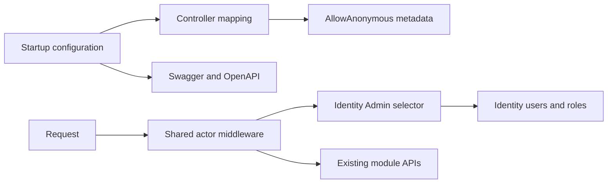

# Temporary anonymous access to all controller APIs

Host.Api owns a startup-configured public access overlay. ApiAccess:AnonymousEnabled enables AllowAnonymous on every module controller endpoint, supplies a real shared Admin for actor-dependent operations and exposes documentation in Production. Disable the flag and restart to restore existing authorization. [Operations](../../operations/configuration/temporary-anonymous-api.md) describes attribution and configuration.

## Code structure

```text
src/Bootstrapper/Host.Api/
  Program.cs                                  # pipeline composition
  Security/AnonymousApiAccess/
    AnonymousApiAccessOptions.cs               # switch and optional existing actor ID
    AnonymousApiActor.cs                       # actor projection and scoped resolver port
    IdentityAnonymousApiActorResolver.cs       # eligible existing Admin selection
    AnonymousApiAccessMiddleware.cs            # internal request actor, no session issuance
    AnonymousApiAccessExtensions.cs            # DI, public controller convention, documentation
```

## Structure diagram



## Tests

tests/HostApiTests/AnonymousApiAccessTests.cs: all HTTP methods, explicit roles, named/fallback policy, normal-mode restoration, missing-actor handling, real-module endpoint inventory and Production documentation. Command: dotnet test tests/HostApiTests/HostApiTests.csproj --filter FullyQualifiedName~AnonymousApiAccessTests. No live DB/provider is needed by the HTTP harness. [SDD](../../specs/platform/002-temporary-anonymous-api/README.md).
