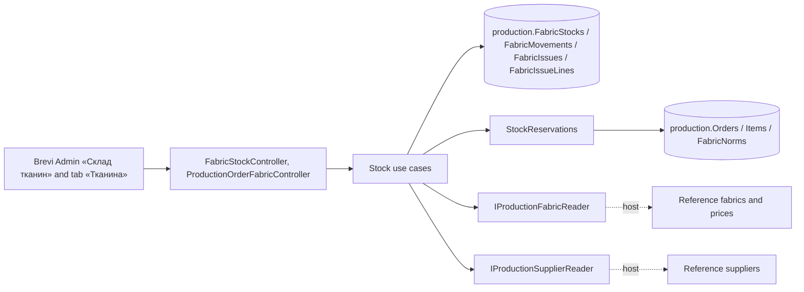

# Fabric stock («Склад тканин», stage 4)

Metres of each fabric of «Тканини» (by FAB- code) in each colour. The balance changes only through movements: opening, receipt from a supplier of «Постачальники», issue to an order item, correction and reversal; each keeps before / change / after, the day and the person. Open orders reserve their plan, computed from the workshop norms by colour, until issues cover it. The «Тканина» tab of an item issues fabric as one package of planned, replacement and additional lines. Managers see the stock; the head of the workshop and Admin move it and see its value. The old «Цех» stock moves in through an import. SDD: [stage 4](../../specs/production/004-fabric-stock/README.md); [contract](../../contracts/production/fabric-stock.openapi.yaml), [tables](../../architecture/data-model/production.md).

## Code structure

```text
src/Modules/Production/
  Production.Domain/Production.Domain/Stock/
    FabricStock.cs               # line + its movements: Move, Correct, Reverse, Transfer; version
    FabricMovement.cs            # kinds, details, before/change/after, reversal mark
    FabricIssue.cs               # «Видача» package + lines (Planned/Replacement/Additional), reversal
    FabricPlanParts.cs           # plan of an item by colour from the norm
    StockColor.cs                # colour text and key
  Production.Application/Production.Application/
    Abstractions/IProductionSupplierReader.cs   # «Постачальники»; IProductionFabricReader also gives the price
    Contracts/FabricStockContracts.cs
    Stock/
      StockReservations.cs       # plans of «Нове» orders minus what issues covered
      StockRows.cs               # row with available and value; permissions
      StockChanges.cs            # actor, fabric, line lookup or creation, save with 409, card
      GetChoices (fabrics, suppliers and «Кольори» colours for the forms; a new line takes a listed colour, REF-006), GetStock, GetStockLine, Movements (opening/receipt, correction, reversal), Issues (ItemFabricCards, tab query, issue, reversal),
      Consumption (period summary), ImportStock (old «Цех»)
      StockMessages.cs
  Production.Infrastructure/.../Persistence/Configurations/FabricStockConfiguration.cs
  Production.Api/Production.Api/Stock/FabricStockController.cs              # /api/production/fabric-stock
  Production.Api/Production.Api/Orders/ProductionOrderFabricController.cs   # /api/production/orders/{id}/items/{itemId}/fabric…
src/Bootstrapper/Host.Api/Production/
  ProductionSupplierReader.cs    # Reference GetSuppliersQuery
  ProductionFabricReader.cs      # Reference GetAllFabricQuery with price
```

## Structure diagram



## Tests

- `tests/UnitTests/Production/ProductionStockHandlerTests.cs` — before/change/after, 409, access and value, plan by colour, issue purposes, reversal of an issue, import checks and repeat.
- `tests/UnitTests/Production/FabricStockContractTests.cs` — DTOs and operations against the contract.

Focused run: `dotnet test tests/UnitTests/UnitTests.csproj --filter FullyQualifiedName~UnitTests.Production`.

**Data:** [production schema](../../architecture/data-model/production.md)
