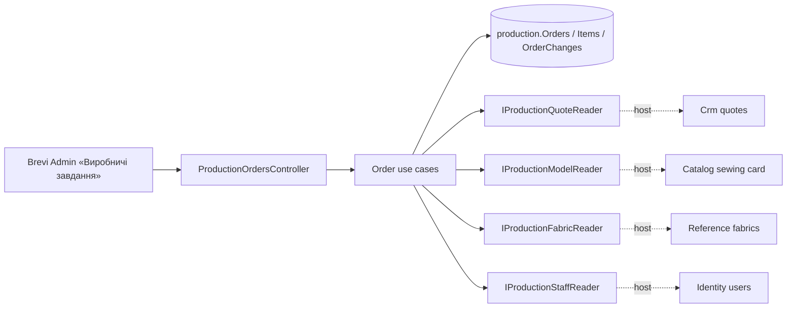

# Production orders («Виробничі завдання», stage 2)

Managers pass their sent КП to the workshop; the head of the workshop sees every order with the sewing rate and planned fabric; Admin and Director also see the КП price kept for reports. Changes are written to «Історія змін». Old orders of the «Цех» move in through an import. [SDD](../../specs/production/002-production-orders/README.md), [contract](../../contracts/production/production-orders.openapi.yaml), [tables](../../architecture/data-model/production.md).

## Code structure

```text
src/Modules/Production/
  Production.Domain/Production.Domain/Orders/
    ProductionOrder.cs           # aggregate: header, items, history lines, soft delete, version
    ProductionItem.cs            # item + ItemSource (snapshot from КП/Catalog) + ItemDetails (what people fill in)
    ProductionOrderChange.cs     # a line of «Історія змін»
    ItemApplication.cs, FabricPlan.cs, OrderText.cs, ProductionOrderEnums.cs
  Production.Application/Production.Application/
    Abstractions/                # IProductionQuoteReader, IProductionFabricReader, IProductionStaffReader, IProductionModelReader
    Contracts/ProductionOrderInputs.cs, ProductionOrderResponses.cs
    Orders/
      Access/ProductionActor.cs  # who may create, edit, delete; which prices they see
      GetOrders, GetOrder, GetHistory, QuoteSources, CreateOrder, UpdateOrder, CopyOrder, DeleteOrder, ImportOrders
      Validation/                # item details and application validators, shared rules
      OrderMapping.cs, OrderNorms.cs, OrderNumbers.cs, OrderActors.cs, OrderMessages.cs
  Production.Infrastructure/.../Persistence/Configurations/ProductionOrderConfiguration.cs, JsonColumn.cs
  Production.Api/Production.Api/Orders/ProductionOrdersController.cs   # /api/production/orders
src/Bootstrapper/Host.Api/Production/
  ProductionQuoteReader.cs       # Crm GetQuotesQuery / GetQuoteQuery, sewn items only
  ProductionFabricReader.cs      # Reference GetAllFabricQuery
  ProductionStaffReader.cs       # Identity users by id and email
  ProductionModelReader.cs       # + Catalog GetSewingArticleSummaryQuery for the seamstress labour
```

## Structure diagram



## Tests

- `tests/UnitTests/Production/ProductionOrderHandlerTests.cs` — create, idempotency, access, hidden prices, history, copy, delete, list filters, import (SQLite in memory, fake ports).
- `tests/UnitTests/Production/ProductionOrdersContractTests.cs` — DTOs and operations against the contract.

Focused run: `dotnet test tests/UnitTests/UnitTests.csproj --filter FullyQualifiedName~UnitTests.Production`.

**Data:** [production schema](../../architecture/data-model/production.md)
