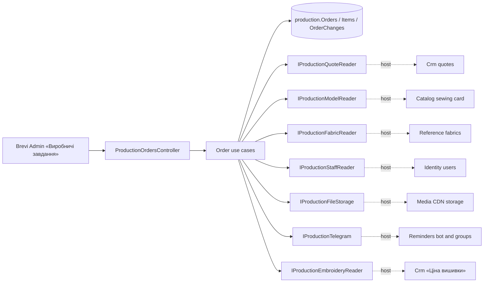

# Production orders («Виробничі завдання», stages 2–3)

Managers pass their sent КП to the workshop; the head of the workshop sees every order with the sewing rate and planned fabric; Admin and Director also see the КП price kept for reports. Changes are written to «Історія змін». Old orders of the «Цех» move in through an import. After «Передати в цех» the head of the workshop ticks stages and records shipments; the order closes when everything is shipped or is cancelled with a reason; files live on the CDN; one Telegram message goes to the workshop group chosen in «Налаштування цеху». The client card tab «Завдання в цех» lists orders by `customerId` (taken from the КП; old imported orders have none). SDD: [stage 2](../../specs/production/002-production-orders/README.md), [stage 3](../../specs/production/003-order-tracking/README.md); [contract](../../contracts/production/production-orders.openapi.yaml), [tables](../../architecture/data-model/production.md).

## Code structure

```text
src/Modules/Production/
  Production.Domain/Production.Domain/Orders/
    ProductionOrder.cs           # aggregate: header, items, history lines, soft delete, version
    ProductionItem.cs            # item + ItemSource (snapshot from КП/Catalog) + ItemDetails (what people fill in)
    ProductionOrderChange.cs     # a line of «Історія змін»
    ItemApplication.cs, FabricPlan.cs, OrderText.cs, ProductionOrderEnums.cs
    ProductionStages.cs          # stage labels and order
    ProductionShipment.cs, ProductionOrderFile.cs, ProductionTelegramDelivery.cs
  Production.Domain/Production.Domain/Settings/WorkshopSettings.cs   # «Налаштування цеху»: group, topic, on/off
  Production.Application/Production.Application/
    Abstractions/                # IProductionQuoteReader, IProductionFabricReader, IProductionStaffReader, IProductionModelReader,
                                 # IProductionFileStorage, IProductionTelegram, IProductionEmbroideryReader
    Contracts/ProductionOrderInputs.cs, ProductionTrackingInputs.cs, ProductionOrderResponses.cs
    Orders/
      Access/ProductionActor.cs  # who may create, edit, delete; which prices they see
      GetOrders, GetOrder, GetHistory, QuoteSources, CreateOrder, UpdateOrder, CopyOrder, DeleteOrder, ImportOrders
      Tracking/                  # OrderTracking + stages, shipments, close/cancel/reopen
      Files/                     # upload and delete order files
      Telegram/                  # the message text and «Надіслати в цех»
      ImportProgress/            # stages, file links and Telegram marks of old orders
      Validation/                # item details and application validators, shared rules
      Embroidery/                # «Вишивка» → saved «ВШ-…» calculation: checks, card details, picker (PRD-D41)
      OrderCards.cs              # the card: order + files + Telegram mark
      OrderMapping.cs, OrderNorms.cs, OrderNumbers.cs, OrderActors.cs, OrderMessages.cs
    Settings/WorkshopSettingsCommands.cs   # get, save, test line
  Production.Infrastructure/.../Persistence/Configurations/ProductionOrderConfiguration.cs, ProductionTrackingConfiguration.cs, JsonColumn.cs
  Production.Api/Production.Api/Orders/ProductionOrdersController.cs   # /api/production/orders
  Production.Api/Production.Api/Orders/ProductionOrderTrackingController.cs   # stages, shipments, status, files, telegram, progress-import
  Production.Api/Production.Api/Settings/WorkshopSettingsController.cs        # /api/production/settings
src/Bootstrapper/Host.Api/Production/
  ProductionQuoteReader.cs       # Crm GetQuotesQuery / GetQuoteQuery, sewn items and «Вишивка» rows
  ProductionEmbroideryReader.cs  # Crm saved embroidery calculations, without prices
  ProductionFabricReader.cs      # Reference GetAllFabricQuery
  ProductionStaffReader.cs       # Identity users by id and email
  ProductionModelReader.cs       # + Catalog GetSewingArticleSummaryQuery for the seamstress labour
  ProductionFileStorage.cs       # Media IMediaStorage (CDN)
  ProductionTelegram.cs          # Reminders ITelegramGateway.SendTopicMessageAsync + the bot's groups
```

## Structure diagram



## Tests

- `tests/UnitTests/Production/ProductionOrderHandlerTests.cs` — create, idempotency, access, hidden prices, history, copy, delete, list filters, import (SQLite in memory, fake ports).
- `tests/UnitTests/Production/ProductionTrackingHandlerTests.cs` — stages, shipments, close/cancel/reopen, files, Telegram once, settings, progress import.
- `tests/UnitTests/Production/ProductionOrdersContractTests.cs` — DTOs and operations against the contract.

Focused run: `dotnet test tests/UnitTests/UnitTests.csproj --filter FullyQualifiedName~UnitTests.Production`.

**Data:** [production schema](../../architecture/data-model/production.md)
