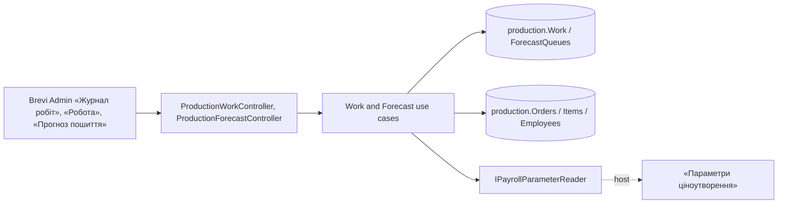

# Work log and sewing forecast («Журнал робіт», «Прогноз пошиття», stage 5)

«Журнал робіт»: the head of the workshop records that a worker sewed or cut pieces of an item on a day; the item's sewing rate is kept with the record. Within the plan the item's quantity is the limit per kind; more goes as «понад план» with a reason. A record is never edited: a wrong one is cancelled by «Сторно» with a reason. Admin and the head of the workshop see the log and the «Робота» section of an item; managers do not. «Прогноз пошиття»: the «Нове» orders in the saved queue with the approximate end of sewing, from the work left and the capacity of «Параметри ціноутворення». Everyone with orders sees dates; the workshop reorders the queue. The old «Цех» log moves in through an import. SDD: [stage 5](../../specs/production/005-work-log/README.md); [contract](../../contracts/production/work-log.openapi.yaml), [tables](../../architecture/data-model/production.md).

## Code structure

```text
src/Modules/Production/
  Production.Domain/Production.Domain/
    Work/ProductionWork.cs       # record, kinds, over-plan reasons, «Сторно»
    Forecast/ForecastQueue.cs    # saved order of the queue, version
    Forecast/SewingForecast.cs   # work left → working days
  Production.Application/Production.Application/
    Contracts/WorkContracts.cs, ForecastContracts.cs
    Work/
      WorkCards.cs               # done counts per item, «Робота» of an item, row mapping
      GetWorkLog (month, worker, order), GetChoices (workers, items, reasons), GetItemWork,
      RecordWork (create with plan limit, «Сторно»), ImportWork (old «Цех»)
      WorkMessages.cs            # also WorkshopDay (today in Kyiv)
    Forecast/
      ForecastQueueReader.cs     # «Нове» orders in queue order
      GetForecast, SaveQueue
  Production.Infrastructure/.../Persistence/Configurations/ProductionWorkConfiguration.cs
  Production.Api/Production.Api/Work/ProductionWorkController.cs          # /api/production/work…, items/{itemId}/work
  Production.Api/Production.Api/Forecast/ProductionForecastController.cs  # /api/production/forecast
```

## Structure diagram



## Tests

- `tests/UnitTests/Production/ProductionWorkHandlerTests.cs` — plan limit and over-plan, «Сторно», access, import, forecast calculation, forecast access and queue.
- `tests/UnitTests/Production/ProductionWorkContractTests.cs` — DTOs and operations against the contract.

Focused run: `dotnet test tests/UnitTests/UnitTests.csproj --filter FullyQualifiedName~UnitTests.Production`.

**Data:** [production schema](../../architecture/data-model/production.md)
