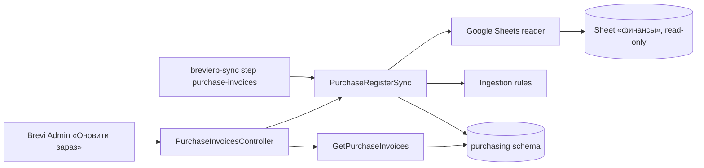

# Purchase invoices «Рахунки на закупку»

Register of purchase invoices for «Контрагенти → Рахунки на закупку». Each card is one Telegram message from the Google Sheet «БРЕВІ команда» / «финансы» with its Dropbox links, payment mark from the sheet and the problems that need a manual check. Director, Accountant and Admin see it; managers do not. [SDD](../../specs/purchasing/001-purchase-invoices/README.md), [contract](../../contracts/purchasing/purchase-invoices.openapi.yaml), [tables](../../architecture/data-model/purchasing.md), [runbook](../../operations/jobs/sync-job.md#purchase-invoices).

## Code structure

```text
src/Modules/Purchasing/
  Purchasing.Domain/Purchasing.Domain/
    Messages/          # PurchaseMessage (source fields + manual supplier/note/version), MessageSource, PaymentState
    Sources/           # PurchaseSourceRow (one UID), PurchaseSourceRevision (raw history)
    Files/             # PurchaseMessageFile (exact link, active)
    Sync/              # PurchaseSyncState (last success, error, counts)
    Ingestion/         # sheet header, ids (PurchaseIdentity), JS-compatible raw JSON, link and problem rules,
                       # message dates, SourceRowNormalizer, PurchaseSourceSnapshot (whole-sheet checks)
  Purchasing.Application/Purchasing.Application/
    Abstractions/      # IPurchasingDbContext (+ sync lock scope), IPurchaseSheetReader
    Register/Sync/     # PurchaseRegisterSync (read → check → one transaction), SyncPurchaseRegisterCommand
    Register/GetInvoices/   # page of cards: representative row, links, search, filter
    Register/GetSyncState/
    Contracts/         # responses and enums
  Purchasing.Infrastructure/Purchasing.Infrastructure/
    Persistence/       # PurchasingDbContext (schema purchasing, advisory lock), configurations, migrations
    GoogleSheets/      # options, Application Default Credentials token, Sheets API v4 reader
    DependencyInjection/
  Purchasing.Api/Purchasing.Api/
    Register/PurchaseInvoicesController.cs   # /api/purchasing/invoices, policy CanUsePurchaseInvoices
src/Bootstrapper/Host.Seed/Jobs/Sync/PurchaseInvoicesSyncTask.cs   # daily step purchase-invoices
```

## Structure diagram



## Tests

`tests/UnitTests/Purchasing/`: source rules (ids, raw JSON, links, problems, payment mark, dates, whole-sheet checks), sync on SQLite in memory with a fake sheet (first run, repeat, moved rows, missing rows, manual fields kept, UID moved, Google unavailable, parallel run), list query, contract. Command: `dotnet test tests/UnitTests/UnitTests.csproj --filter "FullyQualifiedName~UnitTests.Purchasing"`. Module references and schema: `tests/ArchitectureTests/PurchasingDependencyTests.cs`.
