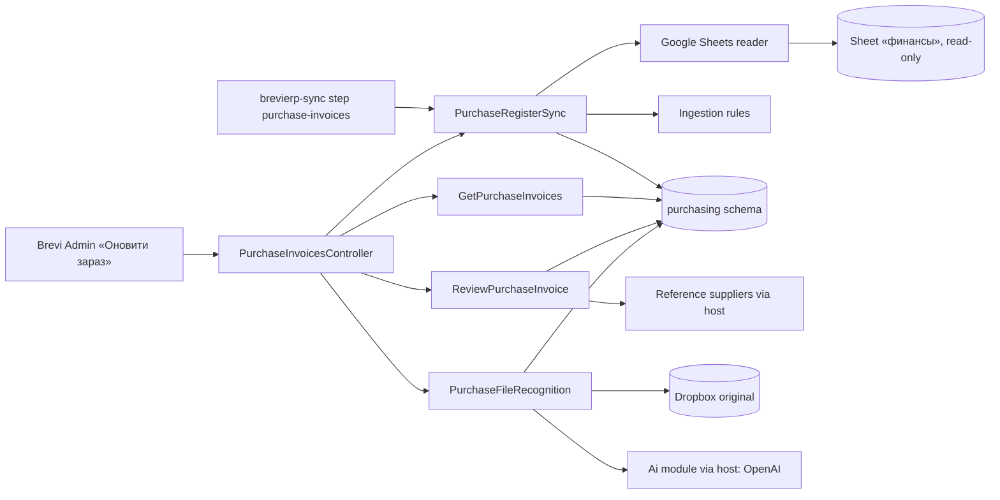

# Purchase invoices «Рахунки на закупку»

Register of purchase invoices for «Контрагенти → Рахунки на закупку». Each card is one Telegram message from the Google Sheet «БРЕВІ команда» / «финансы» with its Dropbox links, payment mark from the sheet and the problems that need a manual check. The accountant links a Brevi supplier and writes a note (optimistic version, history in ReviewChanges); the sync never changes them. Each original can be read by AI («Розпізнати», «Розпізнати всі нові») or filled by hand as JSON: number, date, supplier, «З ПДВ»/«Без ПДВ», positions and totals, checked in kopecks. Director, Accountant and Admin see it; managers do not. [SDD](../../specs/purchasing/001-purchase-invoices/README.md), [contract](../../contracts/purchasing/purchase-invoices.openapi.yaml), [tables](../../architecture/data-model/purchasing.md), [runbook](../../operations/jobs/sync-job.md#purchase-invoices).

## Code structure

```text
src/Modules/Purchasing/
  Purchasing.Domain/Purchasing.Domain/
    Messages/          # PurchaseMessage (source fields + manual supplier/note/version, Review), PurchaseReviewChange,
                       # MessageSource, PaymentState
    Sources/           # PurchaseSourceRow (one UID), PurchaseSourceRevision (raw history)
    Files/             # PurchaseMessageFile (exact link, active)
    Sync/              # PurchaseSyncState (last success, error, counts)
    Documents/         # PurchaseDocument (facts), PurchaseDocumentRules (kopeck check), PurchaseDocumentJson (canonical + hash),
                       # PurchaseCheckedDocument (+ History), PurchaseRecognitionAttempt
    Ingestion/         # sheet header, ids (PurchaseIdentity), JS-compatible raw JSON, link and problem rules,
                       # message dates, SourceRowNormalizer, PurchaseSourceSnapshot (whole-sheet checks)
  Purchasing.Application/Purchasing.Application/
    Abstractions/      # IPurchasingDbContext (+ write lock scope), IPurchaseSheetReader, IPurchasingSupplierReader,
                       # IPurchaseFileDownloader, IPurchaseDocumentRecognizer
    Documents/Recognize/   # PurchaseRecognitionPrompt (fixed instruction + schema), PurchaseFileRecognition, one file, new batch
    Documents/Save/        # SaveCheckedPurchaseDocumentCommand (manual JSON, replace)
    Documents/Template/    # GetPurchaseDocumentTemplateQuery
    Register/Sync/     # PurchaseRegisterSync (read → check → one transaction), SyncPurchaseRegisterCommand
    Register/GetInvoices/   # page of cards: representative row, links, search, filter
    Register/GetSyncState/
    Register/Review/   # ReviewPurchaseInvoiceCommand (version check under the write lock), GetPurchaseSuppliersQuery
    Contracts/         # responses and enums
  Purchasing.Infrastructure/Purchasing.Infrastructure/
    Persistence/       # PurchasingDbContext (schema purchasing, advisory lock), configurations, migrations
    GoogleSheets/      # options, Application Default Credentials token, Sheets API v4 reader
    Dropbox/           # DropboxFileDownloader (dl=1, 20 MB, PDF and pictures)
    DependencyInjection/
  Purchasing.Api/Purchasing.Api/
    Register/PurchaseInvoicesController.cs   # /api/purchasing/invoices, policy CanUsePurchaseInvoices
src/Bootstrapper/Host.Seed/Jobs/Sync/PurchaseInvoicesSyncTask.cs   # daily step purchase-invoices
src/Bootstrapper/Host.Api/Purchasing/PurchasingSupplierReader.cs     # Reference suppliers for the link
src/Bootstrapper/Host.Api/Purchasing/PurchaseDocumentRecognizer.cs   # reading originals through the Ai module
```

## Structure diagram



## Tests

`tests/UnitTests/Purchasing/`: source rules (ids, raw JSON, links, problems, payment mark, dates, whole-sheet checks), sync on SQLite in memory with a fake sheet (first run, repeat, moved rows, missing rows, manual fields kept, UID moved, Google unavailable, parallel run), list query, supplier link and note (version, history, lock, inactive supplier), facts rules (kopecks, VAT modes, misread lines, line discounts), recognition (fast, strong retry, needs review, AI off, Excel, again, batch), manual JSON (same, replace, foreign UID), template, contract. Command: `dotnet test tests/UnitTests/UnitTests.csproj --filter "FullyQualifiedName~UnitTests.Purchasing"`. Module references and schema: `tests/ArchitectureTests/PurchasingDependencyTests.cs`.
