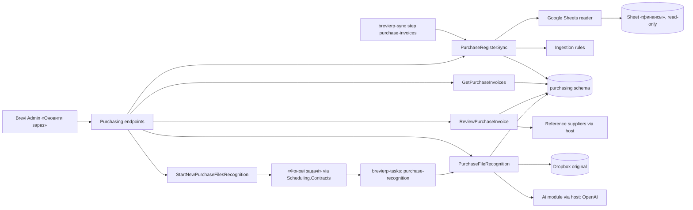

# Purchase invoices «Рахунки на закупку»

Register of purchase invoices for «Бухгалтерія → Рахунки на закупку». Each card is one Telegram message from the Google Sheet «БРЕВІ команда» / «финансы» with its Dropbox links, payment mark from the sheet and the problems that need a manual check. The accountant links a Brevi supplier and writes a note (optimistic version, history in ReviewChanges); the sync never changes them. Each original can be read by AI or filled by hand as JSON. «Розпізнати» reads one file inside the request, bounded by 85 seconds so the proxy never cuts it (a slower answer is recorded as failed with «ШІ не встиг…»); «Розпізнати всі нові» only starts the «Фонові задачі» task `purchase-recognition`, which reads all new originals in the tasks job. The facts are: number, date, supplier, «З ПДВ»/«Без ПДВ», positions and totals, checked in kopecks. «Оплата» links expenses of «Бухгалтерія» by hand and marks a voided payment or another amount as a problem. Only the Director sees it (client corrections item 10, 2026-11-08). [SDD](../../specs/purchasing/001-purchase-invoices/README.md), [contract](../../contracts/openapi.json), [tables](../../architecture/data-model/purchasing.md), [runbook](../../operations/jobs/sync-job.md#purchase-invoices).

## Code structure

```text
src/Modules/Purchasing/
  Purchasing.Domain/Purchasing.Domain/
    Messages/          # PurchaseMessage (source fields + manual supplier/note/version, Review, Link/UnlinkPayment),
                       # PurchasePayment (expense of «Бухгалтерія», removed links kept), PurchaseReviewChange,
                       # MessageSource, PaymentState
    Sources/           # PurchaseSourceRow (one UID), PurchaseSourceRevision (raw history)
    Files/             # PurchaseMessageFile (exact link, active)
    Sync/              # PurchaseSyncState (last success, error, counts)
    Documents/         # PurchaseDocument (facts), PurchaseDocumentRules (kopeck check), PurchaseDocumentJson (canonical + hash),
                       # PurchaseCheckedDocument (+ History), PurchaseRecognitionAttempt
    Ingestion/         # sheet header, ids (PurchaseIdentity), JS-compatible raw JSON, link and problem rules,
                       # message dates, SourceRowNormalizer, PurchaseSourceSnapshot (whole-sheet checks)
  Purchasing.Application/Purchasing.Application/
    Abstractions/      # IPurchasingDbContext (+ write lock scope), IPurchaseSheetReader, IPurchasingSupplierReader,
                       # IPurchasingPaymentReader (Accounting expenses),
                       # IPurchaseFileDownloader, IPurchaseDocumentRecognizer,
                       # IPurchaseRecognitionLauncher (starts the background task)
    Features/Documents/
      Commands/RecognizePurchaseFile   # one file, request time limit
      Commands/StartNewPurchaseFilesRecognition   # «Розпізнати всі нові»: start the background task
      Commands/RecognizeNewPurchaseFiles   # one batch of the background task
      Commands/SaveCheckedPurchaseDocument   # manual JSON, replace
      Queries/GetPurchaseDocumentTemplate
      Shared/          # NewPurchaseFiles (files never tried), PurchaseRecognitionPrompt (fixed instruction + schema),
                       # PurchaseFileRecognition (time limit), document responses
    Features/Register/
      Commands/SyncPurchaseRegister   # PurchaseRegisterSync (read → check → one transaction)
      Commands/ReviewPurchaseInvoice  # version check under the write lock
      Commands/LinkPurchasePayment, UnlinkPurchasePayment
      Queries/GetPurchaseInvoices     # page of cards: representative row, links, search, filter, one supplier (supplier card tab),
                                      # invoice date range and VAT of the checked facts
      Queries/GetPurchaseSyncState, GetPurchaseSuppliers, GetPurchasePaymentCandidates
      Shared/          # PurchasePayments (total, issues, payments block), shared responses
  Purchasing.Infrastructure/Purchasing.Infrastructure/
    Persistence/       # PurchasingDbContext (schema purchasing, advisory lock), configurations, migrations
    Integrations/GoogleSheets/ # options, Application Default Credentials token, Sheets API v4 reader
    Integrations/Dropbox/ # DropboxFileDownloader (dl=1, 20 MB, PDF and pictures)
    DependencyInjection/
  Purchasing.Api/Purchasing.Api/
    Endpoints/Register/   # RegisterEndpoints (/api/purchasing/invoices, policy access:purchase-invoices) + one <UseCase>Endpoint per operation
    Endpoints/Documents/  # DocumentsEndpoints: recognize, save checked document, template
src/Bootstrapper/Host.Seed/Jobs/Tasks/Office/PurchaseInvoicesTaskRunner.cs   # task purchase-invoices
src/Bootstrapper/Host.Seed/Jobs/Tasks/Office/PurchaseRecognitionTaskRunner.cs # task purchase-recognition: batches until none left
src/Modules/Purchasing/Purchasing.Infrastructure/Purchasing.Infrastructure/Adapters/
  Reference/PurchasingSupplierReader.cs     # Reference.Contracts suppliers for the link
  Accounting/PurchasingPaymentReader.cs     # Accounting.Contracts expenses for the payment links
  Ai/PurchaseDocumentRecognizer.cs          # reading originals through Ai.Contracts
  Scheduling/PurchaseRecognitionLauncher.cs # Scheduling.Contracts: start the purchase-recognition task
```

## Structure diagram



## Tests

`tests/UnitTests/Purchasing/`: source rules (ids, raw JSON, links, problems, payment mark, dates, whole-sheet checks), sync on SQLite in memory with a fake sheet (first run, repeat, moved rows, missing rows, manual fields kept, UID moved, Google unavailable, parallel run), list query, supplier link and note (version, history, lock, inactive supplier), facts rules (kopecks, VAT modes, misread lines, line discounts), recognition (fast, strong retry, needs review, AI off, Excel, again, batch, request time limit), «Розпізнати всі нові» only starts the background task (`PurchaseRecognitionStartTests`), manual JSON (same, replace, foreign UID), template, payment links (`PurchasePaymentTests`: link with version, another amount and voided payment as problems, income/stale/twice refused, unlink kept as history, candidates), contract. Command: `dotnet test tests/UnitTests/UnitTests.csproj --filter "FullyQualifiedName~UnitTests.Purchasing"`. Module references and schema: `tests/ArchitectureTests/Modules/Workshop/PurchasingDependencyTests.cs`.
