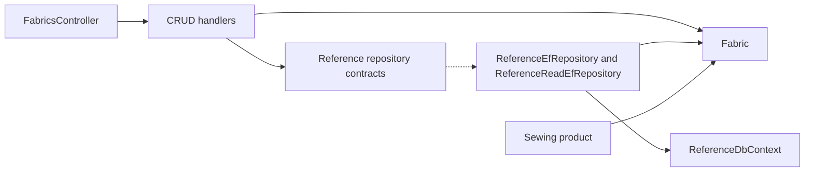

# Fabrics

**Static code review:** 2026-10-16. **Module:** reference.

CRUD operations and list retrieval for the “Fabrics” lookup. Optional composition and density are stored for first-contact proposals; missing metadata blocks a proposal. Existing CRUD payloads do not edit these fields. The frozen catalogue import populates them from `Тканини`.

## Structure and Relationships

[Controller](../../../../src/Modules/Reference/Reference.Api/Reference.Api/Controllers/FabricsController.cs) exposes CRUD. The [create handler](../../../../src/Modules/Reference/Reference.Application/Reference.Application/Features/Fabric/Create/CreateFabricCommandHandler.cs) and adjacent query/update/delete handlers validate the data; [Fabric](../../../../src/Modules/Reference/Reference.Domain/Reference.Domain/GarmentAccessories/Entities/Fabric.cs) is the domain entity. [ReferenceEfRepository](../../../../src/Modules/Reference/Reference.Infrastructure/Reference.Infrastructure/Repositories/ReferenceEfRepository.cs) and [ReferenceDbContext](../../../../src/Modules/Reference/Reference.Infrastructure/Reference.Infrastructure/DataBase/ReferenceDbContext.cs) persist it. Fabrics are used as part of Sewing products.

## Code Structure

Verified entry points and key feature components are shown; the tree does not list every supporting file.

```text
src/
└── Modules/Reference/
    ├── Reference.Api/Reference.Api/Controllers/FabricsController.cs  # HTTP entry point
    ├── Reference.Application/Reference.Application/Features/Fabric/
    │   ├── Create/CreateFabricCommandHandler.cs  # use case handler
    │   ├── Delete/DeleteFabricCommandHandler.cs  # use case handler
    │   ├── GetList/GetAllFabricQueryHandler.cs  # use case handler
    │   └── Update/UpdateFabricCommandHandler.cs  # use case handler
    ├── Reference.Domain/Reference.Domain/GarmentAccessories/Entities/Fabric.cs  # domain model
    └── Reference.Infrastructure/Reference.Infrastructure/
        ├── DataBase/ReferenceDbContext.cs  # data context
        ├── Congigurations/FabricConfiguration.cs  # nullable bounded public metadata mapping
        ├── Migrations/20261029153930_AddFabricPresentationMetadata.cs  # additive schema
        └── Repositories/ReferenceEfRepository.cs  # data access
```

## Structure Diagram



## Tests

`tests/UnitTests/Reference/FabricPresentationMetadataTests.cs` covers metadata normalization and bounds. No automated tests cover this feature's CRUD operations yet. `tests/UnitTests/ReferenceProductUsageTests.cs` covers rejecting deletion of reference data used by a Product.

**Data:** [reference schema](../../architecture/data-model/reference.md)

## Related Sources

[OpenAPI](../../contracts/reference/fabrics.openapi.yaml) · [Reference boundaries](../../architecture/overview/modules.md).

Numeric price/norm edits to previously versioned records append immutable approved revisions in the same transaction. GET remains anonymous; writes require CanManageProducts. See [pricing input versions](pricing-input-versions.md) for persistence, concurrency and precision.
