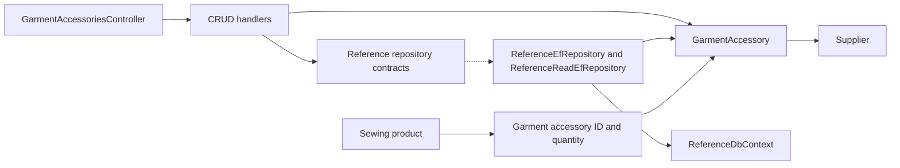

# Garment Accessories

**Static code review:** 2026-10-16. **Module:** reference.

CRUD operations and list retrieval for the “Garment Accessories” lookup.

## Structure and Relationships

[Controller](../../../../src/Modules/Reference/Reference.Api/Reference.Api/Controllers/GarmentAccessoriesController.cs) exposes CRUD. The [create handler](../../../../src/Modules/Reference/Reference.Application/Reference.Application/Features/GarmentAccessory/Create/CreateGarmentAccessoryCommandHandler.cs) and adjacent query/update/delete handlers validate the data; [GarmentAccessory](../../../../src/Modules/Reference/Reference.Domain/Reference.Domain/GarmentAccessories/Entities/GarmentAccessory.cs) is the domain entity. [ReferenceEfRepository](../../../../src/Modules/Reference/Reference.Infrastructure/Reference.Infrastructure/Repositories/ReferenceEfRepository.cs) and [ReferenceDbContext](../../../../src/Modules/Reference/Reference.Infrastructure/Reference.Infrastructure/DataBase/ReferenceDbContext.cs) persist it. A garment accessory has a supplier; a Sewing product references its ID and its own quantity.

## Code Structure

Verified entry points and key feature components are shown; the tree does not list every supporting file.

```text
src/
└── Modules/Reference/
    ├── Reference.Api/Reference.Api/Controllers/GarmentAccessoriesController.cs  # HTTP entry point
    ├── Reference.Application/Reference.Application/Features/GarmentAccessory/
    │   ├── Create/CreateGarmentAccessoryCommandHandler.cs  # use case handler
    │   ├── Delete/DeleteGarmentAccessoryCommandHandler.cs  # use case handler
    │   ├── GetList/GetGarmentAccessoriesQueryHandler.cs  # use case handler
    │   └── Update/UpdateGarmentAccessoryCommandHandler.cs  # use case handler
    ├── Reference.Domain/Reference.Domain/GarmentAccessories/Entities/GarmentAccessory.cs  # domain model
    └── Reference.Infrastructure/Reference.Infrastructure/
        ├── DataBase/ReferenceDbContext.cs  # data context
        └── Repositories/ReferenceEfRepository.cs  # data access
```

## Structure Diagram



## Related Sources

[OpenAPI](../../contracts/reference/garment-accessories.openapi.yaml) · [Reference boundaries](../../architecture/overview/modules.md).

Numeric price/norm edits to previously versioned records append immutable approved revisions in the same transaction. GET remains anonymous; writes require CanManageProducts. See [pricing input versions](pricing-input-versions.md) for persistence, concurrency and precision.
