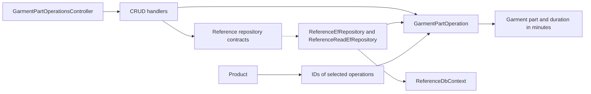

# Garment Part Operations

**Static code review:** 2026-10-16. **Module:** reference.

CRUD operations and list retrieval for the “Garment Part Operations” lookup.

## Structure and Relationships

[Controller](../../../../src/Modules/Reference/Reference.Api/Reference.Api/Controllers/GarmentPartOperationsController.cs) exposes CRUD. The [create handler](../../../../src/Modules/Reference/Reference.Application/Reference.Application/Features/GarmentPartOperation/Create/CreateGarmentPartOperationCommandHandler.cs) and adjacent query/update/delete handlers validate the data; [GarmentPartOperation](../../../../src/Modules/Reference/Reference.Domain/Reference.Domain/GarmentPartOperations/Entities/GarmentPartOperation.cs) is the domain entity. [ReferenceEfRepository](../../../../src/Modules/Reference/Reference.Infrastructure/Reference.Infrastructure/Repositories/ReferenceEfRepository.cs) and [ReferenceDbContext](../../../../src/Modules/Reference/Reference.Infrastructure/Reference.Infrastructure/DataBase/ReferenceDbContext.cs) persist it. An operation belongs to a garment part and contains a duration in minutes; Product stores references to the selected operations.

## Code Structure

Verified entry points and key feature components are shown; the tree does not list every supporting file.

```text
src/
└── Modules/Reference/
    ├── Reference.Api/Reference.Api/Controllers/GarmentPartOperationsController.cs  # HTTP entry point
    ├── Reference.Application/Reference.Application/Features/GarmentPartOperation/
    │   ├── Create/CreateGarmentPartOperationCommandHandler.cs  # use case handler
    │   ├── Delete/DeleteGarmentPartOperationCommandHandler.cs  # use case handler
    │   ├── GetList/GetGarmentPartOperationsQueryHandler.cs  # use case handler
    │   └── Update/UpdateGarmentPartOperationCommandHandler.cs  # use case handler
    ├── Reference.Domain/Reference.Domain/GarmentPartOperations/Entities/GarmentPartOperation.cs  # domain model
    └── Reference.Infrastructure/Reference.Infrastructure/
        ├── DataBase/ReferenceDbContext.cs  # data context
        └── Repositories/ReferenceEfRepository.cs  # data access
```

## Structure Diagram



## Tests

No automated tests cover this feature's CRUD operations yet. `tests/UnitTests/ReferenceProductUsageTests.cs` covers rejecting deletion of reference data used by a Product.

**Data:** [reference schema](../../architecture/data-model/reference.md)

## Related Sources

[OpenAPI](../../contracts/reference/garment-part-operations.openapi.yaml) · [Reference boundaries](../../architecture/overview/modules.md).

Numeric price/norm edits to previously versioned records append immutable approved revisions in the same transaction. GET remains anonymous; writes require CanManageProducts. See [pricing input versions](pricing-input-versions.md) for persistence, concurrency and precision.
