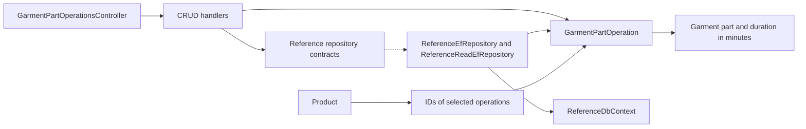

# Garment Part Operations

**Static code review:** 2026-11-02. **Module:** reference.

CRUD operations, list retrieval and the import of the Calculator sheet «Операції» for the sewing operations lookup ([REF-004](../../specs/reference/003-operations-sheet/README.md)).

## Structure and Relationships

[Controller](../../../../src/Modules/Reference/Reference.Api/Reference.Api/Controllers/GarmentPartOperationsController.cs) exposes CRUD. The [create handler](../../../../src/Modules/Reference/Reference.Application/Reference.Application/Features/GarmentPartOperation/Commands/CreateGarmentPartOperation/CreateGarmentPartOperationHandler.cs) and adjacent query/update/delete handlers validate the data; [GarmentPartOperation](../../../../src/Modules/Reference/Reference.Domain/Reference.Domain/GarmentPartOperations/GarmentPartOperation.cs) is the domain entity. [ReferenceEfRepository](../../../../src/Modules/Reference/Reference.Infrastructure/Reference.Infrastructure/Repositories/ReferenceEfRepository.cs) and [ReferenceDbContext](../../../../src/Modules/Reference/Reference.Infrastructure/Reference.Infrastructure/DataBase/ReferenceDbContext.cs) persist it. An operation belongs to a garment part («Група деталей») and has a sheet code (OP-…), element, variant, norm in minutes, a «time per product» flag (no fixed norm), the norm check date, an active flag and notes; Product stores references to the selected operations. Labour cost is not stored: clients compute it from the norm and the sewing pricing settings. A group with operations cannot be deleted.

## Code Structure

Verified entry points and key feature components are shown; the tree does not list every supporting file.

```text
src/
└── Modules/Reference/
    ├── Reference.Api/Reference.Api/Controllers/GarmentPartOperationsController.cs  # HTTP entry point
    ├── Reference.Application/Reference.Application/Features/GarmentPartOperation/
    │   ├── Commands/CreateGarmentPartOperation/CreateGarmentPartOperationHandler.cs  # use case handler
    │   ├── Commands/DeleteGarmentPartOperation/DeleteGarmentPartOperationHandler.cs  # use case handler
    │   ├── Queries/GetGarmentPartOperations/GetGarmentPartOperationsHandler.cs  # use case handler
    │   ├── Commands/ImportGarmentPartOperations/ImportGarmentPartOperationsHandler.cs  # sheet import with preview
    │   ├── Shared/  # common fields, validator, details factory, code spec
    │   └── Commands/UpdateGarmentPartOperation/UpdateGarmentPartOperationHandler.cs  # use case handler
    ├── Reference.Domain/Reference.Domain/GarmentPartOperations/GarmentPartOperation.cs  # domain model
    └── Reference.Infrastructure/Reference.Infrastructure/
        ├── DataBase/ReferenceDbContext.cs  # data context
        └── Repositories/ReferenceEfRepository.cs  # data access
```

## Structure Diagram



## Tests

`tests/UnitTests/Reference/GarmentPartOperationImportTests.cs` covers the sheet import (`--filter FullyQualifiedName~GarmentPartOperationImport`). `tests/UnitTests/ReferenceProductUsageTests.cs` covers rejecting deletion of reference data used by a Product.

**Data:** [reference schema](../../architecture/data-model/reference.md)

## Related Sources

[OpenAPI](../../contracts/reference/garment-part-operations.openapi.yaml) · [Reference boundaries](../../architecture/overview/modules.md).

Numeric price/norm edits to previously versioned records append immutable approved revisions in the same transaction. GET remains anonymous; writes require access:operations. See [pricing input versions](pricing-input-versions.md) for persistence, concurrency and precision.
