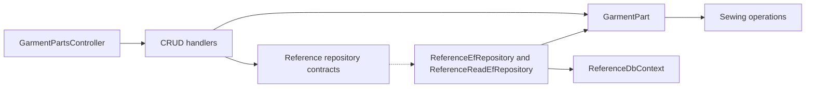

# Garment Parts

**Static code review:** 2026-10-16. **Module:** reference.

CRUD operations and list retrieval for the “Garment Parts” lookup.

## Structure and Relationships

[Controller](../../../../src/Modules/Reference/Reference.Api/Reference.Api/Controllers/GarmentPartsController.cs) exposes CRUD. The [create handler](../../../../src/Modules/Reference/Reference.Application/Reference.Application/Features/GarmentPart/Create/CreateGarmentPartCommandHandler.cs) and adjacent query/update/delete handlers validate the data; [GarmentPart](../../../../src/Modules/Reference/Reference.Domain/Reference.Domain/GarmentPartOperations/Entities/GarmentPart.cs) is the domain entity. [ReferenceEfRepository](../../../../src/Modules/Reference/Reference.Infrastructure/Reference.Infrastructure/Repositories/ReferenceEfRepository.cs) and [ReferenceDbContext](../../../../src/Modules/Reference/Reference.Infrastructure/Reference.Infrastructure/DataBase/ReferenceDbContext.cs) persist it. A garment part groups sewing operations.

## Code Structure

Verified entry points and key feature components are shown; the tree does not list every supporting file.

```text
src/
└── Modules/Reference/
    ├── Reference.Api/Reference.Api/Controllers/GarmentPartsController.cs  # HTTP entry point
    ├── Reference.Application/Reference.Application/Features/GarmentPart/
    │   ├── Create/CreateGarmentPartCommandHandler.cs  # use case handler
    │   ├── Delete/DeleteGarmentPartCommandHandler.cs  # use case handler
    │   ├── GetList/GetGarmentPartsQueryHandler.cs  # use case handler
    │   └── Update/UpdateGarmentPartCommandHandler.cs  # use case handler
    ├── Reference.Domain/Reference.Domain/GarmentPartOperations/Entities/GarmentPart.cs  # domain model
    └── Reference.Infrastructure/Reference.Infrastructure/
        ├── DataBase/ReferenceDbContext.cs  # data context
        └── Repositories/ReferenceEfRepository.cs  # data access
```

## Structure Diagram



## Related Sources

[OpenAPI](../../contracts/reference/garment-parts.openapi.yaml) · [Reference boundaries](../../architecture/overview/modules.md).
