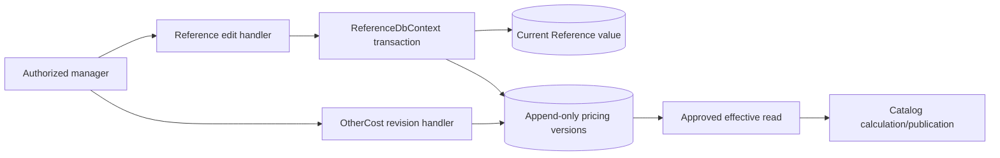

# Reference pricing input versions

Reference owns immutable Fabric/accessory costs, operation norms and non-inventory service costs used by [Sewing pricing](../catalog/sewing-pricing.md). [Publication SDD](../../specs/catalog/003-sheet-pricing-parity/publication-implementation.md) defines approval and concurrency rules.

Fabric, accessory and operation numeric edits append an approved effective version when that reference already has a pricing baseline. Name-only edits append nothing. Both the legacy field and new version commit in one transaction. Concurrent stale edits and edits with a future revision return 409; earlier versions remain unchanged. The legacy MoneyAmount field still rounds to two decimals; revision comparison accounts for this projection, while retained imported version precision remains intact. Unversioned legacy reference records are unchanged by this adapter.

Operation minutes retain up to eight decimal places after the precision migration. Pricing edits use SaveChangesAsync; the synchronous SaveChanges path rejects numeric pricing edits so it cannot bypass version capture.

Existing Reference GET operations remain anonymous. Their POST/PUT/DELETE operations now require CanManageProducts. OtherCost revision is a separate protected command: it accepts an existing code, expected latest version ID, nonnegative value and request UUID, preserves its unit/activity/source identity and returns the new version ID. Retrying the same request returns the original ID; changed payloads or stale expected versions conflict. Creating entirely new cost codes is outside this revision workflow.

## Code structure

```text
src/Modules/Reference/
  Reference.Domain/Reference.Domain/Pricing/InputVersions/
    ReferencePricingInputVersion.cs                 # immutable owner/value/unit/effective provenance
  Reference.Application/Reference.Application/
    Contracts/Pricing/InputVersions/                 # read/revision boundaries and expected conflicts
    Features/Pricing/ReviseOtherCost/                 # one command and handler
    Features/{Fabric,GarmentAccessory,GarmentPartOperation}/Update/ # controlled 409 mapping
  Reference.Infrastructure/Reference.Infrastructure/
    DataBase/ReferenceDbContext.PricingWrites.cs       # atomic SaveChanges transaction hook
    Pricing/InputVersions/Changes/
      TrackedReferencePricingChanges.cs              # EF tracked-value detection and extraction
      ReferencePricingTrackedChange.cs               # original/current values and typed SQL owner predicate
      ReferencePricingChangeAppender.cs              # reads current version; stages retained revision
    Pricing/OtherCosts/Writing/
      OtherCostPricingVersionWriter.cs               # explicit service revision / retry storage
    Pricing/InputVersions/{Reading,Configuration}/    # approved effective read and constraints
  Reference.Api/Reference.Api/
    Controllers/OtherCostPricingController.cs
    Contracts/Pricing/ReviseOtherCostRequest.cs
```

## Structure diagram



## Rules and boundaries

Save/publish, settings writes and Reference pricing writes acquire the same PostgreSQL transaction advisory lock before reading version state. The Host bridge enlists Reference reads in the Catalog transaction. This protects API workflows; direct SQL that bypasses these write paths must follow the same protocol. Bootstrap is an initial baseline operation and is not an editing/synchronization mechanism.

The [publication structure audit](../../specs/catalog/003-sheet-pricing-parity/structure/audit.md) separates tracked legacy-value discovery from version persistence. The source-specific typed predicates, precision comparison and transaction order are preserved.

## Tests

- `tests/UnitTests/PricingReferenceQueryHandlerTests.cs`
- `tests/IntegrationTests/Pricing/Sewing/ReferencePricingRevisionTests.cs`, `tests/IntegrationTests/Pricing/Sewing/OtherCostPricingRevisionTests.cs`, `tests/IntegrationTests/PricingReferenceQueryIntegrationTests.cs`

Focused run: `dotnet test tests/UnitTests/UnitTests.csproj --filter PricingReference`; `dotnet test tests/IntegrationTests/IntegrationTests.csproj --filter PricingReference` (slow; needs `BREVIERP_CATALOG_TEST_CONNECTION`).

**Data:** [reference schema](../../architecture/data-model/reference.md)
