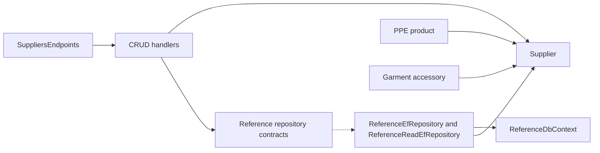

# Suppliers

**Static code review:** 2026-10-16. **Module:** reference.

CRUD operations and list retrieval for the “Suppliers” lookup. Suppliers come from KeepinCRM: the daily `brevierp-sync` job and «Оновити з KeepinCRM» refresh them ([runbook](../../operations/jobs/sync-job.md)). A linked supplier's card (name, «Що закуповуємо», contacts, site, tags) is read-only in Brevi; activity («Використовувати в проєкті») and notes are always edited in Brevi. Manual suppliers can still be added. Specification: [REF-001](../../specs/reference/001-suppliers-keepincrm/README.md).

## Structure and Relationships

[Endpoints](../../../../src/Modules/Reference/Reference.Api/Reference.Api/Endpoints/Suppliers/SuppliersEndpoints.cs) exposes CRUD. The [create handler](../../../../src/Modules/Reference/Reference.Application/Reference.Application/Features/Supplier/Commands/CreateSupplier/CreateSupplierHandler.cs) and adjacent query/update/delete handlers validate the data; [Supplier](../../../../src/Modules/Reference/Reference.Domain/Reference.Domain/Suppliers/Supplier.cs) is the domain entity. [ReferenceEfRepository](../../../../src/Modules/Reference/Reference.Infrastructure/Reference.Infrastructure/Persistence/ReferenceEfRepository.cs) and [ReferenceDbContext](../../../../src/Modules/Reference/Reference.Infrastructure/Reference.Infrastructure/Persistence/ReferenceDbContext.cs) persist it. Suppliers are external reference data for PPE products and garment accessories.

## Code Structure

Verified entry points and key feature components are shown; the tree does not list every supporting file.

```text
src/
└── Modules/Reference/
    ├── Reference.Api/Reference.Api/Endpoints/Suppliers/  # HTTP entry points, one <UseCase>Endpoint.cs each
    ├── Reference.Application/Reference.Application/Features/Supplier/
    │   ├── Commands/CreateSupplier/CreateSupplierHandler.cs  # use case handler
    │   ├── Commands/DeleteSupplier/DeleteSupplierHandler.cs  # use case handler
    │   ├── Queries/GetSuppliers/GetSuppliersHandler.cs  # use case handler
    │   ├── Commands/SyncKeepinCrmSuppliers/KeepinCrmSupplierSync.cs  # KeepinCRM → Brevi refresh
    │   ├── Commands/UpdateSupplierBreviFields/  # activity and notes for any supplier
    │   └── Commands/UpdateSupplier/UpdateSupplierHandler.cs  # use case handler
    ├── Reference.Domain/Reference.Domain/Suppliers/Supplier.cs  # domain model
    └── Reference.Infrastructure/Reference.Infrastructure/
        ├── Integrations/KeepinCrm/  # KeepinCRM HTTP client and response parser
        ├── Persistence/ReferenceDbContext.cs  # data context
        └── Persistence/ReferenceEfRepository.cs  # data access
```

## Structure Diagram



## Tests

`tests/UnitTests/Reference/SupplierTests.cs`, `KeepinCrmSupplierParserTests.cs`, `KeepinCrmSupplierSyncTests.cs`: `dotnet test tests/UnitTests/UnitTests.csproj --filter FullyQualifiedName~UnitTests.Reference`. `tests/UnitTests/Reference/ReferenceProductUsageTests.cs` covers rejecting deletion of reference data used by a Product.

**Data:** [reference schema](../../architecture/data-model/reference.md)

## Related Sources

[OpenAPI](../../contracts/reference/suppliers.openapi.yaml) · [Reference boundaries](../../architecture/overview/modules.md).
